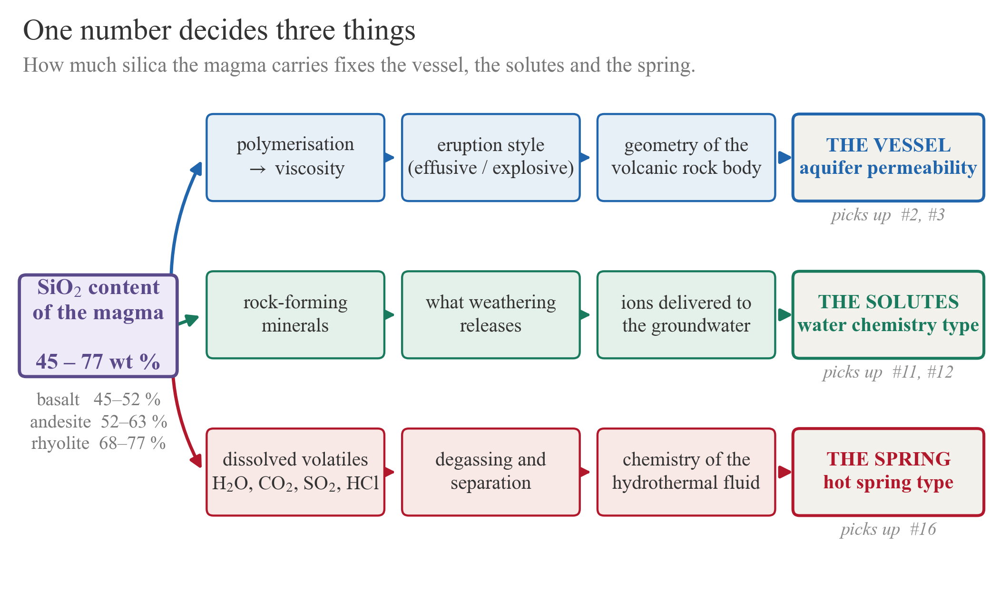
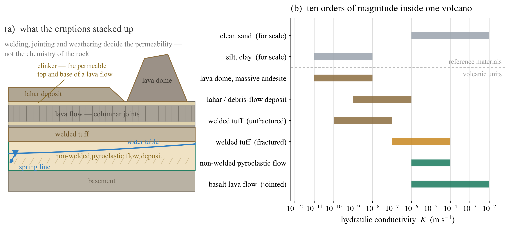
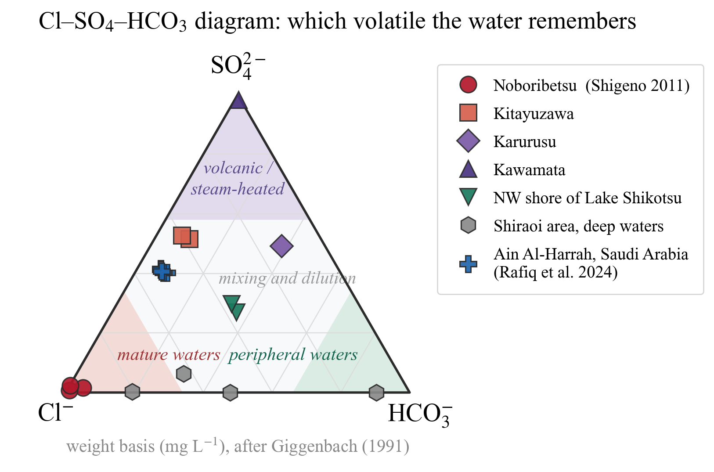

## 同じ「火山の水」が、なぜこれほど違うのか

草津の湯畑から流れ出る湯は pH 2 前後の強酸性で、鉄の釘を数日で溶かす。別府で汲み上げられる湯は中性で、塩化物イオンを主成分とする。北海道・白老の深い井戸から出てくる水は、塩分が薄く、重炭酸イオンに富み、飲めば柔らかい。

いずれも火山のふもとの水である。同じ雨が降り、同じように地下へ入り、同じように岩と反応している。それでも出てくる水はまったく違う。

この違いはどこから来るのか。本記事の答えは一つに絞られる。**マグマが含んでいた SiO₂ の量である。** その一つの数字が、地下水を溜める器の形を決め、水に溶け出す成分を決め、温泉の泉質を決める。三つの帰結が、一本の因果から派生する。

------------------------------------------------------------------------

## 復習：温度は分かった、変形も分かった、では熱源は

本題に入る前に、このシリーズがここまで火山性の水について何を語り、何を語り残したかを確認しておきたい。

[#16](/posts/groundwater/groundwater-sci16/) では、温泉水の Na・K・Mg の比から地熱貯留層の**温度**が読めることを見た。Giggenbach 図とシリカ温度計は、地表で採った一杯の湯から、地下数百メートルの温度を教えてくれた。しかし、その熱が**どこから来たのか**には踏み込んでいない。

[#17](/posts/groundwater/groundwater-sci17/) では、2000年の有珠山噴火の3か月前から、山の北側の観測井 GSH-1 の水位が下がり続けていたことを見た。潮汐応答から求めた歪み感度を通して読み替えれば、これは $7\times10^{-6}$ を超える伸張歪みに相当する。何かが岩盤を静かに押し広げていた。しかしその「何か」——**マグマそのもの**には触れていない。

[#11](/posts/groundwater/groundwater-sci11/) と [#12](/posts/groundwater/groundwater-sci12/) では、地下水の主要イオン組成に地域ごとの「型」があること、熊本ではフッ素が高くなる場所があることを見た。型があることは示したが、**なぜ地域ごとに型が違うのか**——その根にある母岩の違いには立ち入っていない。

本記事は、この三つの空白を同時に埋める回である。埋める道具は、マグマから岩石を経て水に至る、一本の因果鎖である（@fig-chain）。

{#fig-chain .fig-wide}

読者にとっては「火山の話」であるが、実際にやっていることは既刊5回分の統合である。

------------------------------------------------------------------------

## マグマとは何か — 最小限の火山学

### 四つの相の混合物

マグマは「溶けた岩」と一言で言われるが、実際には四つのものが混ざっている。**融体**（シリケイトの液体）、**溶存揮発成分**（H₂O・CO₂・SO₂・H₂S・HCl）、**結晶**（すでに固まり始めた鉱物）、そして**気泡**である。地下深部で岩石が完全に融けることは稀で、通常は一部だけが融ける**部分溶融**によって生じる。

マグマは SiO₂ の重量パーセントで分類される。

| 名称 | SiO₂ | 温度の目安 | 粘性 | 噴火様式 | 代表 |
|---|---|---|---|---|---|
| 玄武岩質（苦鉄質） | 45–52 % | 約 1200 ℃ | 低い | 溶岩流（穏やか） | ハワイ・楯状火山 |
| 安山岩質（中間質） | 52–63 % | 約 1000 ℃ | 中間 | 成層火山 | 日本の島弧・雲仙 |
| デイサイト質 | 63–68 % | — | 高い | 溶岩ドーム | 有珠・雲仙普賢岳 |
| 流紋岩質（珪長質） | 68–77 % | 約 800 ℃ | 極めて高い | 爆発的（プリニー式・カルデラ） | 阿蘇・姶良 |

### なぜ SiO₂ がすべてを決めるのか

理由は分子の構造にある。融体のなかで Si は四つの酸素に囲まれた **Si–O 四面体**を作る。SiO₂ が増えると、この四面体どうしが酸素を共有して連結し、鎖や網目に**重合**する。重合が進んだ融体は流れにくい——すなわち**粘性が高い**。

粘性の差は途方もなく大きい。玄武岩質メルトが $10\text{–}10^{3}$ Pa·s であるのに対し、流紋岩質メルトは $10^{5}\text{–}10^{9}$ Pa·s に達する。6桁から8桁の違いである。水（$10^{-3}$ Pa·s）と水飴を比べるどころの話ではない。

そして粘性が、噴火の姿を決める。マグマが上昇して圧力が下がると、溶けていた揮発成分——とりわけ H₂O——が気泡として分離する。**粘性が低ければ気泡は浮いて抜けていく**ため、マグマは静かに溢れ出て溶岩流になる。**粘性が高ければ気泡は抜けられず**、内部に圧力が溜まり、限界を超えたところで一気に破裂する。爆発的噴火である。

> ここで一つ、ことわっておきたい。マグマの生成論や岩石学は火山学者・岩石学者の土俵であり、本記事はそこで新しいことを言わない。教科書（巽 2003；Best 2003）の水準で正確に紹介するに留める。**本記事の重心は「マグマとは何か」ではなく、「マグマの違いが水にどう現れるか」にある。**

### 日本の火山が安山岩をつくる理由

マグマが生まれる場所は三つある。中央海嶺（減圧融解）、ホットスポット（マントルプルーム）、そして**沈み込み帯**である。日本列島は三つ目にあたる（@fig-subduction）。

{#fig-subduction .fig-wide}

要点は**水**である。沈み込む海洋プレートは、含水鉱物のかたちで水を地下へ運ぶ。深さ 100 km あたりでその水が絞り出され、上のマントルへ入る。乾いた岩石は 1500 ℃ 近くまで融けないが、水が加わると融点が数百度下がる。この**フラックス融解（flux melting）**が、日本の火山の出発点である。

生まれたばかりのメルトは玄武岩質である。しかしそれが地殻を上昇する途中でマグマだまりに滞留し、密度の高い鉱物（かんらん石・輝石・Ca に富む斜長石）が先に晶出して沈む。**残った液体は相対的に SiO₂ に富む。**さらに地殻の岩石を溶かし込み（同化）、別のマグマと混ざる。こうして日本の火山は安山岩質を主体とするマグマを噴き上げる。

**沈み込み帯の火山が地下水科学にとって特別なのは、水が主役だからである。** 融解を引き起こしたのも水であり、マグマが最も多く抱えている揮発成分も水であり、地表で温泉として出てくるのも水である。以下では、この水の行方を三つに分けて追う。

------------------------------------------------------------------------

## 第1の帰結 — マグマは、地下水を溜める器を作る

### 同じ組成の岩でも、透水性は10桁変わる

粘性が噴火様式を決め、噴火様式が岩体の姿を決める。そして岩体の姿が、そのまま**帯水層の性質**になる（@fig-aquifer）。

{#fig-aquifer .fig-wide}

図の (b) を見ていただきたい。**一つの火山体の中だけで、透水係数が10桁近く変わる。** 砂と粘土の差がそっくり収まってしまう幅である。しかも、この幅を作っているのは化学組成ではない。

- **玄武岩の溶岩流**は、流れながら表面と底面が破砕して**クリンカー**となり、内部は冷却時の収縮で**柱状節理**が入る。結果として、割れ目だらけの極めて透水性の高い層になる。富士山の湧水群やハワイの地下水は、この構造に支えられている。
- **火砕流堆積物**は、堆積直後の温度と厚さで運命が分かれる。高温のまま厚く溜まれば自重で圧密・溶着して**溶結凝灰岩**となり、緻密で透水性が低い。冷えていれば**非溶結**のまま、軽石と火山灰の隙間だらけの層になり、良好な帯水層となる。**同じ噴火の同じ堆積物が、場所によって帯水層にも難透水層にもなる。**
- **溶岩ドーム**と**火山泥流堆積物**は、いずれも低透水である。地熱系では、これらが**帽岩（キャップロック）**として深部の熱水を閉じ込める役を果たす。[#16](/posts/groundwater/groundwater-sci16/) で扱った地熱貯留層に蓋をしているのは、多くの場合こうした岩体である。

[#2](/posts/groundwater/groundwater-sci02/) で帯水層の種類を、[#3](/posts/groundwater/groundwater-sci03/) で透水係数を扱った。火山地域では、その二つが**一回の噴火のなかで同時に作られる**。溶結凝灰岩の下に非溶結の火砕流堆積物があれば、それだけで被圧帯水層の一組が完成する。

### 器の形が、湧水の位置を決める

@fig-aquifer の (a) に描いた**湧水線（spring line）**は、火山地域の地下水を語るうえで欠かせない。透水性の高い層が、その下の難透水層に乗ったまま山腹で切れると、水はそこから溢れ出る。火山のふもとに湧水が帯状に並ぶのは、地層の重なりが地形に切られているからである。

**「なぜここに湧くのか」という問いの答えは、たいてい「何万年か前に、ここでこういう噴火があったから」になる。** 水文地質は、火山の履歴書を読む作業でもある。

------------------------------------------------------------------------

## 第2の帰結 — マグマは、水に溶ける成分を決める

### 岩が違えば、溶け出すものが違う

次は化学である。マグマの SiO₂ 量は、固まったときにどんな鉱物が晶出するかを決める。そして鉱物が、風化で水に何を渡すかを決める。

| | 主な造岩鉱物 | 風化で水に出るもの |
|---|---|---|
| 玄武岩（苦鉄質） | Ca に富む斜長石（灰長石）・輝石・かんらん石 | Ca²⁺, Mg²⁺, HCO₃⁻, SiO₂ |
| 安山岩（中間質） | 中性長石・輝石・角閃石 | Ca²⁺, Mg²⁺, Na⁺, HCO₃⁻ |
| 流紋岩（珪長質） | 石英・カリ長石・曹長石・黒雲母・（燐灰石・蛍石） | Na⁺, K⁺, F⁻, SiO₂ |

**ここで [#12](/posts/groundwater/groundwater-sci12/) のフッ素が繋がる。** フッ素を含む鉱物——黒雲母・角閃石・燐灰石・蛍石——は、いずれも珪長質の岩石に伴われる。高フッ素地下水が特定の地域に偏るのは、偶然ではなく**地質学的な必然**である。母岩がフッ素を持っていなければ、水にフッ素は出ない。

### PHREEQC で三つの岩を溶かしてみる

議論を数字にしてみたい。CO₂ を溶かした純水（$P_{\mathrm{CO_2}} = 10^{-2}$ atm、25 ℃）に、三つの岩種を代表する鉱物集合体を少しずつ溶かし込み、生じる水質を比べる。計算は PHREEQC 3.8.6、データベースは公開の `llnl.dat` を用いた。

鉱物集合体は次のように置いた（モル比）。

- **玄武岩**：灰長石 0.55 ／ 透輝石 0.30 ／ 苦土かんらん石 0.15
- **安山岩**：灰長石 0.30 ／ 曹長石 0.32 ／ カリ長石 0.06 ／ 透輝石 0.22 ／ かんらん石 0.05 ／ 石英 0.05
- **流紋岩**：曹長石 0.40 ／ カリ長石 0.30 ／ 石英 0.255 ／ 金雲母 0.03 ／ 蛍石 0.015

一次鉱物は `REACTION` で不可逆に加え（風化のインコングルエント溶解）、二次鉱物としてカオリナイト・方解石・非晶質シリカ・蛍石にのみ沈殿を許した。総量 2.5 mmol の岩石を 25 段階に分けて溶かしている。

```
REACTION 1  Basalt assemblage
    CaAl2Si2O8   0.55      # anorthite
    CaMgSi2O6    0.30      # diopside
    Mg2SiO4      0.15      # forsterite
    2.5e-3 moles in 25 steps
```

結果が @fig-phreeqc である。

{#fig-phreeqc .fig-wide}

数字で並べると、こうなる。

| | 玄武岩 | 安山岩 | 流紋岩 |
|---|---|---|---|
| pH | 7.45 | 7.42 | 7.16 |
| Ca²⁺ (mg/L) | 34 | 37 | 1.5 |
| Mg²⁺ (mg/L) | 36 | 19 | 5.5 |
| Na⁺ (mg/L) | — | 18 | 23 |
| K⁺ (mg/L) | — | 5.9 | 32 |
| HCO₃⁻ (mg/L) | 285 | 267 | 139 |
| F⁻ (mg/L) | — | — | 1.4 |
| 消費した CO₂ (mmol/kg) | 6.3 | 5.1 | 2.6 |

**[#11](/posts/groundwater/groundwater-sci11/) で観察として述べたことが、計算で再現された。** 玄武岩からは Ca–Mg–HCO₃ 型の水が、流紋岩からは Na–K 型の水ができる。フッ素は流紋岩にだけ現れ、1.4 mg/L に達した——WHO の飲料水ガイドライン値 1.5 mg/L のすぐ手前である。

**Ca が低いことが、フッ素にとっては好都合である。** この計算では蛍石の飽和指数が $-2.8$ にとどまり、フッ素はまだ蛍石によって抑えられていない。流紋岩質の水は Ca が 1.5 mg/L しかないため、フッ素が溶けたまま残る余地が大きい。[#12](/posts/groundwater/groundwater-sci12/) で見た「Ca が低い水ほどフッ素が高い」という関係の、上流にある理由がここにある。

### この計算の限界

[#15](/posts/groundwater/groundwater-sci15/) と同じく、正直に線を引いておきたい。

- **鉱物集合体で岩石を代表させるのは近似である。** 実際の火山岩は**火山ガラス**を多く含み、ガラスの溶解は結晶質鉱物とは速度も化学量論も異なる。この計算はガラスを扱っていない。
- **SiO₂ は三つとも 109 mg/L で並んでしまった。** 非晶質シリカの飽和で頭打ちになったためで、この計算のシリカ濃度には岩種を区別する力がない。速度論を入れなければシリカは常に飽和まで行ってしまう——これは [#15](/posts/groundwater/groundwater-sci15/) で扱った論点そのものである。
- **平衡計算であり、時間軸を持たない。** 現実の水質は滞留時間に依存する。横軸の「溶けた岩石量」は時間ではない。
- したがって @fig-phreeqc は**傾向を示す教材計算**であり、特定の帯水層の水質を定量再現するものではない。

------------------------------------------------------------------------

## 第3の帰結 — マグマは、温泉の泉質を決める

### 揮発成分は、順番に消えていく

三つ目の枝がいちばん面白い。マグマが抱えていた揮発成分は、圧力が下がるにつれて順に分離する。量の多い順に、おおよそ

$$\mathrm{H_2O} \;\gg\; \mathrm{CO_2} \;>\; \mathrm{SO_2} \;>\; \mathrm{H_2S} \;>\; \mathrm{HCl}$$

である。島弧のマグマは数パーセントの水を溶かし込んでおり、地表に出る火山ガスの大半は水蒸気である。

重要なのは、これらの**反応性が大きく違う**ことである。岩崎ら（Iwasaki et al. 1962）は噴気孔の温度によって火山ガスを分類し、1200–800 ℃ の高温では HCl・SO₂・CO₂・H₂ が卓越するのに対し、60 ℃ 以下の低温では CO₂ > N₂ > H₂S になることを示した。

この温度変化は空間の変化でもある。**ドヴィーユ（Deville）の法則**——活火山の噴気孔の性質は噴火の中心からの隔たりによって変化する——として知られる経験則である（Iwasaki et al. 1963）。反応性に富む HCl・SO₂・H₂S は、上昇の途上で岩石や地下水と反応して消費される。**反応性に乏しい CO₂ だけが、縁辺部まで生き残る。**

### 一つの火山に、四種類の温泉ができる

この「消えていく順番」が、そのまま温泉の泉質の分布になる（@fig-springs）。

{#fig-springs .fig-wide}

日本地熱学会は2010年に、地熱貯留層と温泉帯水層の水理的関係を**同一熱水型・熱水滲出型・蒸気加熱型・伝導加熱型・独立型**の五つに整理した。しかし実際の温泉データを当てはめると、うまく分類できない例が出た。安川香澄・野田徹郎（2017）は、これに **CO₂ 付加型**と**火山ガス吹込型**の二つを加えて七タイプとし、しかも**判別の閾値を明示した**。

| タイプ | 泉質による判別基準 | 地熱開発の影響可能性 |
|---|---|---|
| 同一熱水型 | 全アニオン中 Cl⁻ > 80 % かつ 温度 > 90 ℃ | 大 |
| 熱水滲出型 | Cl⁻ タイプ かつ 温度 > 60 ℃ | 中 |
| 蒸気加熱型 | SO₄²⁻ タイプ | 小 |
| 伝導加熱型 | Cl⁻・SO₄²⁻ タイプ以外 かつ 総溶存物質 < 1000 mg/L | 極めて小 |
| 独立型 | 温度 < 60 ℃ かつ Cl⁻・SO₄²⁻・HCO₃⁻ タイプ以外 | 不明 |
| CO₂ 付加型 | HCO₃⁻ タイプ | 無または小 |
| 火山ガス吹込型 | pH < 3 かつ Cl⁻ > SO₄²⁻ | 無 |

（安川・野田 2017, Table 4 より作成）

**この表の価値は、閾値が数字で書いてあることに尽きる。** 「酸性硫酸塩泉」「中性塩化物泉」という言葉は文献に溢れているが、どこで線を引くかを明示した表は多くない。

彼らはこの判別フローを大分県九重地域に適用した。九重火山群とその山麓の温泉・鉱泉 84 本（大分県 2006 のデータ集）を分類したところ、**七タイプすべてが確認された**。90 ℃ を超える温泉はほぼすべて同一熱水型であり、八丁原・大岳・九重観光ホテルの三つの地熱発電所の周囲には、貯留層とつながっている可能性のある熱水滲出型と蒸気加熱型が高密度で分布していた。一方、CO₂ 付加型は北部の、貯留層とは関係しない広い範囲に散らばっていた。

**泉質を分類するだけで、地熱貯留層のありかがおおよそ見える。** 論文はこれを「地熱探査の手段としても役に立つ」と書いている。

### Cl–SO₄–HCO₃ 三角図 — 水がどの揮発成分を覚えているか

[#16](/posts/groundwater/groundwater-sci16/) では Na–K–Mg の三角図（Giggenbach 図）で温度を読んだ。同じ Giggenbach が、陰イオンの三角図で**起源**を読む方法も示している（Giggenbach 1991）。軸は Cl⁻・SO₄²⁻・HCO₃⁻ の三つ、すなわち先ほどの揮発成分の行き先そのものである（@fig-ternary）。

{#fig-ternary .fig-wide}

図の読み方は素直である。

- **登別**（赤丸）は Cl 頂点にほぼ張り付いている。茂野（2011）が「高温・高塩濃度で酸性傾向の Na–Ca–Cl 型」と記載した水で、深部熱水がほとんど希釈されずに上がってきている姿である。三本のうち一本は pH 4.3 で、マグマ起源流体の寄与が示唆されている。
- **川股**（濃紫の三角）は SO₄ 頂点にある。Cl 7 mg/L に対し SO₄ が 1073 mg/L という極端な水で、蒸気加熱型の典型である。
- **北湯沢**（橙の四角）と**カルルス**（紫の菱形）はその中間に落ちる。茂野（2011）の記載どおり、前者は Na–Cl–SO₄ 型、後者は Na–Ca–SO₄–HCO₃–Cl 型である。
- **白老地域の深層水**（灰の六角）は Cl–HCO₃ の底辺に並ぶ。第四紀火山域の水とは明らかに別の系統で、SO₄ をほとんど含まない。堆積盆の深層熱水であり、[#16](/posts/groundwater/groundwater-sci16/) で温度計をかけた水そのものである。
- **Ain Al-Harrah**（青の十字）は Cl–SO₄ 側に集まる。

> Rafiq et al.（2024）については一つ注記しておきたい。同論文の要旨には「Na–HCO₃ 型」とあるが、Table 2 の実測値（Cl 473–582、SO₄ 377–456、HCO₃ 64–90 mg/L）も本文 §3.2.1 の記述（"Cl-rich domain of mature geothermal water, which is close to Cl–SO₄"）も、いずれも Cl–SO₄ 側を指している。図には Table 2 の実測値をそのまま打った。

**@fig-ternary と @fig-springs は同じことを言っている。** 三角図の上での位置は、その水がマグマのどの揮発成分をどれだけ覚えているかを表している。Cl は深部で溶けた HCl の行き先、SO₄ は SO₂・H₂S の行き先、HCO₃ は縁辺まで生き残った CO₂ の行き先である。

------------------------------------------------------------------------

## 有珠山に戻る

[#17](/posts/groundwater/groundwater-sci17/) で見た有珠山の水位低下を、ここまでの話の上で読み直しておきたい。

1999年12月から2000年3月にかけて、GSH-1 井の水位は約5 m 下がった。歪みに換算すれば $7\times10^{-6}$ を超える伸張である。**その伸張を作ったのは、上昇してくるマグマの体積である。**

有珠山のマグマはデイサイト質——SiO₂ が 63–68 % の、粘性の高いマグマである。粘性が高いということは、気泡が抜けにくいということであり、上昇するマグマが周囲の岩盤を押し広げながら進むということである。#17 で読んだ水位変化は、その押し広げの記録であった。

そして噴火後、この山が地表に差し出すのは@fig-springs の構図である。中心部には強酸性の噴気帯ができ、深部には中性の熱水系が育ち、縁辺部には CO₂ に富む炭酸泉が湧く。**物理として読んだ #17 と、化学として読んだ本記事は、同じ一つのマグマ上昇を別の側から見ている。**

> ただし、[#17](/posts/groundwater/groundwater-sci17/) で引いた線はここでも維持する。噴火に先立つ水位変動は臨界現象の「可能性」を示すものであって、予知ではない。本記事はマグマの化学から噴火を予測する話を一切していない。

------------------------------------------------------------------------

## なぜ「火山の水」を知ることが役に立つのか

四つ挙げておきたい。

**地熱開発と温泉の共存。** これが最も差し迫った応用である。安川・野田（2017）の判別フローは、そもそも「地熱発電所が近隣の温泉に影響するか」を評価するために作られた。同一熱水型の温泉は貯留層と同じ流体を汲んでいるため影響が大きく、火山ガス吹込型は貯留層とつながっていないため影響がない。**泉質を測るだけで、監視すべき項目と監視しなくてよい項目が分かる。** 彼らは影響可能圏を水平距離 1 km 未満、影響検討圏を 1–5 km と規定した。

**温泉資源の保護。** 泉質のタイプが分かれば、何をモニタリングすべきかが決まる。同一熱水型なら流量、蒸気加熱型なら化学成分、伝導加熱型なら温度である。闇雲に全項目を測るより、はるかに実効的である。

**火山性大帯水層の管理。** 火砕流堆積物は日本の主要な帯水層のいくつかを形作っている。その透水性が溶結度に支配されるということは、**帯水層の境界が地質図の境界と一致しないことがある**ということでもある。同じ地層名でも、溶結していれば蓋、していなければ帯水層である。

**そして、CO₂ である。** @fig-phreeqc の (b) が示すとおり、玄武岩は流紋岩の 2.4 倍の CO₂ を水から奪う。苦鉄質鉱物が多いほど、風化に伴って炭酸として固定できる陽イオン（Ca・Mg）が多いからである。これは次回の主題に直結する。

------------------------------------------------------------------------

## まとめ — 一つの数字から三つの帰結へ

本記事で辿った道を、もう一度一行ずつに畳んでおく。

| 経路 | マグマ側の性質 | 中間 | 水に現れるもの |
|---|---|---|---|
| 物理 | SiO₂ → 重合 → 粘性 | 噴火様式 → 岩体の姿 | 帯水層の透水性（10桁の幅） |
| 化学（岩石） | SiO₂ → 造岩鉱物 | 風化で溶け出す成分 | 水質の型（Ca–Mg–HCO₃ ↔ Na–K–F） |
| 化学（流体） | SiO₂ → 揮発成分の量 | 脱ガスと反応の順番 | 泉質（酸性硫酸塩・中性塩化物・重炭酸） |

三つはまったく別の物理・化学である。それでも、たどれば **SiO₂ という一つの数字**に行き着く。火山地域の水を見るとき、まず問うべきは「ここの岩は何か」である。

そして、この見方は火山地域に限らない。**水の化学は、その水が触れてきた岩の履歴書である。** [#11](/posts/groundwater/groundwater-sci11/) の主要イオンも、[#12](/posts/groundwater/groundwater-sci12/) のフッ素も、[#15](/posts/groundwater/groundwater-sci15/) の滞留時間も、[#16](/posts/groundwater/groundwater-sci16/) の地化学温度計も、結局は同じ一つの問い——**この水は、どこで、何と、どれだけの時間を過ごしたのか**——を別の角度から尋ねているにすぎない。

------------------------------------------------------------------------

## 次回予告

本記事で扱った揮発成分のうち、縁辺部まで生き残るのは CO₂ であった。次回は、その CO₂ を主題にする。

火山が地球の内部から地表へ出している CO₂ と、人間が地表から地下へ戻そうとしている CO₂ は、**同じ CO₂–水–岩石反応**の上に乗っている。玄武岩に炭酸水を触れさせると何が起きるのか。二酸化炭素を地下に貯留する（CCS）とはどういう化学なのか。地熱発電の作動流体として CO₂ を使うという発想はどこから来るのか。@fig-phreeqc の (b) で玄武岩が最も多くの CO₂ を消費したことは、この話の伏線である。

[#16](/posts/groundwater/groundwater-sci16/) の地熱、本記事の火山ガス、そして次回の CCS が、一つの反応でつながる回になる。

------------------------------------------------------------------------

### 参考文献

- 安川香澄・野田徹郎 (2017) 温泉帯水層と地熱貯留層との水理・熱的関係についての温泉地化学的手法による分類. *日本地熱学会誌* 39(4), 203–215.
- 茂野博 (2011) 北海道胆振地方，白老地域と周辺3広域地域の「温泉水」の地球化学・同位体化学的な特徴と起源. *地質調査研究報告* 62(3/4), 143–176.
- Giggenbach, W.F. (1991) Chemical techniques in geothermal exploration. In *Application of Geochemistry in Geothermal Reservoir Development*, UNITAR, pp. 119–144. ※本記事では Rafiq et al. (2024) が引用する形で参照した
- Giggenbach, W.F. & Goguel, R.L. (1989) *Collection and Analysis of Geothermal and Volcanic Water and Gas Discharges*, 4th ed. Chemistry Division, DSIR.
- Rafiq, J., Abu-Mahfouz, I.S., Soupios, P., Humphrey, J.D., Tawabini, B.S. (2024) Hydrochemical characterization, geothermometry, and origin of Ain Al-Harrah hot spring and its relationship to the Al-Lith geothermal system, Saudi Arabia. *ACS Omega* 9, 24807–24818.
- Iwasaki, I., Ozawa, T., Yoshida, M., Katsura, T., Iwasaki, B., Kamada, M. (1962) Nature of volcanic gases and volcanic activity. *Bulletin Volcanologique* 24, 305–313.
- 日本地熱学会 (2010) 『地熱発電と温泉利用との共生を目指して』.
- 巽好幸 (2003) 『沈み込み帯のマグマ学 — 全マントルダイナミクスに向けて』東京大学出版会.
- Best, M.G. (2003) *Igneous and Metamorphic Petrology*, 2nd ed. Blackwell.
- Parkhurst, D.L. & Appelo, C.A.J. (2013) *Description of Input and Examples for PHREEQC Version 3*. USGS Techniques and Methods 6-A43.
- Freeze, R.A. & Cherry, J.A. (1979) *Groundwater*. Prentice-Hall.
- Fetter, C.W. (2001) *Applied Hydrogeology*, 4th ed. Prentice-Hall.
