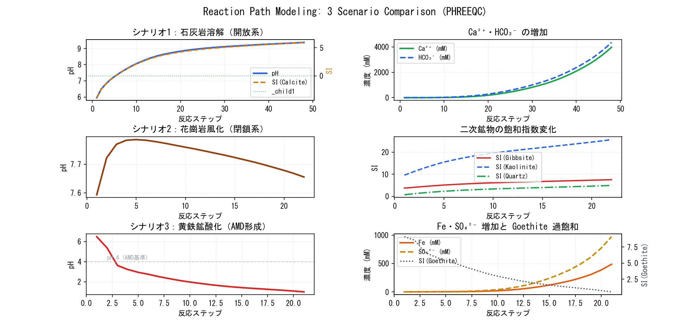

## はじめに：「点」の計算から「旅」の計算へ

#2〜#10 では、ある瞬間の溶液状態を計算してきた。平衡計算は **一枚の写真** と言えよう。

今回の反応経路モデリング（reaction path modeling）は、その写真を何百枚も繋げて作る **映像** に相当する。\
すなわち、反応の進行に伴う化学組成や鉱物相の変化を連続的に追跡し、系がどのように進化していくかを記述する手法である。

```{=html}
<div style="background:#FFF7ED; border-left:4px solid #D97706; padding:1.2em 1.5em; margin:1.5em 0; border-radius:0 8px 8px 0;">
  <div style="font-weight:700; color:#92400E; margin-bottom:0.6em;">今回シミュレートするシナリオ</div>
  <div style="font-size:0.92em; color:#78350F; line-height:1.8;">
    大気 CO₂ を溶かした <strong>酸性雨水（pH 5.6）</strong> が地表に降り注ぎ、<br>
    土壌 CO₂ ゾーンを通過しながら CO₂ をさらに取り込み、<br>
    <strong>石灰岩（カルサイト）</strong> と接触して少しずつ溶かしながら流れ、<br>
    やがて <strong>地下水（pH 7.4、Ca–HCO₃ 型）</strong> へと進化する。<br><br>
    この過程で pH・SI・Ca²⁺・HCO₃⁻ がどう変わるかを追う。
  </div>
</div>
```

::: callout-note
## この記事で学ぶこと

- `REACTION` ブロックの基本構文と「少しずつ反応させる」仕組み
- `INCREMENTAL_REACTIONS` によるステップ分割の意味
- 開放系（CO₂ 補給あり）と閉鎖系（CO₂ 補給なし）の違い
- `USER_GRAPH` と `SELECTED_OUTPUT` で反応経路を可視化する方法
- 石灰岩・花崗岩・黄鉄鉱の 3 シナリオの比較
- Python による反応経路の可視化
:::

------------------------------------------------------------------------

## 理論：反応経路とは何か

### PHREEQC の REACTION ブロックの仕組み

`REACTION` ブロックは、指定した物質を溶液に **少しずつ添加** していく。 各ステップで平衡計算が走り、その都度 pH・SI・化学種が更新される。

```{=html}
<div style="background:#FDFDFD; border:1px solid #E5E7EB; border-radius:12px; padding:1.5em; margin:1.5em 0;">
<svg viewBox="0 0 680 200" xmlns="http://www.w3.org/2000/svg" style="width:100%;max-width:680px;display:block;margin:0 auto;" role="img">
  <title>PHREEQC REACTIONブロックの仕組み：ステップごとの平衡計算フロー</title>
  <defs>
    <marker id="arrR" viewBox="0 0 10 10" refX="8" refY="5" markerWidth="6" markerHeight="6" orient="auto-start-reverse">
      <path d="M2 1L8 5L2 9" fill="none" stroke="context-stroke" stroke-width="1.5" stroke-linecap="round" stroke-linejoin="round"/>
    </marker>
  </defs>

  <!-- 初期溶液 -->
  <rect x="20" y="70" width="110" height="60" rx="8" fill="#EFF6FF" stroke="#2563EB" stroke-width="1"/>
  <text x="75" y="96" text-anchor="middle" font-family="'Segoe UI',sans-serif" font-size="11" font-weight="600" fill="#1E3A5F">初期溶液</text>
  <text x="75" y="112" text-anchor="middle" font-family="'Segoe UI',sans-serif" font-size="10" fill="#1E40AF">酸性雨 pH 5.6</text>

  <!-- 矢印 -->
  <line x1="130" y1="100" x2="158" y2="100" stroke="#9CA3AF" stroke-width="1.5" marker-end="url(#arrR)"/>

  <!-- ステップ1 -->
  <rect x="160" y="50" width="100" height="100" rx="8" fill="#FFF7ED" stroke="#D97706" stroke-width="1.5"/>
  <text x="210" y="78" text-anchor="middle" font-family="'Segoe UI',sans-serif" font-size="10" font-weight="600" fill="#92400E">Step 1</text>
  <text x="210" y="93" text-anchor="middle" font-family="'Segoe UI',sans-serif" font-size="9" fill="#78350F">CaCO₃ 0.01 mmol</text>
  <text x="210" y="107" text-anchor="middle" font-family="'Segoe UI',sans-serif" font-size="9" fill="#78350F">追加 → 平衡</text>
  <text x="210" y="122" text-anchor="middle" font-family="'Segoe UI',sans-serif" font-size="9" fill="#D97706">pH 6.1</text>
  <text x="210" y="136" text-anchor="middle" font-family="'Segoe UI',sans-serif" font-size="9" fill="#D97706">SI=−1.2</text>

  <line x1="260" y1="100" x2="288" y2="100" stroke="#9CA3AF" stroke-width="1.5" marker-end="url(#arrR)"/>

  <!-- ステップ2 -->
  <rect x="290" y="50" width="100" height="100" rx="8" fill="#FFF7ED" stroke="#D97706" stroke-width="1.5"/>
  <text x="340" y="78" text-anchor="middle" font-family="'Segoe UI',sans-serif" font-size="10" font-weight="600" fill="#92400E">Step 2</text>
  <text x="340" y="93" text-anchor="middle" font-family="'Segoe UI',sans-serif" font-size="9" fill="#78350F">さらに 0.01 mmol</text>
  <text x="340" y="107" text-anchor="middle" font-family="'Segoe UI',sans-serif" font-size="9" fill="#78350F">追加 → 平衡</text>
  <text x="340" y="122" text-anchor="middle" font-family="'Segoe UI',sans-serif" font-size="9" fill="#D97706">pH 6.6</text>
  <text x="340" y="136" text-anchor="middle" font-family="'Segoe UI',sans-serif" font-size="9" fill="#D97706">SI=−0.5</text>

  <!-- ... -->
  <text x="415" y="104" text-anchor="middle" font-family="'Segoe UI',sans-serif" font-size="16" fill="#9CA3AF">···</text>

  <line x1="430" y1="100" x2="458" y2="100" stroke="#9CA3AF" stroke-width="1.5" marker-end="url(#arrR)"/>

  <!-- 最終ステップ -->
  <rect x="460" y="50" width="100" height="100" rx="8" fill="#F0FDF4" stroke="#16A34A" stroke-width="1.5"/>
  <text x="510" y="78" text-anchor="middle" font-family="'Segoe UI',sans-serif" font-size="10" font-weight="600" fill="#15803D">Step N</text>
  <text x="510" y="93" text-anchor="middle" font-family="'Segoe UI',sans-serif" font-size="9" fill="#166534">SI(Calcite)</text>
  <text x="510" y="107" text-anchor="middle" font-family="'Segoe UI',sans-serif" font-size="9" fill="#166534">→ 0 に収束</text>
  <text x="510" y="122" text-anchor="middle" font-family="'Segoe UI',sans-serif" font-size="9" fill="#16A34A">pH 7.4</text>
  <text x="510" y="136" text-anchor="middle" font-family="'Segoe UI',sans-serif" font-size="9" fill="#16A34A">SI ≈ 0</text>

  <!-- 下部説明 -->
  <text x="340" y="185" text-anchor="middle" font-family="'Segoe UI',sans-serif" font-size="11" fill="#6B7280">各ステップで「溶液 + 反応物 → 新しい平衡状態」を繰り返す</text>
</svg>
<p style="text-align:center; font-size:0.82em; color:#6B7280; margin-top:0.5em;">図1. REACTION ブロックによる段階的平衡計算の流れ</p>
</div>
```

### 開放系 vs 閉鎖系

```{=html}
<div style="display:grid; grid-template-columns:1fr 1fr; gap:1.2em; margin:1.5em 0;">
  <div style="background:#EFF6FF; border-radius:10px; padding:1.2em; border-top:3px solid #2563EB;">
    <div style="font-weight:700; color:#1E3A5F; margin-bottom:0.6em;">🌬️ 開放系（CO₂ 補給あり）</div>
    <div style="font-size:0.88em; color:#1E40AF; line-height:1.7;">
      大気・土壌 CO₂ と常に平衡を保ちながら溶解が進む。<br>
      <code style="background:#DBEAFE; padding:2px 5px; border-radius:3px;">EQUILIBRIUM_PHASES</code> に<br>
      <code style="background:#DBEAFE; padding:2px 5px; border-radius:3px;">CO2(g)</code> を追加する。<br><br>
      → pH の上昇が抑えられ、カルサイトがより多く溶ける。<br>
      → 典型例：土壌帯水層の上部
    </div>
  </div>
  <div style="background:#F0FDF4; border-radius:10px; padding:1.2em; border-top:3px solid #16A34A;">
    <div style="font-weight:700; color:#15803D; margin-bottom:0.6em;">🔒 閉鎖系（CO₂ 補給なし）</div>
    <div style="font-size:0.88em; color:#166534; line-height:1.7;">
      溶液内の CO₂ だけで反応が進む。<br>
      CO₂ が消費されると H⁺ の供給が止まり<br>
      溶解が抑制される。<br><br>
      → pH が高くなりやすく、溶解量が少ない。<br>
      → 典型例：深部封圧帯水層
    </div>
  </div>
</div>
```

------------------------------------------------------------------------

### なぜ「開放系か閉鎖系か」で結果が変わるのか

上の対比は炭酸系の化学をひとことで言い表したものであるが、この違いは反応経路計算の出発点を決めてしまうほど大きい。もう少し丁寧に追っておきたい。

石灰岩が溶ける反応は、水と二酸化炭素が揃ってはじめて進む。

$$\mathrm{CaCO_3(s)} + \mathrm{CO_2} + \mathrm{H_2O} \rightleftharpoons \mathrm{Ca^{2+}} + 2\,\mathrm{HCO_3^-}$$

左辺に CO₂ がいる点が要である。カルサイトが溶けるたびに CO₂ が消費され、同時に pH が上がる。pH が上がれば炭酸の解離平衡が動き、溶解の駆動力はさらに弱まる。**閉鎖系では、この反応は自分で自分を止めにいく。** どこまで溶けるかは、水が最初に持っていた CO₂ の量で決まってしまう。

いっぽう開放系では、消費された CO₂ が外から補給され続ける。左辺の CO₂ が減らないため、平衡は右へ押され続ける。**同じ石灰岩、同じ水温であっても、CO₂ の補給があるかないかで溶ける量は桁で変わる。**

この違いは、地質学的にはどこで生じるのか。地表から浸み込んだ雨水は、まず土壌帯を通る。植物の根と微生物の呼吸によって、土壌の空気中の CO₂ 分圧は大気の 10 倍から 100 倍に達することがある。この帯を通るあいだ、水は CO₂ を補給され続ける——すなわち開放系である。ところが不透水層の下に潜り込み、気相と切り離されると、以後は手持ちの CO₂ だけで反応を進めるほかない——閉鎖系である。

**同じ帯水層の中でも、水が浅いところを流れているか深いところを流れているかで、この二つは切り替わる。** 反応経路の計算を始める前に、対象の水がどちらの状況にあるのかを決めておく必要がある。ここを取り違えると、以降の計算はすべて別の水の話になってしまう。

実測から見分ける手がかりもある。開放系で溶けた水は、pH のわりに Ca²⁺ と HCO₃⁻ が多く、水質から逆算した CO₂ 分圧が大気の値よりはっきり高く出る。閉鎖系の水は pH が高いわりに溶存量が少なく、逆算した CO₂ 分圧は低い。**現場のデータを前にしてまず見るべき量**は、この逆算 CO₂ 分圧である。

------------------------------------------------------------------------

## シナリオ 1：石灰岩の溶解（開放系）

### 地質学的な設定

```{=html}
<div style="background:#FDFDFD; border:1px solid #E5E7EB; border-radius:12px; padding:1.5em; margin:1.5em 0;">
<svg viewBox="0 0 680 230" xmlns="http://www.w3.org/2000/svg" style="width:100%;max-width:680px;display:block;margin:0 auto;" role="img">
  <title>石灰岩地帯の水文地質断面図：雨水から地下水への変化</title>
  <defs>
    <marker id="arrG" viewBox="0 0 10 10" refX="8" refY="5" markerWidth="6" markerHeight="6" orient="auto-start-reverse">
      <path d="M2 1L8 5L2 9" fill="none" stroke="context-stroke" stroke-width="1.5" stroke-linecap="round" stroke-linejoin="round"/>
    </marker>
  </defs>

  <!-- 空 -->
  <rect x="0" y="0" width="680" height="60" fill="#EFF6FF" opacity="0.4" rx="4"/>
  <text x="340" y="25" text-anchor="middle" font-family="'Segoe UI',sans-serif" font-size="11" fill="#2563EB">大気（CO₂ = 0.04%、log pCO₂ = −3.5）</text>
  <!-- 雨滴 -->
  <ellipse cx="80" cy="15" rx="5" ry="7" fill="#93C5FD" opacity="0.7"/>
  <ellipse cx="140" cy="30" rx="4" ry="6" fill="#93C5FD" opacity="0.6"/>
  <ellipse cx="220" cy="10" rx="5" ry="8" fill="#93C5FD" opacity="0.7"/>
  <text x="80" y="55" text-anchor="middle" font-family="'Segoe UI',sans-serif" font-size="9" fill="#1E40AF">pH 5.6</text>

  <!-- 土壌ゾーン -->
  <rect x="0" y="60" width="680" height="45" fill="#92400E" opacity="0.12"/>
  <text x="340" y="82" text-anchor="middle" font-family="'Segoe UI',sans-serif" font-size="11" fill="#78350F">土壌ゾーン（CO₂ 豊富 log pCO₂ = −1.5 〜 −2.0）</text>
  <text x="340" y="97" text-anchor="middle" font-family="'Segoe UI',sans-serif" font-size="9" fill="#92400E">CO₂ を追加吸収 → より酸性に（pH 4.5〜5.0）</text>

  <!-- 石灰岩ゾーン -->
  <rect x="0" y="105" width="680" height="80" fill="#CA8A04" opacity="0.1"/>
  <!-- 石灰岩パターン（斜線） -->
  <line x1="0"   y1="115" x2="20"  y2="105" stroke="#CA8A04" stroke-width="0.5" opacity="0.4"/>
  <line x1="40"  y1="115" x2="60"  y2="105" stroke="#CA8A04" stroke-width="0.5" opacity="0.4"/>
  <line x1="80"  y1="115" x2="100" y2="105" stroke="#CA8A04" stroke-width="0.5" opacity="0.4"/>
  <line x1="120" y1="115" x2="140" y2="105" stroke="#CA8A04" stroke-width="0.5" opacity="0.4"/>
  <line x1="160" y1="115" x2="180" y2="105" stroke="#CA8A04" stroke-width="0.5" opacity="0.4"/>
  <line x1="200" y1="115" x2="220" y2="105" stroke="#CA8A04" stroke-width="0.5" opacity="0.4"/>
  <text x="340" y="138" text-anchor="middle" font-family="'Segoe UI',sans-serif" font-size="11" fill="#92400E">石灰岩（カルサイト）帯水層</text>
  <text x="340" y="155" text-anchor="middle" font-family="'Segoe UI',sans-serif" font-size="9" fill="#B45309">CaCO₃ を少しずつ溶解 → pH 上昇・Ca²⁺・HCO₃⁻ 増加</text>
  <text x="340" y="170" text-anchor="middle" font-family="'Segoe UI',sans-serif" font-size="9" fill="#B45309">SI(Calcite) が -6 → 0 へと上昇</text>

  <!-- 地下水面 -->
  <line x1="0" y1="185" x2="680" y2="185" stroke="#2563EB" stroke-width="1.5" stroke-dasharray="8 4" opacity="0.6"/>
  <rect x="0" y="185" width="680" height="45" fill="#DBEAFE" opacity="0.3"/>
  <text x="340" y="210" text-anchor="middle" font-family="'Segoe UI',sans-serif" font-size="11" fill="#1E3A5F">地下水（Ca–HCO₃ 型、pH 7.2〜7.8、SI(Calcite) ≈ 0）</text>

  <!-- 矢印（水の流れ） -->
  <line x1="340" y1="55" x2="340" y2="105" stroke="#2563EB" stroke-width="2" marker-end="url(#arrG)" opacity="0.6"/>
  <line x1="340" y1="150" x2="340" y2="183" stroke="#2563EB" stroke-width="2" marker-end="url(#arrG)" opacity="0.6"/>
</svg>
<p style="text-align:center; font-size:0.82em; color:#6B7280; margin-top:0.5em;">図2. 石灰岩地帯における雨水→地下水の反応経路</p>
</div>
```

### PHREEQCコード（完全版・シナリオ 1）

``` phreeqc
# ============================================================
#  DeepFlow #11 - 反応経路モデリング
#  シナリオ1：酸性雨水による石灰岩の溶解（開放系）
# ============================================================

# ---- 初期溶液：土壌通過後の酸性水 ----
SOLUTION 1  "土壌通過雨水"
    temp      12
    pH        4.5
    pe        12
    units     mol/kgw
    -water    1

# ---- 大気 CO₂ との平衡を保つ（開放系） ----
EQUILIBRIUM_PHASES 1
    CO2(g)   -2.0   10    # log pCO2 = -2.0（土壌 CO₂ ゾーン）

# ---- カルサイトを 100 ステップで少しずつ添加 ----
REACTION 1
    CaCO3    1          # 1 mol のカルサイトを...
    0.0001  0.0002  0.0003  0.0005  0.0007  0.001   # ステップ量（mol）
    0.0015  0.002   0.003   0.004   0.005   0.007
    0.010   0.012   0.015   0.018   0.020   0.025
    0.030   0.035   0.040   0.045   0.050   0.055
    0.060   0.065   0.070   0.075   0.080   0.085
    0.090   0.095   0.100   0.110   0.120   0.130
    0.140   0.150   0.160   0.170   0.180   0.190
    0.200   0.220   0.240   0.260   0.280   0.300

INCREMENTAL_REACTIONS true

# ---- 出力設定 ----
SELECTED_OUTPUT 1
    -file               limestone_path.txt
    -reset              false
    -step               true
    -pH                 true
    -temperature        true
    -totals             Ca C(4) Mg
    -activities         Ca+2  HCO3-  CO3-2  H+
    -saturation_indices Calcite  Aragonite  Dolomite  CO2(g)
    -equilibrium_phases CO2(g)

USER_PUNCH 1
    -headings  Step  pH  Ca_mM  HCO3_mM  SI_Calcite  pCO2_log
    -start
    10 PUNCH STEP_NO, -LA("H+"), TOT("Ca")*1000, TOT("C(4)")*1000, \
             SI("Calcite"), SI("CO2(g)")
    -end

USER_GRAPH 2
    -chart_title  "Limestone Dissolution: Reaction Path"
    -axis_titles  "Ca dissolved (mmol/kgw)"  "pH"  "SI"
    -axis_scale   y_axis  4  9.5
    -headings     Ca_mmol  pH  SI(Calcite)
    -start
    10 GRAPH_X  TOT("Ca") * 1000
    20 GRAPH_Y  -LA("H+")
    30 GRAPH_SY SI("Calcite")
    -end
END
```

::: callout-tip
## `INCREMENTAL_REACTIONS true` の意味

`true` にすると、各ステップは「前のステップからの増分」として処理される。 `false`（デフォルト）では各ステップは初期溶液からの累積量として処理される。 反応経路のシミュレーションでは原則 `true` を使う。
:::

------------------------------------------------------------------------

この一行は地味に見えるが、付け忘れると結果が静かに変わる。少し丁寧に説明しておきたい。

`REACTION` に「合計 X mol を 20 ステップで」と書いたとする。`INCREMENTAL_REACTIONS` が `false`（既定値）のとき、PHREEQC は毎回 **初期溶液に戻ってから**、そのステップまでの累積量を一度に加える。すなわち各ステップは互いに独立した 20 個の計算であり、そこに並んでいるのは経路ではなく **20 個の終点**である。

`true` にすると、各ステップは前のステップの結果を引き継ぐ。ステップ 20 は「ステップ 19 の水に、さらに少しだけ加えた状態」になる。こちらがまさに**旅**であり、途中で二次鉱物が沈殿したり、pH の緩衝が効いたりといった履歴が積み上がっていく。

単純な溶解だけを追うのであれば、両者は近い答えに落ち着くことも多い。ところが、**途中で不可逆な出来事が起きる系では答えが変わる。** 次に扱う花崗岩の風化では、途中でギブサイトやカオリナイトが沈殿し、溶液から Al と Si を抜き取ってしまう。この履歴があるかないかで、最終的にどの二次鉱物が現れるかまで変わってくる。

「結果が教科書と違う」という相談で、この一行が抜けていた例は少なくない。**反応経路を追いたいのであれば `true` を書く。** 迷う場面はほとんどない。

------------------------------------------------------------------------

## シナリオ 2：花崗岩の風化（閉鎖系）

花崗岩の主要鉱物である **長石（アルバイト：NaAlSi₃O₈）** の風化を追う。

``` phreeqc
# ============================================================
#  シナリオ2：花崗岩の風化（閉鎖系）
#  アルバイト（Na長石）の溶解
# ============================================================

SOLUTION 2  "大気平衡雨水"
    temp      10
    pH        5.65       # 大気 CO₂ との平衡
    pe        12
    units     mol/kgw
    -water    1

# ---- アルバイト + カルサイト微量を閉鎖系で溶かす ----
REACTION 2
    NaAlSi3O8    1       # アルバイト（長石）
    0.0001  0.0002  0.0005  0.001   0.002   0.003
    0.005   0.007   0.010   0.012   0.015   0.020
    0.025   0.030   0.040   0.050   0.060   0.080
    0.100   0.120   0.150   0.200

INCREMENTAL_REACTIONS true

SELECTED_OUTPUT 2
    -file               granite_path.txt
    -reset              false
    -step               true
    -pH                 true
    -totals             Na Al Si Ca
    -activities         Al+3  Na+  H4SiO4
    -saturation_indices Gibbsite  Kaolinite  Albite  Quartz  K-feldspar

USER_PUNCH 2
    -headings  Step  pH  Na_mM  Al_uM  Si_mM  SI_Gibbsite  SI_Kaolinite  SI_Quartz
    -start
    10 PUNCH STEP_NO, -LA("H+"), TOT("Na")*1000, TOT("Al")*1e6, \
             TOT("Si")*1000, SI("Gibbsite"), SI("Kaolinite"), SI("Quartz")
    -end

USER_GRAPH 2
    -chart_title  "花崗岩風化：反応経路"
    -axis_titles  "溶解ステップ"  "log 活量"  "SI"
    -headings     Step  Al3+  H4SiO4  SI(Gibbsite)  SI(Kaolinite)
    -start
    10 GRAPH_X  STEP_NO
    20 GRAPH_Y  LA("Al+3"),    "Al³⁺"
    30 GRAPH_Y  LA("H4SiO4"), "H₄SiO₄"
    40 GRAPH_SY SI("Gibbsite"), "SI(Gibbsite)"
    50 GRAPH_SY SI("Kaolinite"),"SI(Kaolinite)"
    -end
END
```

### 花崗岩風化の反応系列

花崗岩の風化では、溶解が進むにつれて **二次鉱物** が順番に沈殿する：

```{=html}
<div style="overflow-x:auto; margin:1.5em 0;">
<table style="width:100%; border-collapse:collapse; font-size:0.88em;">
  <thead>
    <tr style="background:#D97706; color:white;">
      <th style="padding:10px 13px; text-align:left;">段階</th>
      <th style="padding:10px 13px; text-align:left;">主反応</th>
      <th style="padding:10px 13px; text-align:center;">pH 域</th>
      <th style="padding:10px 13px; text-align:left;">生成する二次鉱物</th>
    </tr>
  </thead>
  <tbody>
    <tr style="background:#FFF7ED;">
      <td style="padding:9px 13px; font-weight:600; color:#92400E;">① 初期溶解</td>
      <td style="padding:9px 13px; font-size:0.88em;">長石 + H₂O + CO₂ → Na⁺ + HCO₃⁻ + Al³⁺ + H₄SiO₄</td>
      <td style="padding:9px 13px; text-align:center; font-family:monospace;">4〜5.5</td>
      <td style="padding:9px 13px; font-size:0.88em; color:#DC2626;">なし（溶液中に蓄積）</td>
    </tr>
    <tr style="background:#FDFDFD;">
      <td style="padding:9px 13px; font-weight:600; color:#92400E;">② Gibbsite 沈殿</td>
      <td style="padding:9px 13px; font-size:0.88em;">Al³⁺ + 3H₂O → Al(OH)₃ + 3H⁺</td>
      <td style="padding:9px 13px; text-align:center; font-family:monospace;">5.5〜6.5</td>
      <td style="padding:9px 13px; font-size:0.88em; color:#16A34A;">Al(OH)₃（Gibbsite）</td>
    </tr>
    <tr style="background:#FFF7ED;">
      <td style="padding:9px 13px; font-weight:600; color:#92400E;">③ カオリナイト沈殿</td>
      <td style="padding:9px 13px; font-size:0.88em;">Al³⁺ + Si → Al₂Si₂O₅(OH)₄</td>
      <td style="padding:9px 13px; text-align:center; font-family:monospace;">6.5〜7.5</td>
      <td style="padding:9px 13px; font-size:0.88em; color:#16A34A;">カオリナイト（粘土鉱物）</td>
    </tr>
    <tr style="background:#FDFDFD;">
      <td style="padding:9px 13px; font-weight:600; color:#92400E;">④ 長石との平衡</td>
      <td style="padding:9px 13px; font-size:0.88em;">溶解速度 ≈ 沈殿速度</td>
      <td style="padding:9px 13px; text-align:center; font-family:monospace;">&gt; 7.5</td>
      <td style="padding:9px 13px; font-size:0.88em; color:#2563EB;">スメクタイト・モンモリロナイト</td>
    </tr>
  </tbody>
</table>
</div>
```

------------------------------------------------------------------------

## シナリオ 3：黄鉄鉱の酸化（開放系・酸素存在下）

#6 の AMD テーマを反応経路として追う。

``` phreeqc
# ============================================================
#  シナリオ3：黄鉄鉱の段階的酸化（AMD 形成）
# ============================================================

SOLUTION 3  "中性地下水"
    temp      15
    pH        7.0
    pe        4
    units     mol/kgw
    Na        1.0e-3
    Cl        1.0e-3
    Alkalinity 1.0e-3 as HCO3
    Fe        1.0e-6
    S(6)      1.0e-5

# ---- 酸素存在下（大気開放） ----
EQUILIBRIUM_PHASES 3
    O2(g)    -0.68   10      # 大気 O₂（pO₂ = 0.21 atm, log = -0.68）

# ---- 黄鉄鉱を少しずつ酸化 ----
REACTION 3
    FeS2     1
    0.0001  0.0002  0.0003  0.0005  0.0008  0.001
    0.002   0.003   0.005   0.007   0.010   0.015
    0.020   0.025   0.030   0.035   0.040   0.050
    0.060   0.080   0.100

INCREMENTAL_REACTIONS true

SELECTED_OUTPUT 3
    -file               pyrite_path.txt
    -reset              false
    -step               true
    -pH                 true
    -totals             Fe S(6) Al
    -activities         Fe+2  Fe+3  SO4-2
    -saturation_indices Goethite  Calcite  Gypsum

USER_PUNCH 3
    -headings  Step  pH  Fe_mM  SO4_mM  SI_Goethite
    -start
    10 PUNCH STEP_NO, -LA("H+"), TOT("Fe")*1000, TOT("S(6)")*1000, \
             SI("Goethite")
    -end

USER_GRAPH 3
    -chart_title  "Pyrite Oxidation: Reaction Path (AMD)"
    -axis_titles  "Reaction step"  "pH / log activity"  "SI"
    -headings     Step  pH  Fe2+  SO4_2-  SI(Goethite)
    -start
    10 GRAPH_X  STEP_NO
    20 GRAPH_Y  -LA("H+")
    30 GRAPH_Y  LA("Fe+2")
    40 GRAPH_Y  LA("SO4-2")
    50 GRAPH_SY SI("Goethite")
    -end
END
```

------------------------------------------------------------------------

## Python で 3 シナリオを比較可視化する

``` python
# ============================================================
#  reaction_path_plot.py
#  3 シナリオの反応経路を比較プロット
# ============================================================
import pandas as pd
import numpy as np
import matplotlib.pyplot as plt
import matplotlib.gridspec as gridspec

# ---- フォント設定（日本語環境） ----
plt.rcParams.update({
    "font.family": "sans-serif",
    "font.sans-serif": ["MS Gothic", "Noto Sans CJK JP", "IPAexGothic", "DejaVu Sans"],
    "axes.unicode_minus": False,
    "figure.dpi":      150,
})

# ---- データ読み込み ----
def load_phreeqc_selected(fp, comment="#"):
    return pd.read_csv(fp, sep="\t", comment=comment, skipinitialspace=True)

df1 = load_phreeqc_selected("limestone_path.txt")
df2 = load_phreeqc_selected("granite_path.txt")
df3 = load_phreeqc_selected("pyrite_path.txt")

# ======= 3x2 subplot =======
fig = plt.figure(figsize=(14, 10))
gs  = gridspec.GridSpec(3, 2, hspace=0.45, wspace=0.35)

# Filter data to exclude initial state (step = -99)
df1_plot = df1[df1["step"] >= 0]
df2_plot = df2[df2["step"] >= 0]
df3_plot = df3[df3["step"] >= 0]

# ======= シナリオ1：石灰岩 =======
ax1a = fig.add_subplot(gs[0, 0])
ax1b = ax1a.twinx()
ax1a.plot(df1_plot["step"], df1_plot["pH"],          color="#2563EB", lw=2.2, label="pH")
ax1b.plot(df1_plot["step"], df1_plot["SI_Calcite"],  color="#D97706", lw=1.8, ls="--", label="SI(Calcite)")
ax1b.axhline(0, color="#16A34A", lw=1, ls=":", alpha=0.7)
ax1a.set(xlabel="反応ステップ", ylabel="pH", title="シナリオ1：石灰岩溶解（開放系）")
ax1b.set_ylabel("SI", color="#D97706")
lines = ax1a.get_lines() + ax1b.get_lines()
ax1a.legend(lines, [l.get_label() for l in lines], fontsize=9, loc="lower right")
ax1a.grid(True, ls="--", lw=0.5, color="#E5E7EB")

ax1c = fig.add_subplot(gs[0, 1])
ax1c.plot(df1_plot["step"], df1_plot["Ca_mM"],   color="#16A34A", lw=2, label="Ca²⁺ (mM)")
ax1c.plot(df1_plot["step"], df1_plot["HCO3_mM"], color="#2563EB", lw=2, ls="--", label="HCO₃⁻ (mM)")
ax1c.set(xlabel="反応ステップ", ylabel="濃度 (mM)",
         title="Ca²⁺・HCO₃⁻ の増加")
ax1c.legend(fontsize=9); ax1c.grid(True, ls="--", lw=0.5, color="#E5E7EB")

# ======= シナリオ2：花崗岩 =======
ax2a = fig.add_subplot(gs[1, 0])
ax2a.plot(df2_plot["step"], df2_plot["pH"],          color="#92400E", lw=2.2, label="pH")
ax2a.set(xlabel="反応ステップ", ylabel="pH", title="シナリオ2：花崗岩風化（閉鎖系）")
ax2a.grid(True, ls="--", lw=0.5, color="#E5E7EB")

ax2b = fig.add_subplot(gs[1, 1])
ax2b.plot(df2_plot["step"], df2_plot["SI_Gibbsite"],   color="#DC2626", lw=1.8, label="SI(Gibbsite)")
ax2b.plot(df2_plot["step"], df2_plot["SI_Kaolinite"],  color="#2563EB", lw=1.8, ls="--", label="SI(Kaolinite)")
ax2b.plot(df2_plot["step"], df2_plot["SI_Quartz"],     color="#16A34A", lw=1.8, ls="-.", label="SI(Quartz)")
ax2b.axhline(0, color="#9CA3AF", lw=1, ls=":", alpha=0.7)
ax2b.set(xlabel="反応ステップ", ylabel="SI",
         title="二次鉱物の飽和指数変化")
ax2b.legend(fontsize=9); ax2b.grid(True, ls="--", lw=0.5, color="#E5E7EB")

# ======= シナリオ3：黄鉄鉱 =======
ax3a = fig.add_subplot(gs[2, 0])
ax3a.plot(df3_plot["step"], df3_plot["pH"],        color="#DC2626", lw=2.2, label="pH")
ax3a.axhline(4.0, color="#9CA3AF", lw=1, ls="--", alpha=0.5)
ax3a.text(2, 4.2, "pH 4 (AMD基準)", color="#9CA3AF", fontsize=8)
ax3a.set(xlabel="反応ステップ", ylabel="pH", title="シナリオ3：黄鉄鉱酸化（AMD形成）")
ax3a.grid(True, ls="--", lw=0.5, color="#E5E7EB")

ax3b = fig.add_subplot(gs[2, 1])
ax3b_r = ax3b.twinx()
ax3b.plot(df3_plot["step"],   df3_plot["Fe_mM"],  color="#EA580C", lw=2, label="Fe (mM)")
ax3b.plot(df3_plot["step"],   df3_plot["SO4_mM"], color="#CA8A04", lw=2, ls="--", label="SO₄²⁻ (mM)")
ax3b_r.plot(df3_plot["step"], df3_plot["SI_Goethite"], color="#374151", lw=1.5, ls=":", label="SI(Goethite)")
ax3b.set(xlabel="反応ステップ", ylabel="濃度 (mM)",
         title="Fe・SO₄²⁻ 増加と Goethite 過飽和")
lines = ax3b.get_lines() + ax3b_r.get_lines()
ax3b.legend(lines, [l.get_label() for l in lines], fontsize=9)
ax3b_r.set_ylabel("SI(Goethite)", color="#374151")
ax3b.grid(True, ls="--", lw=0.5, color="#E5E7EB")

plt.suptitle("Reaction Path Modeling: 3 Scenario Comparison (PHREEQC)", fontsize=14, y=0.98)
plt.savefig("reaction_paths.svg", bbox_inches="tight")
plt.show()
print("✅ reaction_paths.svg を保存")
```



------------------------------------------------------------------------

## 3 シナリオの比較結果

```{=html}
<div style="background:#FDFDFD; border:1px solid #E5E7EB; border-radius:12px; padding:1.5em; margin:1.5em 0;">
<svg viewBox="0 0 680 310" xmlns="http://www.w3.org/2000/svg" style="width:100%;max-width:680px;display:block;margin:0 auto;" role="img">
  <title>3シナリオのpH変化経路の比較グラフ</title>
  <defs>
    <marker id="arrC" viewBox="0 0 10 10" refX="8" refY="5" markerWidth="6" markerHeight="6" orient="auto-start-reverse">
      <path d="M2 1L8 5L2 9" fill="none" stroke="context-stroke" stroke-width="1.5" stroke-linecap="round" stroke-linejoin="round"/>
    </marker>
  </defs>

  <!-- プロット背景 -->
  <rect x="70" y="30" width="530" height="230" fill="#F9FAFB" rx="4"/>

  <!-- グリッド横 -->
  <line x1="70" y1="30"  x2="600" y2="30"  stroke="#E5E7EB" stroke-width="0.8"/>
  <line x1="70" y1="68"  x2="600" y2="68"  stroke="#E5E7EB" stroke-width="0.8"/>
  <line x1="70" y1="106" x2="600" y2="106" stroke="#E5E7EB" stroke-width="0.8"/>
  <line x1="70" y1="144" x2="600" y2="144" stroke="#E5E7EB" stroke-width="0.8" stroke-dasharray="4 3"/>
  <line x1="70" y1="182" x2="600" y2="182" stroke="#E5E7EB" stroke-width="0.8"/>
  <line x1="70" y1="220" x2="600" y2="220" stroke="#E5E7EB" stroke-width="0.8"/>
  <line x1="70" y1="260" x2="600" y2="260" stroke="#E5E7EB" stroke-width="0.8"/>

  <!-- 軸 -->
  <line x1="70" y1="260" x2="600" y2="260" stroke="#9CA3AF" stroke-width="1.5"/>
  <line x1="70" y1="30"  x2="70"  y2="260" stroke="#9CA3AF" stroke-width="1.5"/>

  <!-- X軸ラベル（ステップ 0〜50） -->
  <text x="70"  y="277" text-anchor="middle" font-family="'Segoe UI',sans-serif" font-size="11" fill="#6B7280">0</text>
  <text x="176" y="277" text-anchor="middle" font-family="'Segoe UI',sans-serif" font-size="11" fill="#6B7280">10</text>
  <text x="282" y="277" text-anchor="middle" font-family="'Segoe UI',sans-serif" font-size="11" fill="#6B7280">20</text>
  <text x="388" y="277" text-anchor="middle" font-family="'Segoe UI',sans-serif" font-size="11" fill="#6B7280">30</text>
  <text x="494" y="277" text-anchor="middle" font-family="'Segoe UI',sans-serif" font-size="11" fill="#6B7280">40</text>
  <text x="600" y="277" text-anchor="middle" font-family="'Segoe UI',sans-serif" font-size="11" fill="#6B7280">50</text>
  <text x="335" y="298" text-anchor="middle" font-family="'Segoe UI',sans-serif" font-size="12" fill="#374151">反応ステップ</text>

  <!-- Y軸ラベル（pH 2〜8） -->
  <!-- y = 260 - (pH - 2) × (230/6) = 260 - (pH-2)×38.3 -->
  <text x="58" y="264" text-anchor="end" font-family="'Segoe UI',sans-serif" font-size="11" fill="#6B7280">2</text>
  <text x="58" y="226" text-anchor="end" font-family="'Segoe UI',sans-serif" font-size="11" fill="#6B7280">3</text>
  <text x="58" y="188" text-anchor="end" font-family="'Segoe UI',sans-serif" font-size="11" fill="#6B7280">4</text>
  <text x="58" y="150" text-anchor="end" font-family="'Segoe UI',sans-serif" font-size="11" fill="#6B7280">5</text>
  <text x="58" y="112" text-anchor="end" font-family="'Segoe UI',sans-serif" font-size="11" fill="#6B7280">6</text>
  <text x="58" y="74"  text-anchor="end" font-family="'Segoe UI',sans-serif" font-size="11" fill="#6B7280">7</text>
  <text x="58" y="36"  text-anchor="end" font-family="'Segoe UI',sans-serif" font-size="11" fill="#6B7280">8</text>
  <text transform="rotate(-90 16 145)" x="16" y="145" text-anchor="middle" font-family="'Segoe UI',sans-serif" font-size="12" fill="#374151">pH</text>

  <!-- pH7 基準線 -->
  <line x1="70" y1="74" x2="600" y2="74" stroke="#9CA3AF" stroke-width="0.8" stroke-dasharray="5 3" opacity="0.5"/>
  <text x="603" y="78" font-family="'Segoe UI',sans-serif" font-size="9" fill="#9CA3AF">pH7</text>

  <!-- === シナリオ1：石灰岩開放系 ===
       初期 pH 4.5 → 緩やかに上昇 → pH 7.4 で平坦化
       step0→pH4.5: y=260-(4.5-2)×38.3=164; step5→pH5.2:y=140; step10→pH5.9:y=113;
       step15→pH6.4:y=94; step20→pH6.8:y=79; step30→pH7.2:y=65; step50→pH7.4:y=57 -->
  <polyline points="70,164 123,140 176,113 229,94 282,79 388,65 600,57"
    fill="none" stroke="#2563EB" stroke-width="2.5" stroke-linejoin="round"/>
  <text x="612" y="57" font-family="'Segoe UI',sans-serif" font-size="10" fill="#2563EB">石灰岩</text>
  <text x="612" y="69" font-family="'Segoe UI',sans-serif" font-size="10" fill="#2563EB">開放系</text>

  <!-- === シナリオ2：花崗岩閉鎖系 ===
       初期 pH 5.65 → ゆっくり上昇 → pH 6.2 付近で安定
       step0→5.65:y=260-(3.65×38.3)=121; step10→5.9:y=112; step20→6.1:y=104;
       step30→6.2:y=100; step40→6.3:y=96; step50→6.35:y=95 -->
  <polyline points="70,121 176,112 282,104 388,100 494,96 600,95"
    fill="none" stroke="#92400E" stroke-width="2.5" stroke-linejoin="round" stroke-dasharray="8 3"/>
  <text x="612" y="95" font-family="'Segoe UI',sans-serif" font-size="10" fill="#92400E">花崗岩</text>
  <text x="612" y="107" font-family="'Segoe UI',sans-serif" font-size="10" fill="#92400E">閉鎖系</text>

  <!-- === シナリオ3：黄鉄鉱酸化（pH は急落） ===
       初期 pH 7.0 → 急激に低下 → pH 2.5 付近まで
       step0→7.0:y=260-(5)×38.3=69; step5→5.5:y=144; step10→4.2:y=194;
       step15→3.5:y=221; step20→3.0:y=240; step30→2.6:y=255; step50→2.5:y=259 -->
  <polyline points="70,69 123,144 176,194 229,221 282,240 388,255 600,259"
    fill="none" stroke="#DC2626" stroke-width="2.5" stroke-linejoin="round"/>
  <text x="612" y="255" font-family="'Segoe UI',sans-serif" font-size="10" fill="#DC2626">黄鉄鉱</text>
  <text x="612" y="267" font-family="'Segoe UI',sans-serif" font-size="10" fill="#DC2626">酸化</text>

  <!-- 初期点マーカー -->
  <circle cx="70" cy="164" r="5" fill="#2563EB"/>
  <circle cx="70" cy="121" r="5" fill="#92400E"/>
  <circle cx="70" cy="69"  r="5" fill="#DC2626"/>
</svg>
<p style="text-align:center; font-size:0.82em; color:#6B7280; margin-top:0.5em;">図3. 3 シナリオの pH 変化経路 — 石灰岩は上昇、花崗岩は緩やかな上昇、黄鉄鉱は急激な低下</p>
</div>
```

------------------------------------------------------------------------

## 考察：3 シナリオが示すこと

```{=html}
<div style="display:grid; grid-template-columns:repeat(3,1fr); gap:1em; margin:1.5em 0;">

  <div style="background:#EFF6FF; border-radius:10px; padding:1.2em; border-bottom:3px solid #2563EB;">
    <div style="font-weight:700; color:#1E3A5F; margin-bottom:0.5em;">🏔️ 石灰岩（開放系）</div>
    <div style="font-size:0.85em; color:#1E40AF; line-height:1.7;">
      pH は <strong>6 → 9.3</strong> まで上昇<br>
      SI(Calcite) は <strong>0を超えて増加（≈ +5）</strong><br>
      Ca²⁺・HCO₃⁻ は継続的に増加<br><br>
      CO₂ 供給により溶解は持続するが、<br>
      pH 上昇によって強い過飽和へ移行<br>
      （平衡で止まらない系）
    </div>
  </div>

  <div style="background:#FFF7ED; border-radius:10px; padding:1.2em; border-bottom:3px solid #D97706;">
    <div style="font-weight:700; color:#92400E; margin-bottom:0.5em;">🪨 花崗岩（閉鎖系）</div>
    <div style="font-size:0.85em; color:#78350F; line-height:1.7;">
      pH は <strong>7.6〜7.8付近で頭打ち後わずかに低下</strong><br>
      Kaolinite・Gibbsite は <strong>強い過飽和</strong><br>
      Quartz はゆっくり飽和に接近<br><br>
      二次鉱物は過飽和だが、<br>
      実際の沈殿は速度・核形成に制約される<br>
      （非平衡状態が持続）
    </div>
  </div>

  <div style="background:#FEF2F2; border-radius:10px; padding:1.2em; border-bottom:3px solid #DC2626;">
    <div style="font-weight:700; color:#991B1B; margin-bottom:0.5em;">⚡ 黄鉄鉱（酸化）</div>
    <div style="font-size:0.85em; color:#7F1D1D; line-height:1.7;">
      pH は <strong>6 → 3 → ~1 まで急落</strong><br>
      Fe・SO₄²⁻ は指数的に増加<br>
      SI(Goethite) は初期高いが低下<br><br>
      Fe³⁺ による自己触媒で反応加速<br>
      酸生成により緩衝能が崩壊し<br>
      強酸性条件へ移行
    </div>
  </div>

</div>
```

```{=html}
<div style="margin:1.5em 0; line-height:1.8; font-size:0.95em;">

  <div style="margin-bottom:1.2em;">
    <strong>「平衡計算」と「反応経路計算」の使い分け</strong>
  </div>

  <div style="background:#F0FDF4; padding:1em 1.2em; border-left:4px solid #16A34A; border-radius:6px; margin-bottom:1em;">
    <div style="font-weight:600; margin-bottom:0.4em;">平衡計算（EQUILIBRIUM_PHASES）</div>
    <div style="font-size:0.9em;">
      系が完全に平衡に達したと仮定したときの状態を求める手法。<br>
      現在の水がどの鉱物と平衡にあるか、またはどの鉱物に対して過飽和／不飽和かを評価するために用いる（SI の確認）。
    </div>
  </div>

  <div style="background:#EFF6FF; padding:1em 1.2em; border-left:4px solid #2563EB; border-radius:6px; margin-bottom:1em;">
    <div style="font-weight:600; margin-bottom:0.4em;">反応経路計算（REACTION）</div>
    <div style="font-size:0.9em;">
      有限量の反応物（鉱物・ガス・溶質など）を段階的に加えながら、系の変化を追跡する手法。<br>
      例えば、「鉱物をどれだけ溶解させると pH や濃度がどのように変化するか」を評価する際に用いる。
    </div>
  </div>

  <div style="background:#FFFBEB; padding:1em 1.2em; border-left:4px solid #D97706; border-radius:6px;">
    <div style="font-size:0.9em;">
      これらを組み合わせることで、各ステップでの平衡状態を評価しながら反応の進行を追跡でき、地下水の進化過程（風化・溶解・沈殿）を一連のプロセスとして再現することが可能となる。
    </div>
  </div>

</div>
```

------------------------------------------------------------------------

------------------------------------------------------------------------

## 三つの旅が教えること

三つのシナリオを並べて眺めると、反応経路計算が何を見せてくれる道具なのかが見えてくる。

**石灰岩の系は、止まらない。** 開放系では CO₂ が補給され続けるため、カルサイトを加えるほど Ca²⁺ と HCO₃⁻ が増え、pH は上がり続ける。ここでひとつ注意したいのは、計算上 SI(Calcite) が +5 という大きな値まで達している点である。**現実の水がこの状態で存在することはない。** 過飽和になれば沈殿が起こり、SI は 0 の近くへ引き戻されるためである。

計算で SI が上がり続けるのは、`REACTION` が「指定した量を、飽和しているかどうかにかかわらず溶かす」ふるまいをするためである。すなわちこの曲線は、**「もしこれだけ溶かし込めたとしたら」という仮想の経路**を描いている。裏を返せば、SI が 0 を大きく超えたあたりから先は、モデルが現実から離れはじめた地点だと読める。**モデルが破綻する場所を読み取ることも、反応経路計算の使い方のひとつである。**

**花崗岩の系は、二次鉱物が決める。** 長石が溶けて放出された Al と Si は、溶液に留まらずギブサイトやカオリナイトとして沈殿する。この沈殿が溶液から成分を抜き取るため、pH は 7.6〜7.8 あたりで頭打ちになる。**溶ける側だけでなく、出ていく側があってはじめて水質は落ち着く。** 地下水の水質が場所ごとに「その土地らしい値」に収まるのは、この二次鉱物のはたらきによるところが大きい。

ただしここにも但し書きがある。計算上は過飽和であっても、実際に沈殿が起きるかどうかは別の話である。粘土鉱物の生成は核形成に時間がかかり、**過飽和のまま長く留まる**ことが珍しくない。計算が示すのは「そうなりうる」であって、「そうなっている」ではない。

**黄鉄鉱の系は、自分で加速する。** 酸化で生じた Fe³⁺ が、今度はさらに黄鉄鉱を酸化する側に回る。酸が増えれば pH が下がり、pH が下がれば Fe³⁺ が溶存しやすくなり、反応はいっそう速くなる。**正のフィードバックである。** 三つのうちこれだけが「途中で加速する旅」であり、pH が 6 から 1 付近まで落ちるのはそのためである。炭酸系の緩衝能が早い段階で使い果たされることが、この暴走を許している。

------------------------------------------------------------------------

### 三つに共通していること

三つの旅はまったく違う顔をしているが、骨格は同じである。いずれも「水が岩と出会って変わっていく」話であり、その変化を止めるものは次の三つしかない。

**反応物が尽きること。** 溶けるべき鉱物が無くなれば、それ以上は進まない。閉鎖系で CO₂ を使い切る場合も、これに当たる。

**二次鉱物が引き取ること。** 溶け出した成分が別の固相として出ていけば、溶液中の濃度は頭打ちになる。花崗岩の系で pH が 7.6〜7.8 に落ち着くのは、この機構による。

**緩衝能が支えきれなくなること。** 炭酸系は pH の変化を吸収するはたらきを持つが、その容量には限りがある。黄鉄鉱の系で pH が急落するのは、緩衝能が先に尽きるためである。

実際の帯水層では、この三つが同時に、しかも場所ごとに違う強さではたらいている。**現場の水質を前にしたとき、「いま何がこの水を止めているのか」を問う**と、見通しがよくなる。反応経路計算は、その問いに数値で答えるための道具である。

------------------------------------------------------------------------

## 計算が走らないとき、収束しないとき

反応経路の計算は、単発の平衡計算よりも失敗しやすい。ステップごとに平衡を解き直すため、途中の一点でつまずくと全体が止まるためである。よく出会う原因を挙げておきたい。

**鉱物名がデータベースに無い。** `PHASES` の名前は大文字小文字まで含めて一致している必要がある。`Calcite` は通るが `calcite` は通らない、といったことが起こる。使っているデータベースを開いて、実際の綴りを確認したい。

**pe（酸化還元の指標）を決めていない。** 酸化還元が絡む系——黄鉄鉱の酸化はまさにそれである——では、pe をどう与えるかで答えが変わる。指定しないと PHREEQC が既定値で走ってしまい、意図と違う結果が静かに出てくる。

**ステップ幅が粗すぎる。** 途中で急に鉱物が沈殿しはじめる系では、1 ステップの反応量が大きすぎると解が飛ぶ。ステップ数を増やして刻みを細かくすると通ることが多い。

**電荷バランスが大きく崩れている。** 初期溶液の入力段階で陽イオンと陰イオンの当量和が合っていないと、そのずれが計算全体に効いてくる。`SOLUTION` の該当成分に `charge` を付けて調整するか、そもそも分析値を見直したい。実測データを使う場合、**電荷バランスの誤差が数 % を超えていれば、まず分析を疑う**のが順序である。

------------------------------------------------------------------------

## この計算に入っていないもの——時間

反応経路モデルの結果を人に見せると、必ず出る質問がある。「これは何年かかるのですか」。

答えは、**この計算には時間が入っていない**である。

`REACTION` の「ステップ」は時間の単位ではなく、**反応の進行度**である。横軸は「どれだけ溶けたか」であって「何年経ったか」ではない。同じ 20 ステップが、石灰岩なら数か月に、花崗岩なら数万年に相当することもある。曲線の形が正しくとも、その上を水がどの速さで進むかは、この計算からは出てこない。

時間を入れるには、鉱物ごとの**溶解速度式**が要る。PHREEQC では `KINETICS` ブロックと `RATES` ブロックがこれを担う。ただし速度定数は温度・比表面積・鉱物表面の状態に強く依存し、室内実験で得た値を野外へそのまま持ち込むと桁で外れることが知られている。**平衡は普遍であるが、速度は現場ごとである。**

ゆえに実務では、まず本記事のように平衡ベースで経路の形を押さえ、そのうえで独立した情報——地下水年代、流速、滞留時間——を組み合わせて時間軸を与える、という進め方を取ることが多い。[地下水科学入門 #15 — ケイ酸塩風化と地下水の滞留時間](/posts/groundwater/groundwater-sci15/) で霧島の湧水を扱ったときも、この手順を踏んでいる。

------------------------------------------------------------------------

## 描いた経路を現場データと突き合わせる

反応経路の曲線は、それ自体では**検証されていない仮説**である。「この経路で説明できる」と言うためには、実測との照合が要る。手順としては、次の四つを順に見ていくことになる。

**モル比を見る。** 石灰岩の溶解だけで説明できるなら、Ca²⁺ と HCO₃⁻ は当量比でおおよそ 1 : 2 に並ぶ。ここから外れていれば、石膏の溶解、苦灰岩（ドロマイト）由来の Mg、あるいは陽イオン交換といった別の反応が効いている。

**Na と Cl の関係を見る。** 海塩起源の成分であれば、Na と Cl は海水の比に乗る。乗らない分の Na——すなわち Cl から期待される量を超えた Na——は、長石の風化か陽イオン交換を疑う手がかりになる。

**シリカを見る。** 溶存シリカは、ケイ酸塩鉱物が溶けた証拠である。炭酸塩の溶解だけでは増えない。花崗岩地帯の水とカルスト地帯の水を分けるのは、この一項目であることが多い。

**SI の分布を見る。** 多数の実測点を並べたとき、ある鉱物で SI が 0 の近くに集まっていれば、その鉱物が水質を支配していると読める。逆に大きく散らばっていれば、平衡に達していないか、別の要因が効いている。

四つが揃ってはじめて、経路の妥当性が言える。**1 本の曲線が実測点の近くを通ったという事実は、その経路が正しいことの証明にはならない。** 別の組み合わせでも同じ点を通れてしまうためである。この「答えが一通りに決まらない」という問題そのものを扱うのが、#15 で登場するインバースモデリングである。

------------------------------------------------------------------------

## まとめ：シリーズ全体の統合

```{=html}
<div style="background:#FDFDFD; border:1px solid #E5E7EB; border-radius:12px; padding:1.5em; margin:1.5em 0;">
<svg viewBox="0 0 680 240" xmlns="http://www.w3.org/2000/svg" style="width:100%;display:block;" role="img">
  <title>PHREEQCシリーズ#1〜#11の知識統合マップ</title>
  <defs>
    <marker id="arrFin" viewBox="0 0 10 10" refX="8" refY="5" markerWidth="6" markerHeight="6" orient="auto-start-reverse">
      <path d="M2 1L8 5L2 9" fill="none" stroke="context-stroke" stroke-width="1.5" stroke-linecap="round" stroke-linejoin="round"/>
    </marker>
  </defs>

  <!-- 外枠 -->
  <rect x="10" y="10" width="660" height="220" rx="12" fill="none" stroke="#E5E7EB" stroke-width="1" stroke-dasharray="6 4"/>
  <text x="340" y="32" text-anchor="middle" font-family="'Segoe UI',sans-serif" font-size="12" font-weight="600" fill="#374151">DeepFlow PHREEQCシリーズ 知識マップ</text>

  <!-- #1〜#6 基礎ブロック -->
  <rect x="30"  y="50" width="80" height="36" rx="6" fill="#F0FDF4" stroke="#16A34A" stroke-width="1"/>
  <text x="70"  y="65" text-anchor="middle" font-family="'Segoe UI',sans-serif" font-size="9" font-weight="600" fill="#15803D">#1–3</text>
  <text x="70"  y="78" text-anchor="middle" font-family="'Segoe UI',sans-serif" font-size="8" fill="#166534">基礎・混合・石膏</text>

  <rect x="130" y="50" width="80" height="36" rx="6" fill="#FFF7ED" stroke="#D97706" stroke-width="1"/>
  <text x="170" y="65" text-anchor="middle" font-family="'Segoe UI',sans-serif" font-size="9" font-weight="600" fill="#92400E">#4–5</text>
  <text x="170" y="78" text-anchor="middle" font-family="'Segoe UI',sans-serif" font-size="8" fill="#78350F">炭酸系・混合腐食</text>

  <rect x="230" y="50" width="80" height="36" rx="6" fill="#FEF2F2" stroke="#DC2626" stroke-width="1"/>
  <text x="270" y="65" text-anchor="middle" font-family="'Segoe UI',sans-serif" font-size="9" font-weight="600" fill="#991B1B">#6</text>
  <text x="270" y="78" text-anchor="middle" font-family="'Segoe UI',sans-serif" font-size="8" fill="#7F1D1D">黄鉄鉱・AMD</text>

  <rect x="330" y="50" width="80" height="36" rx="6" fill="#EFF6FF" stroke="#2563EB" stroke-width="1"/>
  <text x="370" y="65" text-anchor="middle" font-family="'Segoe UI',sans-serif" font-size="9" font-weight="600" fill="#1E3A5F">#7–8</text>
  <text x="370" y="78" text-anchor="middle" font-family="'Segoe UI',sans-serif" font-size="8" fill="#1E40AF">溶解度・Python</text>

  <rect x="430" y="50" width="80" height="36" rx="6" fill="#F5F3FF" stroke="#7C3AED" stroke-width="1"/>
  <text x="470" y="65" text-anchor="middle" font-family="'Segoe UI',sans-serif" font-size="9" font-weight="600" fill="#5B21B6">#9–10</text>
  <text x="470" y="78" text-anchor="middle" font-family="'Segoe UI',sans-serif" font-size="8" fill="#6D28D9">活量・SI</text>

  <!-- 矢印が #11 へ収束 -->
  <line x1="70"  y1="86" x2="70"  y2="138" stroke="#9CA3AF" stroke-width="1" marker-end="url(#arrFin)"/>
  <line x1="170" y1="86" x2="170" y2="138" stroke="#9CA3AF" stroke-width="1" marker-end="url(#arrFin)"/>
  <line x1="270" y1="86" x2="270" y2="138" stroke="#9CA3AF" stroke-width="1" marker-end="url(#arrFin)"/>
  <line x1="370" y1="86" x2="370" y2="138" stroke="#9CA3AF" stroke-width="1" marker-end="url(#arrFin)"/>
  <line x1="470" y1="86" x2="470" y2="138" stroke="#9CA3AF" stroke-width="1" marker-end="url(#arrFin)"/>

  <!-- #11 統合ボックス -->
  <rect x="140" y="140" width="320" height="50" rx="10" fill="#FFF7ED" stroke="#D97706" stroke-width="2"/>
  <text x="300" y="162" text-anchor="middle" font-family="'Segoe UI',sans-serif" font-size="13" font-weight="700" fill="#92400E">#11 反応経路モデリング</text>
  <text x="300" y="180" text-anchor="middle" font-family="'Segoe UI',sans-serif" font-size="10" fill="#B45309">REACTION × EQUILIBRIUM_PHASES × SELECTED_OUTPUT</text>

  <!-- 次のステップへ -->
  <line x1="300" y1="190" x2="300" y2="215" stroke="#D97706" stroke-width="1.5" marker-end="url(#arrFin)"/>
  <text x="300" y="230" text-anchor="middle" font-family="'Segoe UI',sans-serif" font-size="10" fill="#9CA3AF">次回 #12 → 移流分散モデル（TRANSPORT ブロック）</text>
</svg>
</div>
```

#1 から #10 までで身につけた道具——speciation、混合、平衡相、活量係数、飽和指数、そして Python による可視化——は、いずれも単独では「ある一点の水」を調べるためのものであった。本記事はそれらを一本の線につないだことになる。上の図は、その合流のしかたを表している。

------------------------------------------------------------------------

::: callout-note
## 実践例：地下水科学入門 #15（霧島湧水の"熟成"）

本回で学んだ反応経路モデリングは、[地下水科学入門 #15 — ケイ酸塩風化と地下水の滞留時間](/posts/groundwater/groundwater-sci15/) で霧島の火山湧水に適用している。希薄な涵養水に鉱物を少しずつ溶かし込み、二次鉱物が ギブサイト→カオリナイト→Ca-スメクタイト と移り変わる「水質の熟成」を追う応用例である。
:::

------------------------------------------------------------------------

## 次回予告

本記事までで、ひとつの水がたどる化学的な旅は追えるようになった。ただし、その旅はずっと同じ場所で起きている。ビーカーの中で鉱物を少しずつ溶かしているようなもので、**水そのものは動いていない。**

実際の帯水層では、水は流れている。ある地点で溶けた成分は下流へ運ばれ、途中で薄まり、別の水と混ざり合う。汚染物質であれば、どこまで、どれだけの濃度で届くのかが問題になる。**空間の次元が入ると、同じ化学反応でもまるで違う問いに変わる。**

次回 #12 では `TRANSPORT` ブロックを扱う。移流（流れに運ばれること）と分散（広がってぼやけること）を組み合わせ、帯水層の中を溶存成分が進んでいく様子を追う。本記事で組み立てた反応経路が、そのまま流れの中で起こるようになる——シリーズでも最も統合的な回になる。

------------------------------------------------------------------------

## 参考文献（References）

::: {#refs}
:::

- [#1 インストールと最初の計算](../phreeqc-part1/)
- [#2 Speciationで海水を解析する](../phreeqc-part2/)
- [#3 MixingとEQUILIBRIUM_PHASES](../phreeqc-part3/)
- [#4 カルサイト−CO₂水反応](../phreeqc-part4/)
- [#5 炭酸地下水と海水の混合](../phreeqc-part5/)
- [#6 黄鉄鉱の酸化（AMD）](../phreeqc-part6/)
- [#7 溶解度ダイアグラム（Gibbsite）](../phreeqc-part7/)
- [#8 Pythonでの可視化](../phreeqc-part8/)
- [#9 イオン強度と活量係数](../phreeqc-part9/)
- [#10 飽和指数（SI）の使いこなし](../phreeqc-part10/)
- **#11 反応経路モデリング（REACTION block の応用）**
- [#12 移流分散モデル（TRANSPORT block の応用）](../phreeqc-part12/)
