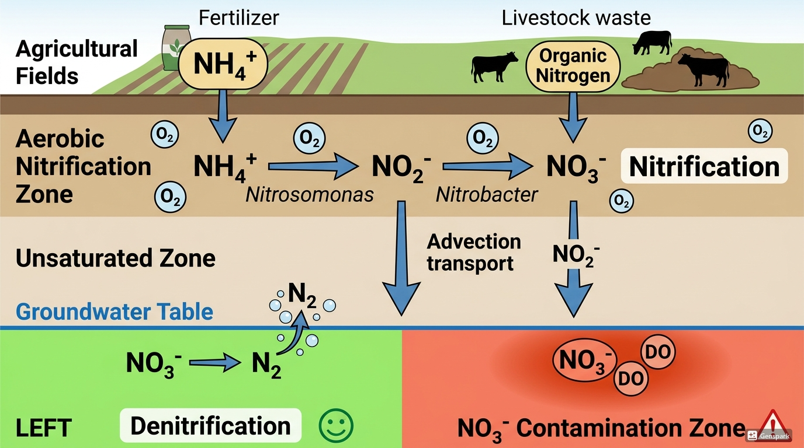
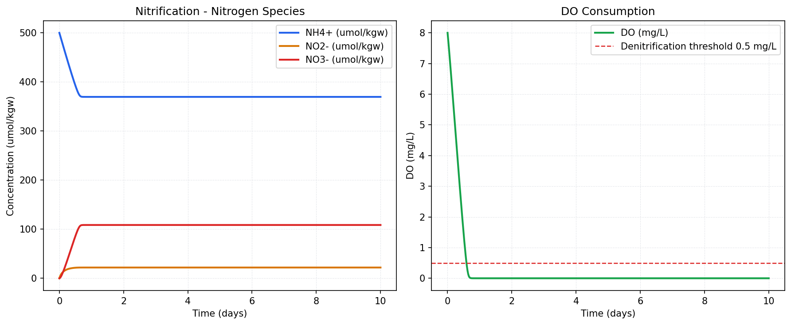
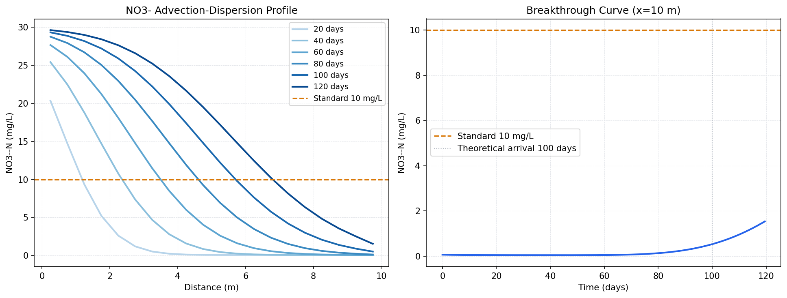
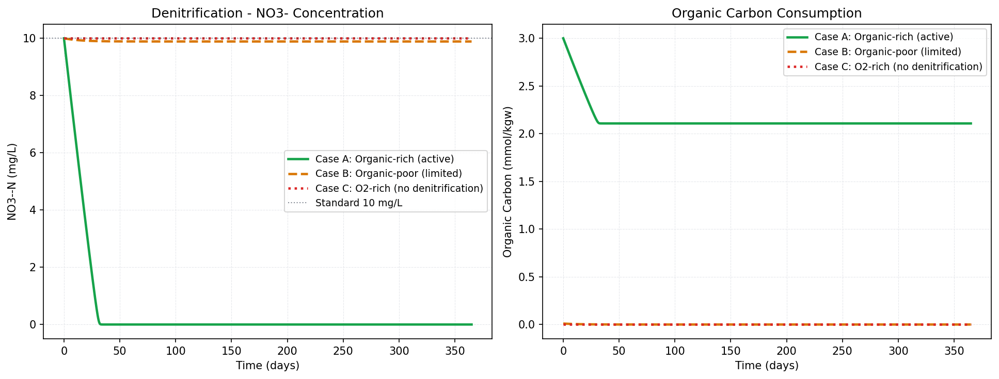
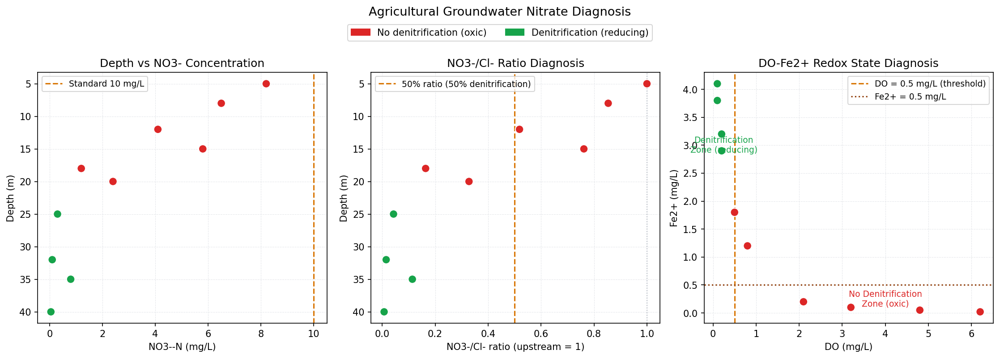
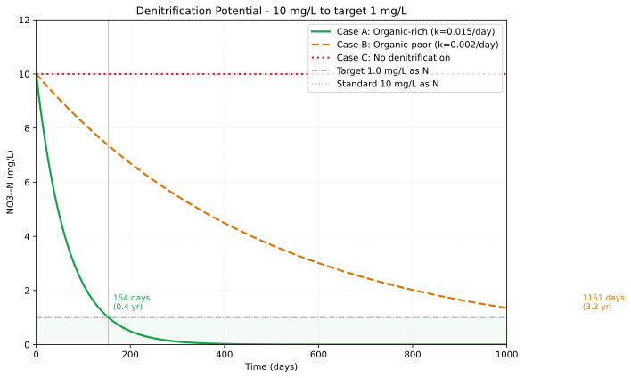

## はじめに：農業地帯の地下水はなぜ「硝酸塩だらけ」になるのか

日本の農業地帯で採取した地下水を分析すると、しばしば硝酸態窒素が **10 mg/L（環境基準値）を超える**。 なぜか。答えは土壌の中にある。

この記事では：

1.  **硝化（Nitrification）** — NH₄⁺ が NO₃⁻ に変わる過程
2.  **移動（Transport）** — NO₃⁻ が帯水層を流れる過程
3.  **脱窒（Denitrification）** — NO₃⁻ が N₂ として消える過程
4.  **診断** — 野外データから「どこで・どれだけ」脱窒しているかを評価する方法

をすべて Python で計算する。

::: callout-note
## 環境基準と換算

- 日本の地下水環境基準：**硝酸態窒素 + 亜硝酸態窒素 ≤ 10 mg/L**
- WHO 飲料水ガイドライン：**NO₃⁻-N ≤ 11.3 mg/L（= 50 mg/L as NO₃⁻）**
- 換算：10 mg/L as N = 10 / 14 × 62 = **44.3 mg/L as NO₃⁻ = 0.714 mmol/L**
:::


------------------------------------------------------------------------

## この記事で学ぶこと

本記事は、硝酸塩汚染を **「生まれる・運ばれる・消える」の三幕**として扱う。読み終えると、次のことができるようになる。

1. **土壌で硝酸が生まれる過程を、速度式で追う。** アンモニウムが硝酸に変わる速さと、それが pH に及ぼす影響を計算する。
2. **硝酸が帯水層を進む過程を、移流分散で追う。** どこまで、いつ、どのくらいの濃度で届くのかを見積もる。
3. **硝酸が消える条件を、三つのケースで比べる。** 何が律速になっているのかを、計算のうえで切り分ける。
4. **野外の水質データから、脱窒の有無と量を診断する。** 現場で採ったデータを前にして、何をどう読むかの手順を身につける。

計算そのものより難しいのは、最後の一つである。**現場のデータは、いつでも「どちらとも読める」形で現れる。** 本記事では、その曖昧さをどう詰めていくかに紙面を割いている。

------------------------------------------------------------------------

### なぜ 10 mg/L という線が引かれているのか

数字だけを見ても、それがどれくらい厳しい基準なのかは伝わってこない。基準の背景を押さえておきたい。

硝酸イオンそのものは、成人にとってそれほど強い毒性を持たない。問題が起きるのは、体内で**亜硝酸イオンに還元されたあと**である。亜硝酸はヘモグロビンの鉄を酸化してメトヘモグロビンに変え、酸素を運べなくしてしまう。**メトヘモグロビン血症**であり、乳児で唇や皮膚が青みを帯びることから「ブルーベビー症候群」の名で知られている。

乳児がとりわけ危険なのは、胃酸の酸性度が低く硝酸を亜硝酸へ還元する細菌が住みつきやすいこと、そして体重あたりの水の摂取量が大人よりはるかに多いことによる。**基準値は成人ではなく、いちばん弱い立場にある乳児を守る線として引かれている。**

ここで注意したいのは単位である。「10 mg/L」は**窒素として（as N）**の値であり、硝酸イオンそのものの重さではない。上の換算のとおり、これは硝酸イオンとして 44.3 mg/L に当たる。**同じ水を指しているのに、表記の流儀ひとつで数字が 4 倍以上違って見える。** 文献を読むとき、分析値を受け取るとき、まず「as N か as NO₃⁻ か」を確認する習慣を持ちたい。この取り違えは、実務でいまも起こり続けている。

### 単位でつまずかないために

窒素の分野は単位の流儀が多く、しかも混在したまま流通している。最低限の整理をしておきたい。

**as N か as NO₃⁻ か。** 換算係数は 62 / 14 ≈ 4.43 である。日本の環境基準は窒素として（as N）、ヨーロッパの文献や WHO のガイドライン値 50 mg/L は硝酸イオンとして（as NO₃⁻）表記されることが多い。**同じ水が 10 とも 44 とも書かれる。**

**mg/L か mmol/L か。** 化学反応を考えるときは、モルで揃える必要がある。NO₃⁻-N として 10 mg/L は 10 / 14 = 0.714 mmol/L である。本記事の計算がモルで進むのは、反応の化学量論と直結させるためである。

**meq/L（当量濃度）。** 電荷バランスを確認するときに使う。NO₃⁻ は 1 価であるから mmol/L の値がそのまま meq/L になるが、Ca²⁺ のような 2 価は 2 倍する。分析値の妥当性を最初に確かめる手段として、陽イオンと陰イオンの当量和の一致を見る習慣を持ちたい。

**「硝酸性窒素及び亜硝酸性窒素」。** 日本の基準は両者の合計で定められている。分析結果が別々に出てくる場合、足してから基準と比べる。亜硝酸は通常きわめて低い値であるが、還元的な井戸では無視できない量になることがある。

そして分析値そのものについて、ひとこと添えておきたい。**基準値のすぐ近くの値は、慎重に扱う必要がある。** 分析には誤差があり、採水の条件——井戸をどれだけ洗ってから採ったか、季節はいつか、直前に雨が降ったか——によっても値は動く。**一度の測定で 10.3 mg/L であったことは、その井戸が基準を超えていることの確定ではない。** 逆に 9.7 mg/L であったことも、安全の証明ではない。基準の近傍では、複数回・複数季節の測定で判断するのが筋である。

------------------------------------------------------------------------

### そもそも、その窒素はどこから来たのか

汚染を見つけたとき、次に問われるのは出どころである。地下水の硝酸には、主に四つの供給源がある。

**化学肥料。** 施用量が作物の吸収量を超えた分が、雨とともに下へ抜けていく。**家畜排せつ物。** 畜舎や堆肥舎の周辺で局所的に高い値が出る。**生活排水。** 下水道が未整備の地域では、浄化槽や汲み取りからの漏れが効く。**大気沈着。** 都市域や工業地帯の風下では無視できない量になることがある。

対策は供給源によってまったく違うから、**どれが効いているのかを見分ける必要がある。** 実務でよく使われる手がかりを挙げておきたい。

**塩化物イオンとの関係を見る。** Cl⁻ は地下で反応しない保守的な成分である。家畜排せつ物や生活排水は Cl⁻ も一緒に持ち込むため、NO₃⁻ と Cl⁻ がそろって高い水は人畜由来を疑う。逆に化学肥料（硫安・尿素など）由来であれば Cl⁻ はあまり増えず、NO₃⁻ だけが高くなる。

**窒素の安定同位体比（δ¹⁵N）を見る。** 化学肥料の窒素は大気窒素に近く 0‰ 前後、土壌有機物は +3〜+8‰ 程度、家畜排せつ物や下水は +10‰ を超えることが多い。おおよその目安ではあるが、供給源を絞り込む力は強い。

**ホウ素や人工甘味料を見る。** 生活排水には洗剤由来のホウ素や、分解されにくい人工甘味料が含まれる。農地由来との切り分けに使われる。

::: callout-warning
## δ¹⁵N だけで起源を判断してはいけない

同位体比には落とし穴がある。**脱窒が起きると、残った NO₃⁻ の δ¹⁵N は重くなる。** 後述するとおり、軽い ¹⁴N が優先的に N₂ になって抜けていくためである。

すなわち「δ¹⁵N が +15‰ だった」という結果は、**家畜排せつ物起源**とも読めるし、**化学肥料起源の水が途中で脱窒を受けた**とも読める。二つを取り違えれば、対策の相手を間違えることになる。

区別するには、酸素の同位体比（δ¹⁸O-NO₃⁻）を同時に測り、δ¹⁵N との二次元で見るのが定石である。起源が違えば両者は独立に動くが、脱窒による変化は δ¹⁵N と δ¹⁸O が**決まった比でそろって重くなる**。二次元の図の上で、点が斜めに並んでいれば脱窒、離れた場所に固まっていれば起源の違いと読める。
:::

------------------------------------------------------------------------

## 理論：窒素の変換反応

### 硝化（Nitrification）

好気的条件下で微生物が NH₄⁺ を酸化する 2 段階反応：

$$\text{NH}_4^+ + \frac{3}{2}\text{O}_2 \xrightarrow{\text{Nitrosomonas}} \text{NO}_2^- + \text{H}_2\text{O} + 2\text{H}^+
\quad \Delta G° = -275 \text{ kJ/mol}$$

$$\text{NO}_2^- + \frac{1}{2}\text{O}_2 \xrightarrow{\text{Nitrobacter}} \text{NO}_3^-
\quad \Delta G° = -76 \text{ kJ/mol}$$

**重要な点：** - 硝化は **H⁺ を生成する** → 土壌・地下水の pH を下げる - 硝化には **O₂ が必須** → 嫌気的な帯水層では硝化は起きない - 硝化で生成した NO₃⁻ は **負電荷を持つ** → 土壌への吸着が弱く、雨水で容易に溶脱

#### 硝化は土壌で終わるとは限らない

硝化には酸素が要る。ゆえに「硝化は土壌帯で起こり、地下水に届くころには硝酸になっている」と考えたくなるが、そうとは限らない。

浅い不圧帯水層の上部には、しばしば溶存酸素が残っている。ここにアンモニウムが直接持ち込まれれば——浄化槽の漏れや、家畜排せつ物の浸透がそれに当たる——**硝化は地下水の中で進む。**

この事実は、起源の判別に効いてくる。井戸の水にアンモニウムが検出されなかったとしても、それは**アンモニウム系の汚染源を否定する材料にはならない。** すでに硝化されて硝酸に変わっているだけかもしれないためである。前節で挙げた Cl⁻ や同位体の手がかりを併せて見るべき理由が、ここにもある。

逆に、**深部の還元的な帯水層でアンモニウムが検出された**場合には、硝化が進めなかったことを意味する。その水がどこから来たのか、どれだけ長く酸素から遮られていたのかを考える手がかりになる。

#### 硝化が酸を出すことの帰結

上の「重要な点」の一つめ——硝化は H⁺ を生成する——は、窒素だけの話にとどまらない。**農業地帯の地下水で、硝酸と一緒に他の成分まで上がってくる**ことの説明になっている。

アンモニウム 1 mol が硝酸まで酸化されると、H⁺ が 2 mol 放出される。この酸が土壌と帯水層で何を起こすかは、その土地に何があるかで決まる。

**炭酸塩があれば、それが溶ける。** 酸は石灰質の粒子を溶かし、Ca²⁺ と HCO₃⁻ を水に加える。硝酸濃度の高い井戸で硬度も一緒に高い、という組み合わせがしばしば見られるのは、このためである。**硝酸は汚染の指標であると同時に、水の主要成分を書き換える駆動力でもある。**

**炭酸塩が乏しければ、pH が下がる。** 花崗岩地帯のように緩衝する相が少ない土壌では、硝化が進むほど酸性化する。そして pH が 5 を下回りはじめると、[#8 で描いた溶解度ダイアグラム](../phreeqc-part8/)の左の壁が効いてくる。**Al³⁺ が溶け出し、作物の根を傷める。** 施肥が土壌を酸性化させ、酸性化がアルミニウム毒性を招くという連鎖である。

窒素の話をしているつもりが、いつのまにか炭酸系とアルミニウムの話になっている——地球化学ではこうした連鎖が普通に起こる。**一つの成分だけを追っていると、水の姿を見誤る。**

### 脱窒（Denitrification）

嫌気的条件下で微生物が NO₃⁻ を N₂ に還元する：

$$\text{CH}_2\text{O} + \frac{4}{5}\text{NO}_3^- + \frac{4}{5}\text{H}^+ \rightarrow \text{CO}_2 + \frac{2}{5}\text{N}_2 + \frac{7}{5}\text{H}_2\text{O}
\quad \Delta G° = -453 \text{ kJ/mol}$$

**脱窒の必要条件：**

```{=html}
<div style="display:grid; grid-template-columns:repeat(3,1fr); gap:1em; margin:1.2em 0;">
  <div style="background:#FEF2F2; border-radius:8px; padding:1em; border-top:3px solid #DC2626;">
    <div style="font-weight:700; color:#991B1B; font-size:0.92em; margin-bottom:0.4em;">❌ O₂ がない</div>
    <div style="font-size:0.83em; color:#7F1D1D; line-height:1.6;">DO &lt; 0.5 mg/L が目安。O₂ がある限り脱窒菌は O₂ を優先的に使い、NO₃⁻ を還元しない</div>
  </div>
  <div style="background:#F0FDF4; border-radius:8px; padding:1em; border-top:3px solid #16A34A;">
    <div style="font-weight:700; color:#15803D; font-size:0.92em; margin-bottom:0.4em;">✅ 有機炭素がある</div>
    <div style="font-size:0.83em; color:#166534; line-height:1.6;">電子供与体（CH₂O）が必要。DOC &gt; 0.5 mg/L が脱窒活性の目安とされる</div>
  </div>
  <div style="background:#EFF6FF; border-radius:8px; padding:1em; border-top:3px solid #2563EB;">
    <div style="font-weight:700; color:#1E3A5F; font-size:0.92em; margin-bottom:0.4em;">🦠 脱窒菌がいる</div>
    <div style="font-size:0.83em; color:#1E40AF; line-height:1.6;">Pseudomonas・Paracoccus など通性嫌気性菌。地下水にはほぼ普遍的に存在する</div>
  </div>
</div>
```

------------------------------------------------------------------------

#### 脱窒は一足飛びには進まない——N₂O という落とし穴

上の反応式は、NO₃⁻ が N₂ になるまでを一本にまとめて書いたものである。実際には四つの段階を順に踏む。

$$\mathrm{NO_3^-} \rightarrow \mathrm{NO_2^-} \rightarrow \mathrm{NO} \rightarrow \mathrm{N_2O} \rightarrow \mathrm{N_2}$$

それぞれ別の酵素が担っており、**途中で止まることがある。** とくに最後の段階——N₂O を N₂ に還元する酵素——は、条件に敏感である。pH が低い環境、酸素がわずかに残る環境、硝酸が過剰にある環境では、この段階だけが遅れやすい。結果として **N₂O が溜まり、大気へ抜けていく。**

これが軽い話ではないのは、N₂O が強力な温室効果ガスであるためである。同じ重さの二酸化炭素と比べて桁違いに大きな温室効果を持ち、しかも成層圏でオゾンを壊す側にも回る。

すなわち、**脱窒は「硝酸が消える」現象ではあっても、「窒素が無害になる」現象とは限らない。** 地下水の水質という観点では望ましい反応が、大気という別の観点では負債を生んでいる場合がある。

本記事の計算では、この中間段階を省いて NO₃⁻ から N₂ への一段反応として扱っている。地下水中の硝酸がどう減るかを追う目的にはこれで足りるが、**窒素の行き先まで含めて評価したい場合には、この省略が効いてくる**ことを覚えておきたい。現場では、溶存ガスとして N₂ と N₂O の両方を測ることで、どこまで進んだ脱窒なのかを判別する。

------------------------------------------------------------------------

## Step 1：硝化のシミュレーション

### 設定

NH₄⁺ が好気的に酸化される過程を Monod 式で記述し、 `scipy.integrate.solve_ivp` で数値積分する。

``` python
# ============================================================
#  Step1：硝化（Nitrification）
#  NH₄⁺ → NO₂⁻ → NO₃⁻  Monod 動力学
# ============================================================
import numpy as np
import matplotlib.pyplot as plt
from scipy.integrate import solve_ivp

plt.rcParams.update({
    "font.family":     "sans-serif",
    "font.sans-serif": ["Noto Sans CJK JP", "IPAexGothic", "DejaVu Sans"],
    "axes.unicode_minus": False,
    "figure.dpi":      150,
})

# ---- パラメータ ----
rmax1  = 3e-9   # NH₄⁺→NO₂⁻ 最大速度 (mol/kgw/s)
Ks_NH4 = 5e-5   # NH₄⁺ 半飽和定数 (mol/kgw)
rmax2  = 5e-9   # NO₂⁻→NO₃⁻ 最大速度 (mol/kgw/s)
Ks_NO2 = 2e-5   # NO₂⁻ 半飽和定数 (mol/kgw)
Ks_O2  = 1e-5   # O₂ 半飽和定数 (mol/kgw)

# ---- 初期濃度 (mol/kgw) ----
NH4_0 = 5.0e-4   # NH₄⁺ 0.5 mmol/kg（施肥由来）
NO2_0 = 0.0
NO3_0 = 0.0
O2_0  = 2.5e-4   # DO ≈ 8 mg/L

# ---- ODE 定義 ----
def nitrification(t, y):
    NH4, NO2, NO3, O2 = y
    NH4 = max(NH4, 0); NO2 = max(NO2, 0); O2 = max(O2, 0)

    # 硝化 step1: NH₄⁺ → NO₂⁻
    r1 = rmax1 * NH4 / (Ks_NH4 + NH4) * O2 / (Ks_O2 + O2)
    # 硝化 step2: NO₂⁻ → NO₃⁻
    r2 = rmax2 * NO2 / (Ks_NO2 + NO2) * O2 / (Ks_O2 + O2)

    dNH4 = -r1
    dNO2 =  r1 - r2
    dNO3 =  r2
    dO2  = -1.5 * r1 - 0.5 * r2   # 化学量論

    return [dNH4, dNO2, dNO3, dO2]

t_span = (0, 10 * 86400)   # 10日間（秒）
t_eval = np.linspace(0, 10 * 86400, 500)
sol = solve_ivp(nitrification, t_span,
                [NH4_0, NO2_0, NO3_0, O2_0],
                t_eval=t_eval, method="RK45",
                rtol=1e-8, atol=1e-12)

t_day = sol.t / 86400
NH4   = sol.y[0] * 1e6   # → μmol/kgw
NO2   = sol.y[1] * 1e6
NO3   = sol.y[2] * 1e6
O2_mg = sol.y[3] * 32000  # → mg/L

# ---- Plot ----
fig, axes = plt.subplots(1, 2, figsize=(12, 5))

ax = axes[0]
ax.plot(t_day, NH4, color="#2563EB", lw=2,   label="NH₄⁺ (μmol/kgw)")
ax.plot(t_day, NO2, color="#D97706", lw=2,   label="NO₂⁻ (μmol/kgw)")
ax.plot(t_day, NO3, color="#DC2626", lw=2,   label="NO₃⁻ (μmol/kgw)")
ax.set(xlabel="Time (days)", ylabel="Concentration (μmol/kgw)",
       title="Nitrification — Nitrogen Species")
ax.legend(); ax.grid(True, ls="--", lw=0.5, color="#E5E7EB")

ax = axes[1]
ax.plot(t_day, O2_mg, color="#16A34A", lw=2, label="DO (mg/L)")
ax.axhline(0.5, color="#DC2626", lw=1.2, ls="--", label="Denitrification threshold 0.5 mg/L")
ax.set(xlabel="Time (days)", ylabel="DO (mg/L)",
       title="DO Consumption")
ax.legend(); ax.grid(True, ls="--", lw=0.5, color="#E5E7EB")

plt.tight_layout()
plt.savefig("Figure_1.png", dpi=150, bbox_inches="tight")
plt.show()

# Numerical check
print(f"Day 10 NH₄⁺: {NH4[-1]:.2f} μmol/kgw")
print(f"Day 10 NO₃⁻: {NO3[-1]:.2f} μmol/kgw")
print(f"Day 10 DO:    {O2_mg[-1]:.2f} mg/L")
```



### Figure 1：硝化シミュレーション

**左図（窒素形態の変化）**

- NH₄⁺（青）が最初の約0.5日で急激に減少し、その後 370 μmol/kgw 付近で横ばいになっています。NH₄⁺が完全に消費されず残っているのは、**DOが枯渇して硝化が止まった**ためです。

- NO₃⁻（赤）が約110 μmol/kgw まで増加して停止。初期NH₄⁺の約22%しかNO₃⁻に変換されていません。

- NO₂⁻（橙）は中間体として少量蓄積し、ほぼ横ばいです。

**右図（DOの消費）**

- DOが0.5日以内に 8 mg/L → ほぼ0 mg/L に急落しています。

- **DO が先に枯渇したため硝化が途中で止まった**という構造がよく見えます。実際の土壌では空気からO₂が補給されますが、このシミュレーションはクローズドシステムなので当然の結果です。

------------------------------------------------------------------------

## Step 2：NO₃⁻ の移流 — 地下水面への到達

硝化で生成した NO₃⁻ が不飽和帯を通過して地下水面に到達するまでの 移流分散を 1次元移流分散方程式（ADE）で計算する。

``` python
# ============================================================
#  Step2：NO₃⁻ の移流分散（1D ADE）
#  有限差分法（陰解法）
# ============================================================
import numpy as np
import matplotlib.pyplot as plt
import matplotlib.cm as cm

plt.rcParams.update({
    "font.family":     "sans-serif",
    "font.sans-serif": ["Noto Sans CJK JP", "IPAexGothic", "DejaVu Sans"],
    "axes.unicode_minus": False,
    "figure.dpi":      150,
})

# ---- グリッド設定 ----
L      = 10.0    # カラム長 (m)
n_cell = 20      # セル数
dx     = L / n_cell
x      = np.linspace(dx/2, L - dx/2, n_cell)  # セル中心

# ---- 流れパラメータ ----
v     = 0.1      # 平均流速 (m/day)
alpha = 0.5      # 分散長 (m)
D     = alpha * v  # 分散係数 (m²/day)
dt    = 0.5      # 時間ステップ (day)
n_steps = 240    # 総ステップ数 → 120日

# ---- 初期・境界条件 ----
C0_in  = 10.0    # 注入水 NO₃⁻-N (mg/L)
C_init = 0.07    # 初期帯水層濃度 (mg/L)
C = np.ones(n_cell) * C_init

# ---- 陰解法（Crank-Nicolson）の係数行列 ----
r = D * dt / dx**2
Pe_cell = v * dx / D
theta = 0.5   # Crank-Nicolson

def build_matrix(n, r, v, dx, dt, theta):
    """移流分散の係数行列を構築（中央差分）"""
    A = np.zeros((n, n))
    adv = v * dt / (2 * dx)
    for i in range(n):
        A[i, i] = 1 + 2 * theta * r
        if i > 0:
            A[i, i-1] = -theta * r + theta * adv
        if i < n - 1:
            A[i, i+1] = -theta * r - theta * adv
    return A

A = build_matrix(n_cell, r, v, dx, dt, theta)

# ---- 時間積分 ----
snap_times = [20, 40, 60, 80, 100, 120]   # スナップショット（日）
snaps = {}

for step in range(n_steps):
    t = step * dt
    if any(abs(t - ts) < dt/2 for ts in snap_times):
        snaps[round(t)] = C.copy()

    # 右辺ベクトル（陽的部分）
    b = C.copy()
    b[0] += (r - v*dt/(2*dx)) * C0_in  # 上流境界

    # 境界条件（上流フラックス）
    A_mod = A.copy()
    A_mod[0, 0] = 1 + theta * r + theta * v*dt/dx
    if n_cell > 1:
        A_mod[0, 1] = -theta * r

    C = np.linalg.solve(A_mod, b)
    C = np.maximum(C, 0)

snaps[120] = C.copy()

# ---- Plot ----
fig, axes = plt.subplots(1, 2, figsize=(13, 5))

ax = axes[0]
colors = cm.Blues(np.linspace(0.3, 0.9, len(snaps)))
for (t_snap, c_snap), col in zip(sorted(snaps.items()), colors):
    ax.plot(x, c_snap, color=col, lw=2, label=f"{t_snap} days")
ax.axhline(10, color="#D97706", lw=1.5, ls="--", label="Standard 10 mg/L")
ax.set(xlabel="Distance (m)", ylabel="NO₃⁻-N (mg/L)",
       title="NO₃⁻ Advection-Dispersion Profile")
ax.legend(fontsize=9); ax.grid(True, ls="--", lw=0.5, color="#E5E7EB")

ax = axes[1]
# Breakthrough curve at outlet
C_outlet = []
C2 = np.ones(n_cell) * C_init
for step in range(n_steps):
    b = C2.copy()
    b[0] += (r - v*dt/(2*dx)) * C0_in
    A_mod2 = A.copy()
    A_mod2[0, 0] = 1 + theta * r + theta * v*dt/dx
    if n_cell > 1:
        A_mod2[0, 1] = -theta * r
    C2 = np.linalg.solve(A_mod2, b)
    C2 = np.maximum(C2, 0)
    C_outlet.append(C2[-1])

t_all = np.arange(n_steps) * dt
ax.plot(t_all, C_outlet, color="#2563EB", lw=2)
ax.axhline(10, color="#D97706", lw=1.5, ls="--", label="Standard 10 mg/L")
ax.axvline(100, color="#9CA3AF", lw=1, ls=":", alpha=0.7, label="Theoretical arrival 100 days")
ax.set(xlabel="Time (days)", ylabel="NO₃⁻-N (mg/L)",
       title="Breakthrough Curve (x=10 m)")
ax.legend(); ax.grid(True, ls="--", lw=0.5, color="#E5E7EB")

plt.tight_layout()
plt.savefig("Figure_2.png", dpi=150, bbox_inches="tight")
plt.show()
print("✅ Figure_2.png saved")
```



### Figure 2：NO₃⁻の移流分散

### 左図：移流分散プロファイル（空間）

時間とともに汚染フロントが下流へ押し流されていく様子が見えています。

- **x=0付近が常に10 mg/L**：上流境界から継続的にNO₃⁻が注入されているため、注入点は常に飽和状態です。

- **フロントが右へ移動**：20日→40日→…と時間が経つほど汚染が下流に広がっています。移動速度はほぼ v=0.1 m/day に対応しており、100日で約10m という理論値と一致します。

- **曲線がS字ではなくなだらかに傾斜**：分散（α=0.5m）の影響でフロントがぼやけています。分散長が大きいほどこの傾きが緩やかになります。

### 右図：破過曲線（出口 x=10m）

- **100日まで濃度がほぼ0**：汚染フロントがまだ出口に届いていない段階で、理論到達時間（点線）の100日までは予想通り低い値が続きます。

- **100日以降から上昇開始**：フロントが出口に到達し始め、濃度が急激に上がり始めています。120日時点でまだ約2.7 mg/Lで、**S字カーブの立ち上がり部分**にあたります。

- **まだ10 mg/Lに達していない**：分散の影響でフロントが分散しているため、理論到達時間より少し遅れて濃度が上昇しています。計算期間を200〜300日まで延ばすと最終的に10 mg/Lに収束するS字が完成します。

------------------------------------------------------------------------

### 硝酸が厄介である理由——遅れずに、そのまま届く

移流分散の計算を見て、あらためて確認しておきたいことがある。**なぜ硝酸は、これほど遠くまで届いてしまうのか。**

地下水に溶けた成分が動く速さは、水そのものの速さと同じとは限らない。多くの陽イオンや有機汚染物質は、土粒子の表面に吸着したり離れたりを繰り返しながら進むため、水より遅れて動く。この遅れの度合いを **遅延係数（retardation factor）** と呼び、値が 5 であれば水の 5 分の 1 の速さでしか進まないことを意味する。

ところが硝酸イオンは違う。**負の電荷を持つイオン**であり、同じく負に帯電していることの多い土粒子の表面には引きつけられない。ゆえに吸着がほとんど起こらず、遅延係数はおおむね 1 に近い。**硝酸は、水と同じ速さで、薄まりこそすれ遅れることなく届く。**

理論の節で触れた「NO₃⁻ は土壌への吸着が弱く、雨水で容易に溶脱する」という一文は、ここで効いてくる。同じ量が撒かれたとしても、吸着される成分であれば地表付近に留まって時間を稼げる。硝酸にはその猶予がない。**対策を土壌の側で打たなければならない**理由が、この一点にある。

そしてもう一つ、分散について注意しておきたい。計算に入れた分散長は、実験室のカラムで測った値をそのまま野外へ持ち込むことができない量である。**観測するスケールが大きくなるほど、見かけの分散長も大きくなる**ことが知られている。地層の不均質性が、スケールに応じて次々と現れてくるためである。数メートルの実験で得た値で数キロメートルの移動を計算すると、広がり方を大きく過小評価する。**分散長は物質の性質ではなく、対象とするスケールの性質である**と考えたい。

------------------------------------------------------------------------

## Step 3：脱窒のシミュレーション — NO₃⁻ が消える条件

有機炭素を含む還元的な帯水層に NO₃⁻ 汚染水が侵入する場合。 脱窒が起きる条件・起きない条件を Monod 式で比較する。

``` python
# ============================================================
#  Step3：脱窒（Denitrification）
#  有機炭素あり vs なし の比較
# ============================================================
import numpy as np
import matplotlib.pyplot as plt
from scipy.integrate import solve_ivp

plt.rcParams.update({
    "font.family":     "sans-serif",
    "font.sans-serif": ["Noto Sans CJK JP", "IPAexGothic", "DejaVu Sans"],
    "axes.unicode_minus": False,
    "figure.dpi":      150,
})

# ---- 動力学パラメータ ----
rmax   = 2e-9    # 最大脱窒速度 (mol NO₃⁻/kgw/s)
Ks_NO3 = 1e-5    # NO₃⁻ 半飽和定数 (mol/kgw)
Ks_C   = 5e-4    # 有機炭素 半飽和定数 (mol/kgw)
Ki_O2  = 1e-5    # O₂ 阻害定数 (mol/kgw)

def denitrification_ode(t, y, C_org_0):
    NO3, O2, Corg = y
    NO3 = max(NO3, 0); O2 = max(O2, 0); Corg = max(Corg, 0)

    # O₂ による阻害項（O₂ が多いと脱窒が抑制される）
    inhibit_O2 = Ki_O2 / (Ki_O2 + O2)
    rate = (rmax
            * NO3  / (Ks_NO3 + NO3)
            * Corg / (Ks_C   + Corg)
            * inhibit_O2)

    dNO3  = -rate
    dO2   = 0.0   # 嫌気的なので O₂ は変化しない（初期値が低い）
    dCorg = -rate * (5/4)  # 化学量論比（CH₂O 消費）
    return [dNO3, dO2, dCorg]

t_span = (0, 365 * 86400)   # 1年
t_eval = np.linspace(0, 365 * 86400, 800)

# 初期溶液（共通）
NO3_0 = 7.14e-4   # NO₃⁻ 10 mg/L as N

# ケース A：有機炭素あり・DO 低
cases = {
    "Case A: Organic-rich (active)": {
        "y0":   [NO3_0, 5e-5, 3e-3],   # NO3, O2, Corg
        "color": "#16A34A", "ls": "-",
    },
    "Case B: Organic-poor (limited)": {
        "y0":   [NO3_0, 5e-5, 1e-5],
        "color": "#D97706", "ls": "--",
    },
    "Case C: O\u2082-rich (no denitrification)": {
        "y0":   [NO3_0, 2e-4, 0.0],
        "color": "#DC2626", "ls": ":",
    },
}

fig, axes = plt.subplots(1, 2, figsize=(13, 5))

for label, cfg in cases.items():
    sol = solve_ivp(
        lambda t, y: denitrification_ode(t, y, cfg["y0"][2]),
        t_span, cfg["y0"],
        t_eval=t_eval, method="RK45", rtol=1e-8, atol=1e-12
    )
    t_day = sol.t / 86400
    NO3_mgN = sol.y[0] * 14000   # mol/kgw → mg/L as N
    Corg_mM = sol.y[2] * 1000    # mol/kgw → mmol/kgw

    axes[0].plot(t_day, NO3_mgN,
                 color=cfg["color"], lw=2.2, ls=cfg["ls"], label=label)
    axes[1].plot(t_day, Corg_mM,
                 color=cfg["color"], lw=2.2, ls=cfg["ls"], label=label)

axes[0].axhline(10, color="#374151", lw=1, ls=":", alpha=0.6,
                label="Standard 10 mg/L")
axes[0].set(xlabel="Time (days)", ylabel="NO₃⁻-N (mg/L)",
            title="Denitrification — NO₃⁻ Concentration")
axes[0].legend(fontsize=9); axes[0].grid(True, ls="--", lw=0.5, color="#E5E7EB")

axes[1].set(xlabel="Time (days)", ylabel="Organic Carbon (mmol/kgw)",
            title="Organic Carbon Consumption")
axes[1].legend(fontsize=9); axes[1].grid(True, ls="--", lw=0.5, color="#E5E7EB")

plt.tight_layout()
plt.savefig("Figure_3.png", dpi=150, bbox_inches="tight")
plt.show()
print("✅ Figure_3.png saved")
```



### Figure 3：脱窒シミュレーション

### 左図：NO₃⁻ 濃度変化

**ケースA（緑・実線）** 約30日でNO₃⁻がほぼ0に到達しています。有機炭素が豊富で DO が低い嫌気的環境では、脱窒が非常に効率よく進むことが再現できています。

**ケースB（橙・破線）とケースC（赤・点線）** 両方とも365日間ほぼ10 mg/Lで横ばいです。理由は異なります。

- ケースB：DOは低いが**有機炭素が律速**。電子供与体がないので脱窒菌が反応できない

- ケースC：有機炭素はゼロで**好気環境**。そもそも脱窒の基質も条件も揃っていない

### 右図：有機炭素の消費

**ケースA（緑）** 3.0 mmol から約2.1 mmol まで急減して安定します。消費量は約0.9 mmol で、これはNO₃⁻の消費量（0.714×10⁻³ mol × 5/4 の化学量論）と一致しており、**質量バランスが正しく取れています**。

**ケースBとC（橙・赤）** 完全に0付近で横ばい。ケースBは初期量が極少（1e-5 mol）、ケースCは初期値ゼロなので当然の結果です。

### 3ケースの比較まとめ

| ケース | 律速要因         | 脱窒       | 物理的意味                 |
|--------|------------------|------------|----------------------------|
| A      | なし             | 完全に進む | 嫌気的帯水層・有機炭素豊富 |
| B      | 有機炭素不足     | 起きない   | 嫌気的だが有機炭素が枯渇   |
| C      | O₂過剰＋炭素なし | 起きない   | 好気的環境（表層地下水）   |

### 有機炭素がなくても脱窒は起きる——硫黄脱窒という抜け道

ケース B の結論は「嫌気的であるが、有機炭素がないので脱窒しない」であった。計算としては正しい。ところが現場では、**有機炭素がほとんど無いのに硝酸が消えている帯水層**にしばしば出会う。

答えは、電子供与体が有機物である必要はない、という点にある。**黄鉄鉱（FeS₂）が、その役を務める。**

$$5\,\mathrm{FeS_2} + 14\,\mathrm{NO_3^-} + 4\,\mathrm{H^+} \rightarrow 7\,\mathrm{N_2} + 10\,\mathrm{SO_4^{2-}} + 5\,\mathrm{Fe^{2+}} + 2\,\mathrm{H_2O}$$

[#6 で扱った黄鉄鉱の酸化](../phreeqc-part6/)では、酸化剤は酸素であった。ここではその役を硝酸が引き受けている。有機物を使わないことから **独立栄養脱窒（autotrophic denitrification）** と呼ばれ、*Thiobacillus denitrificans* に代表される細菌が担うとされる。

この経路が効いているかどうかは、水質から見分けられる。鍵になるのは **硫酸イオン**である。

- **硝酸が減った分だけ SO₄²⁻ が増える。** 上の式では NO₃⁻ 14 mol に対して SO₄²⁻ が 10 mol 生じる
- **Fe²⁺ が溶存する。** 還元的環境の指標であると同時に、この反応そのものの生成物でもある
- **有機炭素（DOC）は減らない。** 有機物を使っていないのであるから、当然である

すなわち「DOC が低いにもかかわらず硝酸が下流で減っており、しかも硫酸が増えている」という組み合わせを見たら、硫黄脱窒を疑いたい。有機炭素だけを見て「ここでは脱窒しない」と結論すると、**帯水層が実際に持っている浄化能力を過小評価する**ことになる。

ただし、ただで手に入る浄化ではない。黄鉄鉱は有限であり、使い切れば脱窒は止まる。しかも副産物として硫酸と鉄が水に加わる。**硝酸が消える代わりに、硫酸濃度と鉄濃度が上がる**——水質の問題を別の問題に置き換えている面がある。飲用に使う井戸であれば、この点も併せて評価する必要がある。

------------------------------------------------------------------------

### 脱窒が「起きているか」の判断指標

野外で採水した水質データを見るだけで、脱窒の有無をある程度診断できる：

```{=html}
<div style="overflow-x:auto; margin:1.5em 0;">
<table style="width:100%; border-collapse:collapse; font-size:0.88em;">
  <thead>
    <tr style="background:#D97706; color:white;">
      <th style="padding:10px 13px; text-align:left;">指標</th>
      <th style="padding:10px 13px; text-align:center;">脱窒あり</th>
      <th style="padding:10px 13px; text-align:center;">脱窒なし</th>
      <th style="padding:10px 13px; text-align:left;">理由</th>
    </tr>
  </thead>
  <tbody>
    <tr style="background:#FFF7ED;">
      <td style="padding:9px 13px; font-weight:600;">DO（溶存酸素）</td>
      <td style="padding:9px 13px; text-align:center; color:#16A34A; font-weight:600;">&lt; 0.5 mg/L</td>
      <td style="padding:9px 13px; text-align:center; color:#DC2626;">&gt; 1 mg/L</td>
      <td style="padding:9px 13px; font-size:0.88em;">O₂ があると脱窒が抑制される</td>
    </tr>
    <tr style="background:#FDFDFD;">
      <td style="padding:9px 13px; font-weight:600;">Fe²⁺</td>
      <td style="padding:9px 13px; text-align:center; color:#16A34A; font-weight:600;">&gt; 0.1 mg/L</td>
      <td style="padding:9px 13px; text-align:center; color:#DC2626;">検出なし</td>
      <td style="padding:9px 13px; font-size:0.88em;">Fe²⁺ が溶存 = 還元的環境 = 脱窒条件</td>
    </tr>
    <tr style="background:#FFF7ED;">
      <td style="padding:9px 13px; font-weight:600;">NO₃⁻/Cl⁻ 比</td>
      <td style="padding:9px 13px; text-align:center; color:#16A34A; font-weight:600;">上流より低下</td>
      <td style="padding:9px 13px; text-align:center; color:#DC2626;">Cl⁻ と同じ比率</td>
      <td style="padding:9px 13px; font-size:0.88em;">Cl⁻ は保守的（反応しない）。比が下がれば NO₃⁻ が消費されている</td>
    </tr>
    <tr style="background:#FDFDFD;">
      <td style="padding:9px 13px; font-weight:600;">過剰 N₂（excess N₂）</td>
      <td style="padding:9px 13px; text-align:center; color:#16A34A; font-weight:600;">検出あり</td>
      <td style="padding:9px 13px; text-align:center; color:#DC2626;">温度補正後ゼロ</td>
      <td style="padding:9px 13px; font-size:0.88em;">脱窒で生成した N₂ は大気溶存量を超える excess N₂ として検出できる</td>
    </tr>
    <tr style="background:#FFF7ED;">
      <td style="padding:9px 13px; font-weight:600;">δ¹⁵N-NO₃⁻</td>
      <td style="padding:9px 13px; text-align:center; color:#16A34A; font-weight:600;">重くなる（+10〜+30‰）</td>
      <td style="padding:9px 13px; text-align:center; color:#DC2626;">施肥由来（0〜+5‰）</td>
      <td style="padding:9px 13px; font-size:0.88em;">脱窒で軽い ¹⁴N が優先的に N₂ になり、残った NO₃⁻ の δ¹⁵N が重くなる</td>
    </tr>
    <tr style="background:#FDFDFD;">
      <td style="padding:9px 13px; font-weight:600;">HCO₃⁻ の増加</td>
      <td style="padding:9px 13px; text-align:center; color:#16A34A; font-weight:600;">上流より増加</td>
      <td style="padding:9px 13px; text-align:center; color:#DC2626;">変化なし</td>
      <td style="padding:9px 13px; font-size:0.88em;">脱窒で CO₂ が生成 → HCO₃⁻ 増加。炭酸塩溶解と区別が必要</td>
    </tr>
  </tbody>
</table>
</div>
```

### 硝酸が消えても、窒素が消えたとは限らない

ここまで「硝酸が減った」ことを脱窒の証拠として扱ってきた。ただし、硝酸が減る道は一本ではない。診断の前に、競合する経路を押さえておきたい。

**DNRA（異化的硝酸還元によるアンモニア生成）** という経路がある。硝酸が N₂ にならず、**アンモニウムイオンに戻る**反応である。脱窒と同じく嫌気的条件で起こるが、行き先がまるで違う。

$$\mathrm{NO_3^-} \rightarrow \mathrm{NO_2^-} \rightarrow \mathrm{NH_4^+}$$

脱窒であれば窒素は N₂ として系外へ抜けるが、DNRA では**窒素が系内に留まる。** しかも生じたアンモニウムは正の電荷を持つため土粒子に吸着され、条件が変われば再び硝化されて硝酸に戻る。**浄化ではなく、一時的な保留である。**

どちらが優勢になるかは環境で決まる。硫化物が多く、硝酸に対して電子供与体が過剰にある環境——すなわち強く還元的で有機物に富む場所——では DNRA が有利になるとされる。逆に硝酸が豊富で電子供与体が限られる環境では脱窒が優勢になる。

診断上の含意は明快である。**硝酸が減っていることに加えて、アンモニウムが増えていないかを確かめる。** NO₃⁻ が下流で減り、しかも NH₄⁺ が上流より高ければ、DNRA を疑う。この場合、帯水層は汚染を消しているのではなく、**形を変えて抱え込んでいる**ことになる。

このほか、**植物や微生物に取り込まれて有機態窒素になる**経路、**単純な希釈**による見かけの低下もある。次の診断コードで NO₃⁻/Cl⁻ 比を使うのは、まさにこの希釈を除くためである。Cl⁻ は反応しないから、希釈であれば NO₃⁻ と Cl⁻ が同じ割合で下がる。**比が下がったときにだけ、反応で消えたと言える。**

------------------------------------------------------------------------

### 診断コード：NO₃⁻/Cl⁻ 比による脱窒定量

``` python
# ============================================================
#  Step4：野外データからの脱窒量推定
#  NO₃⁻/Cl⁻ 比 + 逆算による脱窒量定量
# ============================================================
import pandas as pd
import numpy as np
import matplotlib.pyplot as plt

plt.rcParams.update({
    "font.family":     "sans-serif",
    "font.sans-serif": ["Noto Sans CJK JP", "IPAexGothic", "DejaVu Sans"],
    "axes.unicode_minus": False,
    "figure.dpi":      150,
})

# ---- サンプルデータ（野外データを想定） ----
wells = pd.DataFrame({
    "well_id": ["W01", "W02", "W03", "W04", "W05",
                "W06", "W07", "W08", "W09", "W10"],
    "depth_m":  [5, 8, 12, 18, 25, 32, 40, 15, 20, 35],
    "NO3_mgN":  [8.2, 6.5, 4.1, 1.2, 0.3, 0.1, 0.05, 5.8, 2.4, 0.8],
    "Cl_mg":    [28, 26, 27, 25, 24, 23, 24, 26, 25, 24],
    "DO_mg":    [6.2, 4.8, 2.1, 0.5, 0.2, 0.1, 0.1, 3.2, 0.8, 0.2],
    "Fe_mg":    [0.02, 0.05, 0.2, 1.8, 3.2, 4.1, 3.8, 0.1, 1.2, 2.9],
    "HCO3_mg":  [145, 152, 168, 195, 218, 230, 225, 160, 190, 220],
})

# NO₃⁻/Cl⁻ 比（mol/mol）
wells["NO3_mol"] = wells["NO3_mgN"] / 14
wells["Cl_mol"]  = wells["Cl_mg"]  / 35.5
wells["NO3_Cl_ratio"] = wells["NO3_mol"] / wells["Cl_mol"]

# 上流端（最浅井戸）を基準に正規化
ref_idx = wells["depth_m"].idxmin()
ref_ratio = wells.loc[ref_idx, "NO3_Cl_ratio"]
wells["ratio_normalized"] = wells["NO3_Cl_ratio"] / ref_ratio

# 保守的トレーサー補正による推定脱窒量
# 脱窒量 = (NO3_ref × Cl_ratio_normalized - NO3_obs) × 希釈補正
ref_NO3 = wells.loc[ref_idx, "NO3_mgN"]
wells["Cl_ratio"] = wells["Cl_mol"] / wells.loc[ref_idx, "Cl_mol"]
wells["NO3_expected"] = ref_NO3 * wells["Cl_ratio"]  # 脱窒なしの場合の期待値
wells["denitri_mgN"] = (wells["NO3_expected"] - wells["NO3_mgN"]).clip(lower=0)

# 脱窒の有無を判定
wells["denitrification"] = (wells["DO_mg"] < 0.5) & (wells["Fe_mg"] > 0.5)
colors = ["#16A34A" if d else "#DC2626" for d in wells["denitrification"]]

fig, axes = plt.subplots(1, 3, figsize=(15, 5))

# ---- Depth vs NO₃⁻ ----
ax = axes[0]
ax.scatter(wells["NO3_mgN"], wells["depth_m"],
           c=colors, s=80, edgecolors="white", zorder=3)
ax.axvline(10, color="#D97706", lw=1.5, ls="--", label="Standard 10 mg/L")
ax.set(xlabel="NO₃⁻-N (mg/L)", ylabel="Depth (m)",
       title="Depth vs NO₃⁻ Concentration")
ax.invert_yaxis(); ax.legend(fontsize=9)
ax.grid(True, ls="--", lw=0.5, color="#E5E7EB")

# ---- NO₃⁻/Cl⁻ ratio vs Depth ----
ax = axes[1]
ax.scatter(wells["ratio_normalized"], wells["depth_m"],
           c=colors, s=80, edgecolors="white", zorder=3)
ax.axvline(1.0, color="#9CA3AF", lw=1, ls=":", alpha=0.7)
ax.axvline(0.5, color="#D97706", lw=1.5, ls="--",
           label="50% ratio (50% denitrification)")
ax.set(xlabel="NO₃⁻/Cl⁻ ratio (upstream = 1)", ylabel="Depth (m)",
       title="NO₃⁻/Cl⁻ Ratio Diagnosis")
ax.invert_yaxis(); ax.legend(fontsize=9)
ax.grid(True, ls="--", lw=0.5, color="#E5E7EB")

# ---- DO vs Fe²⁺ (redox indicator) ----
ax = axes[2]
ax.scatter(wells["DO_mg"], wells["Fe_mg"],
           c=colors, s=80, edgecolors="white", zorder=3)
ax.axvline(0.5, color="#D97706", lw=1.5, ls="--",
           label="DO = 0.5 mg/L (threshold)")
ax.axhline(0.5, color="#92400E", lw=1.5, ls=":",
           label="Fe²⁺ = 0.5 mg/L")
ax.text(0.25, 3.0, "Denitrification\nZone (reducing)",
        color="#16A34A", fontsize=9, ha="center", va="center")
ax.text(4.0, 0.25, "No Denitrification\nZone (oxic)",
        color="#DC2626", fontsize=9, ha="center", va="center")
ax.set(xlabel="DO (mg/L)", ylabel="Fe²⁺ (mg/L)",
       title="DO–Fe²⁺ Redox State Diagnosis")
ax.legend(fontsize=9); ax.grid(True, ls="--", lw=0.5, color="#E5E7EB")

from matplotlib.patches import Patch
legend_els = [Patch(color="#DC2626", label="No denitrification (oxic)"),
              Patch(color="#16A34A", label="Denitrification (reducing)")]
fig.legend(handles=legend_els, loc="upper center",
           bbox_to_anchor=(0.5, 1.02), ncol=2, fontsize=10)

plt.suptitle("Agricultural Groundwater Nitrate Diagnosis",
             fontsize=13, y=1.06)
plt.tight_layout()
plt.savefig("Figure_4.png", dpi=150, bbox_inches="tight")
plt.show()
print("✅ Figure_4.png saved")

# ---- 脱窒量の表示 ----
print("\n--- Cl⁻ 補正による推定脱窒量 ---")
print(wells[["well_id", "depth_m", "NO3_mgN",
             "NO3_expected", "denitri_mgN",
             "denitrification"]].to_string(index=False))
```



### Figure 4：野外データ診断

**左図（深度 vs NO₃⁻）**

- 浅い井戸（赤・好気的）ほどNO₃⁻が高く、深い井戸（緑・還元的）ではNO₃⁻がほぼ0です。**深度とともに酸化還元状態が変化し、脱窒が進む**という典型的なパターンが再現されています。

**中図（NO₃⁻/Cl⁻比）**

- 浅い井戸では比率が1.0（上流と同じ）ですが、深い井戸では0.2以下に低下しています。**Cl⁻は保守的なので比率の低下＝NO₃⁻の消費＝脱窒の証拠**という診断が明確に出ています。

**右図（DO–Fe²⁺図）**

- DO \< 0.5 mg/L かつ Fe²⁺ \> 0.5 mg/L の左上ゾーンに緑点が集まり、右下の好気的ゾーンに赤点が集まっています。**2つの指標が矛盾なく脱窒の有無を分離**できており、診断ロジックが正常に機能しています。

**左図と中図は、なぜ見た目が似てしまうのか**

NO₃⁻/Cl⁻ 比は「NO₃⁻ ÷ Cl⁻（上流の比で正規化）」なので、**Cl⁻濃度が全サンプルでほぼ一定なら、割り算しても順番も形も変わらない**のです。

```         
Cl⁻ がほぼ一定 ≈ C（定数）の場合：    

NO₃⁻ / Cl⁻  ∝  NO₃⁻    

→ x 軸の数値のスケールは変わるが、     
各点の左右の並び順は変わらない
```

つまり：

- 赤い点（脱窒なし）は左グラフで右側にある → 中グラフでも右側にある

- 緑の点（脱窒あり）は左グラフで左側（0付近）にある → 中グラフでも左側にある

**形がほぼ鏡写しになるのは、*Cl⁻が空間的*に均一な農業地帯の地下水の仮定であるためです**。

------------------------------------------------------------------------

## Step 5：脱窒ポテンシャルの試算 — あと何年で浄化されるか

逆算した脱窒速度定数から、残存汚染が消えるまでの時間を計算する。

``` python
# ============================================================
#  Step5：脱窒ポテンシャル試算
#  帯水層の脱窒ポテンシャル試算
# ============================================================
import numpy as np
import matplotlib.pyplot as plt

plt.rcParams.update({
    "font.family":     "sans-serif",
    "font.sans-serif": ["Noto Sans CJK JP", "IPAexGothic", "DejaVu Sans"],
    "axes.unicode_minus": False,
    "figure.dpi":      150,
})

# ---- パラメータ ----
NO3_init = 10.0   # 初期 NO₃⁻-N 濃度 (mg/L)
target   = 1.0    # 目標濃度 (mg/L)

# ケースA：有機炭素豊富（脱窒速度 大）
k_A = 0.015   # 一次速度定数 (1/day)

# ケースB：有機炭素貧困（脱窒速度 小）
k_B = 0.002

# ケースC：脱窒なし
k_C = 0.0

time = np.linspace(0, 1000, 1000)   # 0〜1000日

fig, ax = plt.subplots(figsize=(10, 6))

for k, label, color, ls in [
    (k_A, "Case A: Organic-rich (k=0.015/day)", "#16A34A", "-"),
    (k_B, "Case B: Organic-poor (k=0.002/day)", "#D97706", "--"),
    (k_C, "Case C: No denitrification",          "#DC2626", ":"),
]:
    if k > 0:
        NO3 = NO3_init * np.exp(-k * time)
        t_target = -np.log(target / NO3_init) / k
        ax.plot(time, NO3, color=color, lw=2.2, ls=ls, label=label)
        ax.axvline(t_target, color=color, lw=0.8, alpha=0.5)
        ax.text(t_target + 10, target + 0.3,
                f"{t_target:.0f} days\n({t_target/365:.1f} yr)",
                color=color, fontsize=9)
    else:
        ax.axhline(NO3_init, color=color, lw=2.2, ls=ls, label=label)

ax.axhline(target, color="#9CA3AF", lw=1, ls="-.",
           label=f"Target {target} mg/L as N")
ax.axhline(10, color="#374151", lw=1, ls=":",
           label="Standard 10 mg/L as N", alpha=0.5)
ax.fill_between(time, 0, target, alpha=0.05, color="#16A34A")

ax.set(xlim=(0, 1000), ylim=(0, 12),
       xlabel="Time (days)",
       ylabel="NO₃⁻-N (mg/L)",
       title="Denitrification Potential — 10 mg/L to target 1 mg/L")
ax.legend(fontsize=10, loc="upper right")
ax.grid(True, ls="--", lw=0.5, color="#E5E7EB")

plt.tight_layout()
plt.savefig("denitrification_capacity.svg", bbox_inches="tight")
plt.show()

for k, label in [(k_A, "Case A"), (k_B, "Case B")]:
    t = -np.log(target / NO3_init) / k
    print(f"{label}: {t:.0f} days = {t/365:.1f} yr")
```



### Figure 5：脱窒ポテンシャルの試算

- **Case A（緑色）**：有機炭素が豊富な帯水層（k=0.015/day）。硝酸塩が10 mg/Lから目標値の1 mg/Lに減少するのに約154日（0.4年）しかかかりません。非常に強力な自然浄化能を持っています。
- **Case B（橙色）**：有機炭素が乏しい帯水層（k=0.002/day）。目標の1 mg/Lに到達するのに約1151日（3.2年）と長期間を要します。
- **Case C（赤色）**：脱窒が全く起きないため、汚染は薄まらない限り残り続けます。

------------------------------------------------------------------------

------------------------------------------------------------------------

## 施肥を止めても、すぐには良くならない

Step 5 の試算は「脱窒が働けば、あと何年で基準を下回るか」を見積もるものであった。ここで、もうひとつの時間の話をしておきたい。**供給を止めてから地下水が応えるまでの遅れ**である。

畑に撒かれた窒素は、その年のうちに地下水へ届くわけではない。まず不飽和帯——地表から地下水面までの、水で満たされていない層——をゆっくり下っていく。この移動にかかる時間は、地下水面の深さと土質によって、数年から数十年に及ぶ。

つまり、いま井戸で測っている硝酸は、**何年も前に撒かれた肥料**である可能性が高い。裏を返せば、今日から施肥を減らしても、その効果が井戸に現れるのは何年も先になる。すでに地中に蓄えられているこの窒素は **レガシー窒素（legacy nitrogen）** と呼ばれ、対策を打ったあとも供給され続ける。

帯水層の中でも、さらに時間がかかる。涵養域で入った水が観測井に届くまでの滞留時間が数十年であれば、その分だけ応答は遅れる。

この二重の遅れは、対策の評価を難しくする。**「対策を打ったのに数値が下がらない」ことは、対策が無効であることを意味しない。** まだ届いていないだけかもしれない。逆に **「まだ何もしていないのに数値が下がった」ことも、安心の材料にはならない。** 降水量の多い年に薄まっただけかもしれない。

ゆえに硝酸汚染の監視では、単年の値ではなく **十年の単位でのトレンド**を見る。そして濃度だけでなく、地下水年代（トリチウムやフロン類などによる推定）を併せて押さえ、いま見ている水がいつ涵養された水なのかを知っておきたい。**時間軸を持たない濃度データは、対策の評価には使えない。**

------------------------------------------------------------------------

## この計算がどこまで信用できるか

五つのステップで計算を組み立ててきた。人に見せる前に、**どこまでが言えて、どこからが言えないのか**を整理しておきたい。

**速度定数は現場の値ではない。** Monod 式に入れた最大速度や半飽和定数は、文献から借りた代表値である。ところが微生物の活性は、温度・栄養塩・その土地の菌叢によって大きく変わり、同じ帯水層でも季節によって変わる。**この計算が示す「およそ 30 日で消える」は、桁の見当であって予測ではない。**

**空間を一次元に潰している。** 実際の帯水層は不均質である。粗い層と細かい層が互い違いに重なり、水はほとんど粗い層だけを速く流れる。この**優先流路**があると、平均的な滞留時間を仮定した計算は到達時間を大きく見誤る。「平均としては 20 年かかるはずの汚染が 5 年で届いた」という事態は珍しくない。

**井戸で採る水は、一つの水ではない。** スクリーン（採水区間）が長い井戸では、深さの違う複数の水がポンプの中で混ざる。硝酸の高い浅層水と脱窒の進んだ深層水が混ざれば、**中間の濃度が出る。** その値を「この深さの水質」として解釈すると、脱窒の程度を過小にも過大にも評価しうる。鉛直方向の変化が大きいと予想される場所では、多深度の観測井が要る。

**平衡と速度を混ぜている。** Step 1 と Step 3 は速度式で解いているが、水質の他の部分は平衡を仮定している。実際には鉱物の溶解も微生物の反応もそれぞれの速さで進んでおり、どこまで平衡とみなせるかは対象によって違う。

限界を並べると心細くなるが、**限界を知ったうえで使うことと、知らずに使うことのあいだには大きな差がある。** この計算の正しい使い方は「何年後にこうなる」と断言することではなく、**どの条件が効いているのかを見極め、次に何を測るべきかを決める**ことである。ケース A・B・C を並べたのは、まさにそのためであった。

------------------------------------------------------------------------

## 打てる手は、二つの場所にある

診断の結果を対策につなげるところまで触れておきたい。硝酸汚染への対処は、**供給を絞る**か、**通り道で減らす**かの二つに大別される。

**供給源で減らす。** 施肥量を作物の吸収量に合わせる、施肥の時期を作物の吸収期に寄せる、収穫後の裸地にカバークロップを植えて余った窒素を吸わせる、家畜排せつ物の保管と施用を管理する——いずれも地味であるが、**最も確実で最も安い。** 前節で述べたレガシー窒素の遅れがあるため効果はすぐには見えないが、地下水全体を相手にする以上、ここを外して根本的な解決はない。

**通り道で減らす。** 汚染が既に地下水に入ってしまった場合、帯水層の中で脱窒を促す手がある。地下水の流れを横切る形で有機物（木材チップなど）や硫黄系の材料を詰めた層を設け、通過する水の脱窒を助ける方法が知られている。**本記事のケース B で欠けていた電子供与体を、人為的に供給してやる**という発想である。

ただし後者には条件がある。汚染の広がりが把握できていること、地下水の流向が安定していること、そして施工できる深さに収まっていること。**深く広く広がってしまった汚染に対しては、現実的な手段が乏しい。** ここでも、診断が早いほど選べる手が多いという原則が効いてくる。

**揚水して地上で処理する**方法もあるが、地下水の量が膨大であることから、汚染源近傍の限られた範囲でなければ費用が見合いにくい。

対策の選択は、結局のところ**診断の精度に依存する。** どこで生まれ、どこを通り、どこで消えているのか。それが分からないまま打つ手は、当たるかどうかが運任せになる。本記事で診断に紙面を割いたのは、そのためである。

------------------------------------------------------------------------

## 採水の前に決めておくこと

次に示す診断フローは「採水したあと」の話である。ところが **測っていない項目は、後から足せない。** 現場へ行く前に決めておくべきことを挙げておきたい。

**現地でしか測れない項目がある。** 溶存酸素（DO）、酸化還元電位（ORP）、pH、水温、電気伝導度の五つは、**必ず現地で測る。** 試料を持ち帰るあいだに空気に触れれば DO は上がり、Fe²⁺ は酸化されて沈み、pH も動く。研究室に持ち帰ってから測った DO は、脱窒の判定には使えない。

**脱窒の診断には、窒素以外の項目が要る。** 前掲の表のとおり、判定には Fe²⁺、SO₄²⁻、DOC、HCO₃⁻、そして保守成分としての Cl⁻ が必要である。硝酸だけを測って持ち帰ると、「高い」ということしか分からない。

**上流と下流を対にする。** 脱窒は「減ったこと」で判定するのであるから、**比較の相手がなければ判定できない。** 地下水位から流向を推定したうえで、同じ流線上の上流側と下流側を対で採る。この一対が揃ってはじめて、NO₃⁻/Cl⁻ 比の低下が意味を持つ。

**深さを分けて採る。** 硝酸は浅い層で高く、深くなるほど脱窒を受けて減るという鉛直分布を持つことが多い。既存の井戸を使う場合でも、スクリーンの深度と長さは必ず記録しておきたい。

**溶存ガスを測るなら、専用の採水が要る。** 過剰 N₂ は脱窒の直接証拠になる有力な指標であるが、採水時に気泡が一つでも入れば台無しになる。密封できる容器と手順が必要で、現場で思い立ってから足せる項目ではない。

**同位体を測るなら δ¹⁵N と δ¹⁸O を対で。** 前述のとおり、δ¹⁵N だけでは起源と脱窒を分けられない。

------------------------------------------------------------------------

## 現場診断フロー：採水したらまずこれを見る

```{=html}
<div style="background:#FDFDFD; border:1px solid #E5E7EB; border-radius:12px; padding:1.5em; margin:1.5em 0;">
<svg viewBox="0 0 680 320" xmlns="http://www.w3.org/2000/svg" style="width:100%;max-width:680px;display:block;margin:0 auto;" role="img">
  <title>野外採水後の硝酸塩汚染診断フローチャート</title>
  <defs>
    <marker id="arrD" viewBox="0 0 10 10" refX="8" refY="5" markerWidth="6" markerHeight="6" orient="auto-start-reverse">
      <path d="M2 1L8 5L2 9" fill="none" stroke="context-stroke" stroke-width="1.5" stroke-linecap="round" stroke-linejoin="round"/>
    </marker>
  </defs>

  <!-- スタート -->
  <rect x="240" y="10" width="200" height="40" rx="20" fill="#374151"/>
  <text x="340" y="34" text-anchor="middle" font-family="'Segoe UI',sans-serif" font-size="12" font-weight="600" fill="white">採水・水質分析</text>

  <line x1="340" y1="50" x2="340" y2="75" stroke="#9CA3AF" stroke-width="1.5" marker-end="url(#arrD)"/>

  <!-- 分岐1：NO₃⁻ > 基準値？ -->
  <polygon points="340,75 460,105 340,135 220,105" fill="#FEF3C7" stroke="#D97706" stroke-width="1"/>
  <text x="340" y="101" text-anchor="middle" font-family="'Segoe UI',sans-serif" font-size="11" fill="#92400E">NO₃⁻ &gt; 10 mg/L?</text>
  <text x="340" y="116" text-anchor="middle" font-family="'Segoe UI',sans-serif" font-size="9" fill="#B45309">（as N）</text>

  <!-- No → 基準以下 -->
  <line x1="220" y1="105" x2="100" y2="105" stroke="#16A34A" stroke-width="1.5" marker-end="url(#arrD)"/>
  <text x="160" y="98" font-family="'Segoe UI',sans-serif" font-size="10" fill="#16A34A">No</text>
  <rect x="20" y="85" width="78" height="40" rx="6" fill="#F0FDF4" stroke="#16A34A" stroke-width="1"/>
  <text x="59" y="101" text-anchor="middle" font-family="'Segoe UI',sans-serif" font-size="10" fill="#15803D">基準以下</text>
  <text x="59" y="115" text-anchor="middle" font-family="'Segoe UI',sans-serif" font-size="9" fill="#166534">継続監視</text>

  <!-- Yes ↓ -->
  <line x1="340" y1="135" x2="340" y2="160" stroke="#9CA3AF" stroke-width="1.5" marker-end="url(#arrD)"/>
  <text x="350" y="153" font-family="'Segoe UI',sans-serif" font-size="10" fill="#DC2626">Yes</text>

  <!-- 分岐2：DO < 0.5？ -->
  <polygon points="340,160 460,190 340,220 220,190" fill="#FEF3C7" stroke="#D97706" stroke-width="1"/>
  <text x="340" y="186" text-anchor="middle" font-family="'Segoe UI',sans-serif" font-size="11" fill="#92400E">DO &lt; 0.5 mg/L?</text>
  <text x="340" y="201" text-anchor="middle" font-family="'Segoe UI',sans-serif" font-size="9" fill="#B45309">Fe²⁺ あり？</text>

  <!-- No → 好気的 脱窒なし -->
  <line x1="460" y1="190" x2="570" y2="190" stroke="#DC2626" stroke-width="1.5" marker-end="url(#arrD)"/>
  <text x="515" y="183" font-family="'Segoe UI',sans-serif" font-size="10" fill="#DC2626">No</text>
  <rect x="572" y="170" width="100" height="40" rx="6" fill="#FEF2F2" stroke="#DC2626" stroke-width="1"/>
  <text x="622" y="186" text-anchor="middle" font-family="'Segoe UI',sans-serif" font-size="10" fill="#DC2626">好気的</text>
  <text x="622" y="200" text-anchor="middle" font-family="'Segoe UI',sans-serif" font-size="9" fill="#DC2626">脱窒なし</text>

  <!-- Yes ↓ -->
  <line x1="340" y1="220" x2="340" y2="245" stroke="#9CA3AF" stroke-width="1.5" marker-end="url(#arrD)"/>
  <text x="350" y="238" font-family="'Segoe UI',sans-serif" font-size="10" fill="#16A34A">Yes</text>

  <!-- 分岐3：NO₃⁻/Cl⁻ 比 -->
  <polygon points="340,245 460,270 340,295 220,270" fill="#FEF3C7" stroke="#D97706" stroke-width="1"/>
  <text x="340" y="266" text-anchor="middle" font-family="'Segoe UI',sans-serif" font-size="11" fill="#92400E">NO₃⁻/Cl⁻ 比</text>
  <text x="340" y="281" text-anchor="middle" font-family="'Segoe UI',sans-serif" font-size="9" fill="#B45309">上流より低下？</text>

  <!-- Yes → 脱窒進行中 -->
  <line x1="220" y1="270" x2="100" y2="270" stroke="#16A34A" stroke-width="1.5" marker-end="url(#arrD)"/>
  <text x="160" y="263" font-family="'Segoe UI',sans-serif" font-size="10" fill="#16A34A">Yes</text>
  <rect x="20" y="250" width="78" height="40" rx="6" fill="#F0FDF4" stroke="#16A34A" stroke-width="1.5"/>
  <text x="59" y="266" text-anchor="middle" font-family="'Segoe UI',sans-serif" font-size="10" font-weight="600" fill="#15803D">脱窒進行中</text>
  <text x="59" y="280" text-anchor="middle" font-family="'Segoe UI',sans-serif" font-size="9" fill="#166534">速度を定量</text>

  <!-- No → 脱窒なし（有機炭素不足） -->
  <line x1="460" y1="270" x2="572" y2="270" stroke="#D97706" stroke-width="1.5" marker-end="url(#arrD)"/>
  <text x="515" y="263" font-family="'Segoe UI',sans-serif" font-size="10" fill="#D97706">No</text>
  <rect x="574" y="250" width="98" height="40" rx="6" fill="#FFF7ED" stroke="#D97706" stroke-width="1"/>
  <text x="623" y="266" text-anchor="middle" font-family="'Segoe UI',sans-serif" font-size="10" fill="#92400E">嫌気的だが</text>
  <text x="623" y="280" text-anchor="middle" font-family="'Segoe UI',sans-serif" font-size="9" fill="#78350F">有機炭素不足</text>
</svg>
<p style="text-align:center; font-size:0.82em; color:#6B7280; margin-top:0.5em;">図2. 野外採水後の硝酸塩汚染診断フロー</p>
</div>
```

------------------------------------------------------------------------

## まとめ

```{=html}
<div style="background:#FFF7ED; border-left:4px solid #D97706; padding:1.4em 1.5em; margin:1.5em 0; border-radius:0 8px 8px 0;">
  <div style="font-weight:700; color:#92400E; margin-bottom:0.8em; font-size:1.05em;">硝酸塩汚染の地下水診断 — 3つの問いに答える</div>
  <div style="display:grid; grid-template-columns:repeat(3,1fr); gap:1em; font-size:0.88em;">
    <div style="color:#78350F; line-height:1.8;">
      <strong>① どこで汚染が生まれるか</strong><br>
      土壌の硝化帯。DO があり NH₄⁺ がある場所で NO₃⁻ が生成。
      Step 1 のコードで定量。
    </div>
    <div style="color:#78350F; line-height:1.8;">
      <strong>② どこで消えるか</strong><br>
      嫌気的 + 有機炭素がある帯水層。
      NO₃⁻/Cl⁻ 比と DO・Fe²⁺ の組み合わせで診断。
    </div>
    <div style="color:#78350F; line-height:1.8;">
      <strong>③ いつ消えるか</strong><br>
      脱窒速度定数から試算。有機炭素量が鍵。
      一次速度モデルで定量。
    </div>
  </div>
</div>
```

硝酸塩汚染は、地球化学の道具立てがそのまま現場の判断につながる、分かりやすい題材である。本記事で扱った三つの問い——どこで生まれ、どこで消え、いつ消えるのか——は、いずれも水質データと計算の組み合わせで答えられる。

ただし、**答えの精度は測ったものの範囲を超えない。** 硝酸だけを測れば「高い」ことしか分からず、DO と Fe²⁺ を足せば「脱窒が起こりうるか」まで分かり、上流下流の対と Cl⁻ を足せば「実際に起きているか」が分かり、そこに同位体と溶存ガスが加わってはじめて「どれだけ起きたか」が言える。**計算は、測ったものを結びつける道具であって、測っていないものを埋める道具ではない。**

------------------------------------------------------------------------

## 次回予告

本記事では、**原因から結果へ**という向きで計算を進めてきた。「硝化がこれだけ起きて、これだけ流れて、これだけ脱窒される」と条件を与え、その帰結として水質を求める。順方向の計算である。

ところが現場で手にするのは、たいてい逆の情報である。手元にあるのは**結果としての水質データ**だけで、そこに至るまでに何が起きたのかは分からない。上流と下流で水質が違っていたとして、その差を生んだのは鉱物の溶解なのか、混合なのか、陽イオン交換なのか。**候補はいくつも立ち、しかもどれか一つに決められない。**

次回 #15 では、この向きの計算——**インバースモデリング（逆解析）**——を扱う。二つの水質を与え、そのあいだで「どの鉱物がどれだけ溶け、どれだけ沈殿すれば説明がつくか」を PHREEQC に逆算させる手法である。

面白いのは、この計算が**答えを一つに絞ってくれない**ところにある。制約を緩めれば無数の解が出てくるし、きつくすれば解が消える。わざと失敗させながら条件を詰めていく過程そのものが、地下で何が起きたのかを推理する作業になる。海水の混入、陽イオン交換、泉質の進化——本記事までに積み上げた知識が、ここで**推理の道具**に変わる。

--------

## 参考文献（References）

- 嶋田純, 伊藤沙希, 荒川祐介, 多田和広, 森康二, 中野慧, 利部慎, 松永緑 (2015). 二毛作水田地帯における施肥起源の窒素負荷による浅層不圧地下水中の窒素収支の検討―地下水観測結果を踏まえた地下水シミュレーションに基づいた考察―. 地下水学会誌, 57(4), 467-482.

::: {#refs}
:::
