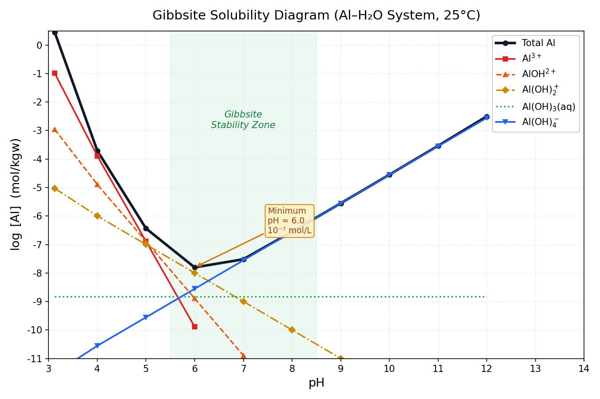
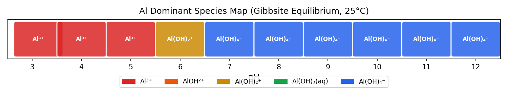

## はじめに：なぜ Python と連携するのか

PHREEQC の `USER_GRAPH` は手軽にグラフを描けるが、**出版品質の図・インタラクティブ可視化・統計処理**には Python が圧倒的に強い。 #7 で出力した `gibbsite_solubility.txt` を Python で読み込み、以下を実現する：

```{=html}
<div style="display:grid; grid-template-columns:repeat(3,1fr); gap:1em; margin:1.5em 0;">
  <div style="background:#FFF7ED; border-radius:10px; padding:1.1em; text-align:center; border-bottom:3px solid #D97706;">
    <div style="font-size:1.8em; margin-bottom:0.3em;">🐼</div>
    <div style="font-weight:700; color:#92400E; font-size:0.95em;">pandas</div>
    <div style="font-size:0.82em; color:#78350F; margin-top:0.4em; line-height:1.5;">SELECTED_OUTPUT の<br>タブ区切りファイルを<br>スマートに読み込む</div>
  </div>
  <div style="background:#F0FDF4; border-radius:10px; padding:1.1em; text-align:center; border-bottom:3px solid #16A34A;">
    <div style="font-size:1.8em; margin-bottom:0.3em;">📈</div>
    <div style="font-weight:700; color:#15803D; font-size:0.95em;">matplotlib</div>
    <div style="font-size:0.82em; color:#166534; margin-top:0.4em; line-height:1.5;">出版品質の<br>溶解度ダイアグラムを<br>描画する</div>
  </div>
  <div style="background:#EFF6FF; border-radius:10px; padding:1.1em; text-align:center; border-bottom:3px solid #2563EB;">
    <div style="font-size:1.8em; margin-bottom:0.3em;">🔵</div>
    <div style="font-weight:700; color:#1E3A5F; font-size:0.95em;">plotly</div>
    <div style="font-size:0.82em; color:#1E40AF; margin-top:0.4em; line-height:1.5;">ホバー対応の<br>インタラクティブ図を<br>ブログに埋め込む</div>
  </div>
</div>
```

もっとも、Python を挟む理由は「図が綺麗になる」ことだけではない。`USER_GRAPH` が不得手とするものは、大きく三つある。

第一に、軸の刻み・凡例・フォント・線種を細かく制御できないため、論文や報告書にそのまま載せられる図にならない。第二に、計算結果を再利用できない。PHREEQC の中で描いた図は PHREEQC の中で完結してしまい、別の条件の計算結果と重ねたり、実測値を並べて置いたりする作業が難しい。第三に、統計処理ができない。回帰・誤差の伝播・複数条件の一括処理といった、研究で当然必要になる操作が `USER_GRAPH` の外にある。

Python を挟むと、この三つが一度に解ける。PHREEQC は「化学平衡を解く計算エンジン」に徹し、図と統計は Python が引き受ける、という分業である。本記事で組み立てるのは、その分業のいちばん単純な形——PHREEQC がテキストファイルを吐き、Python がそれを読んで図にする、という一方向の流れである。地味に見えるが、この流れさえ手元にあれば、以降の回で扱うより複雑な計算もすべて同じ手順で可視化できる。

::: callout-note
## 前提

- #7 の PHREEQC コードを実行済みで `gibbsite_solubility.txt` が手元にあること
- Python 3.9 以上 + `pandas`, `matplotlib`, `plotly` がインストール済みであること\
  （`pip install pandas matplotlib plotly kaleido` ）kaleidoは画像ファイルの出力
- pipは Python のパッケージ管理ツールで、ターミナル（コマンドプロンプト）で上記コマンドを実行することで必要なライブラリをインストールできる。
- **例：`pip install phreeqpy` で phreeqpy をインストールできる。上記のコマンドは pandas、matplotlib、plotly、kaleido を一括でインストールする。**
:::

------------------------------------------------------------------------

## この記事で学ぶこと

本記事を読み終えると、次の四つができるようになる。

1. **`SELECTED_OUTPUT` が吐いたテキストファイルを pandas で正しく読み込む。** タブ区切り・コメント行・活量の対数値という、PHREEQC 特有の癖への対処を含む。
2. **溶解度ダイアグラムを出版品質で描く。** 論文や報告書にそのまま載せられる水準の、軸・凡例・注釈・ベクター出力までを一通り扱う。
3. **描いた図を自分の言葉で説明する。** 曲線の傾きから反応式を逆に読み取る手順を身につける。ここが本記事でいちばん力を入れた部分である。
4. **一連の処理を 1 本のスクリプトにまとめる。** 次回以降、条件を変えて計算し直すたびに、同じ手順を繰り返さずに済むようになる。

図を描くだけなら Step 3 まででも足りる。ただし、**描いた図が何を意味するのかを説明できなければ、その図は研究にも報告にも使えない。** 本記事では、後半にその読み方をまとめて置いている。

------------------------------------------------------------------------

## Step 1：SELECTED_OUTPUT ファイルの構造を理解する

PHREEQC の `SELECTED_OUTPUT` が出力するファイルはタブ区切りのテキストである。 先頭行がヘッダー、2行目以降がデータになる。

```{=html}
<div style="background:#1E293B; border-radius:8px; padding:1.3em; margin:1.2em 0; overflow-x:auto;">
<pre style="color:#1E293B; font-size:0.82em; margin:0; line-height:1.6; font-family:'Cascadia Code','Fira Code',monospace;">
<span style="color:#94A3B8;"># gibbsite_solubility.txt（抜粋）</span>
sim state   soln    dist_x  <span style="color:#FCD34D;">pH</span>  <span style="color:#86EFAC;">Al</span> <span style="color:#94A3B8;">Al+3</span>    AlOH+2  Al(OH)2+    Al(OH)3 Al(OH)4-    <span style="color:#93C5FD;">Gibbsite</span>
1   i_soln  1   -1  7.000   0.000e+00   ...
2   react   1   -1  3.000   <span style="color:#FCD34D;">3.000</span>   <span style="color:#86EFAC;">7.76e-03</span>    <span style="color:#F9A8D4;">-2.110</span>  -5.270  -7.970  -9.710  -13.5   ...
3   react   2   -1  <span style="color:#FCD34D;">4.000</span>   <span style="color:#86EFAC;">7.76e-04</span>    <span style="color:#F9A8D4;">-3.110</span>  -5.270  -6.970  -9.710  -13.5   ...
...
</pre>
</div>
```

::: callout-important
## ヘッダー名の注意点

`-activities` で指定した化学種は **log₁₀（活量）** で出力される。 一方 `-totals` で指定した `Al` は **mol/kgw（線形値）** で出力される。 可視化前に `np.log10()` で変換が必要な列と不要な列を区別しよう。

場合によっては**ヘッダーが　「pH Al・・・」**に始まる場合がある。
:::

------------------------------------------------------------------------

### 列名の読み方——`la_` が付く列と付かない列

`SELECTED_OUTPUT` の列名は、#7 の入力ブロックに書いた指定から PHREEQC が機械的に組み立てている。ゆえに、列名を見ればその数値が何であるかが分かる。

`-totals Al` と書いた列は、列名がそのまま `Al` になる。中身は**全アルミニウム濃度**、すなわち溶けている Al³⁺・AlOH²⁺・Al(OH)₂⁺・Al(OH)₃(aq)・Al(OH)₄⁻ をすべて足し合わせた量で、単位は mol/kgw の**線形値**である。

いっぽう `-activities Al+3` と書いた列は、頭に `la_` が付いて `la_Al+3` になる。`la` は log activity の略で、中身はすでに**常用対数をとった活量**である。

この違いを踏まえずに全列へ一律に `np.log10()` を掛けると、対数を二重に取ってしまい、桁が壊れた図ができあがる。**`la_` が付いていれば対数の活量、付いていなければ線形のモル濃度**——本記事の範囲ではこの区別だけ覚えておけば足りる。活量と濃度がそもそもどう違うのか、という一段深い話は #9 の主題である。

------------------------------------------------------------------------

## Step 2：pandas でデータを読み込む

``` python
# ============================================================
#  phreeqc_read.py
#  PHREEQC SELECTED_OUTPUT ファイルの読み込みと整形
# ============================================================
import pandas as pd
import numpy as np
from pathlib import Path

# ---- ファイル読み込み ----
fp = Path("gibbsite_solubility.txt")

df_raw = pd.read_csv(
    fp,
    sep="\t",        # タブ区切り
    comment="#",     # # 行をスキップ
    skipinitialspace=True,
)

print(f"Shape: {df_raw.shape}")
print(df_raw.head())
print("\nColumns:", df_raw.columns.tolist())
```

```{=html}
<div style="background:#F8FAFC; border:1px solid #E2E8F0; border-radius:8px; padding:1.1em; margin:1em 0; font-size:0.85em; font-family:'Cascadia Code','Fira Code',monospace; overflow-x:auto; color:#334155;">
> Shape: (13, 10) or (10, 10)<br>
> Columns: ['sim', 'state', 'soln', 'dist_x', 'pH', 'Al', 'la_Al+3',<br>
&nbsp;&nbsp;&nbsp;&nbsp;&nbsp;&nbsp;&nbsp;&nbsp;&nbsp;'la_AlOH+2', 'la_Al(OH)2+', 'la_Al(OH)3', 'la_Al(OH)4-', 'Gibbsite']
</div>
```

``` python
# ---- 整形：初期状態行を除き、pHデータ行だけ残す ----
df = (
    df_raw
    #.query("state == 'react'")          # 平衡計算結果だけ
    .rename(columns={
        "Al": "Al_total_mol",  # total Al（線形値）
        "la_Al+3":        "log_Al3",
        "la_AlOH+2":      "log_AlOH2",
        "la_Al(OH)2+":    "log_AlOH2p",
        "la_Al(OH)3":     "log_AlOH3",
        "la_Al(OH)4-":    "log_AlOH4",
    })
    .reset_index(drop=True)
)

# ---- total Al を log スケールに変換 ----
df["log_Al_total"] = np.log10(df["Al_total_mol"].clip(lower=1e-15))

print(df[["pH", "log_Al_total", "log_Al3", "log_AlOH2p", "log_AlOH3","log_AlOH4"]].to_string(index=False))
```

```{=html}
<div style="overflow-x:auto; margin:1em 0; border-radius:8px;">
<table style="width:100%; border-collapse:collapse; font-size:0.86em; font-family:'Cascadia Code','Fira Code',monospace;">
  <thead>
    <tr style="background:#D97706; color:white;">
      <th style="padding:8px 14px;">pH</th>
      <th style="padding:8px 14px;">log_Al_total</th>
      <th style="padding:8px 14px;">log_Al3</th>
      <th style="padding:8px 14px;">log_AlOH2p</th>
      <th style="padding:8px 14px;">log_AlOH3</th>
      <th style="padding:8px 14px;">log_AlOH4</th>
    </tr>
  </thead>
  <tbody>
    <tr style="background:#FFF7ED;"><td style="padding:7px 14px;">3.12</td><td>0.45</td><td>-0.98</td><td>-5.03</td><td>-8.83</td><td>-11.52</td></tr>
    <tr style="background:#FDFDFD;"><td style="padding:7px 14px;">4.00</td><td>-3.71</td><td>-3.89</td><td>-6.00</td><td>-8.83</td><td>-10.56</td></tr>
    <tr style="background:#FFF7ED;"><td style="padding:7px 14px;">5.00</td><td>-6.44</td><td>-6.89</td><td>-7.00</td><td>-8.83</td><td>-9.56</td></tr>
    <tr style="background:#FED7AA; font-weight:600; color:#92400E;"><td style="padding:7px 14px;">6.00 ★</td><td>-7.80</td><td>-9.89</td><td>-8.00</td><td>-8.83</td><td>-8.56</td></tr>
    <tr style="background:#FDFDFD;"><td style="padding:7px 14px;">7.00</td><td>-7.52</td><td>-12.89</td><td>-9.00</td><td>-8.83</td><td>-7.56</td></tr>
    <tr style="background:#FFF7ED;"><td style="padding:7px 14px;">8.00</td><td>-6.55</td><td>-15.89</td><td>-10.00</td><td>-8.83</td><td>-6.56</td></tr>
    <tr style="background:#FDFDFD;"><td style="padding:7px 14px;">9.00</td><td>-5.55</td><td>-18.89</td><td>-11.00</td><td>-8.83</td><td>-5.56</td></tr>
    <tr style="background:#FFF7ED;"><td style="padding:7px 14px;">10.00</td><td>-4.55</td><td>-21.89</td><td>-12.00</td><td>-8.83</td><td>-4.56</td></tr>
    <tr style="background:#FDFDFD;"><td style="padding:7px 14px;">11.00</td><td>-3.54</td><td>-24.89</td><td>-13.00</td><td>-8.83</td><td>-3.56</td></tr>
    <tr style="background:#FFF7ED;"><td style="padding:7px 14px;">12.00</td><td>-2.50</td><td>-27.89</td><td>-14.00</td><td>-8.83</td><td>-2.56</td></tr>
  </tbody>
</table>
</div>
```

------------------------------------------------------------------------

### 読み込みコードで効いている四つの指定

短いコードだが、四つの引数がそれぞれ実害を防いでいる。順に確認しておきたい。

**`sep="\t"`** — `SELECTED_OUTPUT` はタブ区切りである。画面上は空白で桁が揃って見えるため `sep="\s+"`（空白区切り）と書きたくなるが、見出しや化学種名に空白が入った場合に列がずれる。タブを明示するほうが安全である。

**`comment="#"`** — 先頭に `#` を置いた行を読み飛ばす。PHREEQC の設定によっては、データ本体の前後に注記行が混ざることがある。

**`skipinitialspace=True`** — 区切り文字の直後の空白を無視する。PHREEQC は数値を右揃えで書き出すため、値や列名の頭に空白が残ることがある。付けておいて損はない指定である。

**`.clip(lower=1e-15)`** — これがいちばん実害を防いでいる。濃度がちょうど 0 の行が一つでもあると `np.log10(0)` が `-inf` になり、matplotlib は軸範囲を決められずに図全体が崩れる。下限を 10⁻¹⁵ で切っておけば、その行は「対数で −15」、すなわち事実上ゼロという扱いに落ち着く。

なお、整形コードで `.query("state == 'react'")` がコメントアウトされている点にも意味がある。PHREEQC のバージョンや入力の書き方によっては `state` 列そのものが出力されず、その状態でこの行を有効にすると `KeyError` で止まってしまう。**まず全行を読み、`print(df_raw.head())` で中身を目で見てから絞り込む**という順序のほうが確実である。

------------------------------------------------------------------------

## Step 3：matplotlib で出版品質の図を描く

Step 2の下に以下のコードをコピー＆ペーストすること。

``` python
# ============================================================
#  phreeqc_plot_matplotlib.py
# ============================================================
import matplotlib.pyplot as plt
import matplotlib.ticker as ticker
import numpy as np
import pandas as pd

# ---- フォント設定（日本語環境） ----
plt.rcParams.update({
    "font.family": "sans-serif",
    "font.sans-serif": ["MS Gothic", "Noto Sans CJK JP", "IPAexGothic", "DejaVu Sans"],
    "axes.unicode_minus": False,
    "figure.dpi":      150,
})

# ---- データ（dfはStep2で作成済み） ----
ph = df["pH"].values

species = {
    "Total Al":      ("log_Al_total", "#111827", 2.8, "-",  "o"),
    r"Al$^{3+}$":    ("log_Al3",      "#DC2626", 1.8, "-",  "s"),
    r"AlOH$^{2+}$":  ("log_AlOH2",   "#EA580C", 1.6, "--", "^"),
    r"Al(OH)$_2^+$": ("log_AlOH2p",  "#CA8A04", 1.6, "-.", "D"),
    r"Al(OH)$_3$(aq)":("log_AlOH3",  "#16A34A", 1.6, ":",  ""),
    r"Al(OH)$_4^-$": ("log_AlOH4",   "#2563EB", 1.8, "-",  "v"),
}

fig, ax = plt.subplots(figsize=(9, 6))

# ---- Gibbsite 安定域の背景色 ----
ax.axvspan(5.5, 8.5, alpha=0.07, color="#16A34A", label="_nolegend_")
ax.text(7.0, -2.3, "Gibbsite\n安定域", ha="center", va="top",
        fontsize=9, color="#15803D", style="italic")

# ---- 各化学種ライン ----
for label, (col, color, lw, ls, marker) in species.items():
    y = df[col].replace([np.inf, -np.inf], np.nan).values
    valid = ~np.isnan(y) & (y > -12)          # 検出限界以上のみ
    if marker:
        ax.plot(ph[valid], y[valid], color=color, lw=lw,
                ls=ls, marker=marker, ms=5, label=label)
    else:
        ax.plot(ph[valid], y[valid], color=color, lw=lw,
                ls=ls, label=label)

# ---- 最小値アノテーション ----
min_idx = df["log_Al_total"].idxmin()
min_ph  = df.loc[min_idx, "pH"]
min_log = df.loc[min_idx, "log_Al_total"]
ax.annotate(
    f"最小値\npH ≈ {min_ph:.1f}\n10⁻⁷ mol/L",
    xy=(min_ph, min_log),
    xytext=(min_ph + 1.5, min_log + 1.2),
    fontsize=9, color="#92400E",
    arrowprops=dict(arrowstyle="->", color="#D97706", lw=1.5),
    bbox=dict(boxstyle="round,pad=0.3", fc="#FEF3C7", ec="#D97706", alpha=0.9),
)

# ---- 軸・装飾 ----
ax.set_xlim(3, 14)
ax.set_ylim(-11, 0.5)
ax.set_xlabel("pH", fontsize=13)
ax.set_ylabel(r"$\log$ [Al]  (mol/kgw)", fontsize=13)
ax.set_title("Gibbsite 溶解度ダイアグラム（Al–H₂O系, 25°C）", fontsize=14, pad=12)
ax.xaxis.set_major_locator(ticker.MultipleLocator(1))
ax.yaxis.set_major_locator(ticker.MultipleLocator(1))
ax.grid(True, which="major", ls="--", lw=0.5, color="#E5E7EB")
ax.legend(loc="upper right", fontsize=10, framealpha=0.95)

plt.tight_layout()
plt.savefig("gibbsite_solubility.png", dpi=300, bbox_inches="tight")
plt.savefig("gibbsite_solubility.svg", bbox_inches="tight")   # ベクター形式
plt.show()
print("✅ 保存完了：gibbsite_solubility.png / .svg")
```



------------------------------------------------------------------------

------------------------------------------------------------------------

## 図を読む：なぜ pH 6 付近で溶解度が最小になるのか

図が描けたところで、いちばん大切な問いに進みたい。**なぜ全アルミニウム濃度は pH 6 付近で最小になり、その両側で跳ね上がるのか。**

答えは、Step 2 で表示した数表の中にそのまま書かれている。各列を縦に読むと、pH が 1 上がるごとの変化量が化学種ごとにきれいに揃っていることに気づく。

- `log_Al3`（Al³⁺）は −3.89 → −6.89 → −9.89 → −12.89 と、**1 pH あたり −3.00**
- `log_AlOH2p`（Al(OH)₂⁺）は −6.00 → −7.00 → −8.00 と、**1 pH あたり −1.00**
- `log_AlOH3`（Al(OH)₃(aq)）は pH 3 から 12 まで **−8.83 で一定**
- `log_AlOH4`（Al(OH)₄⁻）は −10.56 → −9.56 → −8.56 と、**1 pH あたり +1.00**

−3、−1、0、+1 というこの数字は偶然ではない。ギブサイトが溶ける反応を化学種ごとに書き下すと、そのまま出てくる。

- Al(OH)₃(s) + 3H⁺ ⇌ Al³⁺ + 3H₂O
- Al(OH)₃(s) + 2H⁺ ⇌ AlOH²⁺ + 2H₂O
- Al(OH)₃(s) + H⁺ ⇌ Al(OH)₂⁺ + H₂O
- Al(OH)₃(s) ⇌ Al(OH)₃(aq)
- Al(OH)₃(s) + H₂O ⇌ Al(OH)₄⁻ + H⁺

固相のギブサイトが余っている限り、その活量は 1 に固定される。ゆえに溶存種の活量は H⁺ の活量だけで決まり、質量作用の式の対数をとれば

$$\log \left[ \mathrm{Al(OH)}_n^{\,3-n} \right] = \log K - (3-n)\,\mathrm{pH}$$

という一次式になる。傾きは −(3 − n)、すなわち OH を 0 個持つ Al³⁺ なら −3、3 個持つ Al(OH)₃(aq) なら 0、4 個持つ Al(OH)₄⁻ なら +1 である。**数表の縦の変化が、反応式の H⁺ の係数をそのまま映している**ことになる。

この読み方は、計算結果の検算にも実測データの解釈にも使える。図の線が理屈どおりの傾きを持っていなければ、入力か解釈のどちらかを疑うべきである。

### V 字の谷底が pH 6〜7 に来る理由

全アルミニウム濃度は、これらの和である。酸性側では傾き −3 の Al³⁺ が圧倒的に効き、pH が上がるほど急激に減る。アルカリ側では傾き +1 の Al(OH)₄⁻ が効き、pH が上がるほど増える。**減る成分と増える成分が入れ替わる場所**が谷底であり、この計算では pH 6.00、log[Al] = −7.80、すなわち 1.6 × 10⁻⁸ mol/L 付近に落ちる。

谷底の高さを決めているのは、pH に依存しない Al(OH)₃(aq)（−8.83 で一定）と、その両隣の Al(OH)₂⁺・Al(OH)₄⁻ の足し合わせである。三つが同じくらいの大きさで並ぶため、谷は鋭い「点」ではなく、pH 6 から 7 にかけて 10⁻⁸ mol/L 台にとどまる**平らな底**になる。

### V 字が左右非対称であること

見落とされやすいが、この谷は左右で形が違う。左の壁は傾き −3 で切り立ち、右の斜面は傾き +1 でなだらかである。**酸性側にわずかに振れただけでアルミニウムは大量に溶け出すのに対し、アルカリ側では同じだけ pH を動かしても溶ける量は 3 分の 1 の勢いでしか増えない。** この非対称性は、後述する実務上の判断に直結する。

### 最初の 1 点だけ pH が 3.12 になっている理由

数表の先頭行だけ、pH が 3.00 ではなく 3.12 と半端になっている。これは計算の失敗ではなく、#7 の入力の作り方が素直に表れたものと考えられる。

#7 では `Fix_H+` という仮想鉱物で pH を固定し、`Fix_H+ -3 HCl 10` のように**添加できる試薬の量に上限（10 mol）**を置いていた。ところが pH 3 付近ではギブサイトが大量に溶け、Al 1 mol あたり H⁺ を 3 mol 消費する。この行の全 Al 濃度は対数で 0.45、すなわち約 2.8 mol/kgw であるから、溶解だけで 8 mol を超える H⁺ が消えている計算になる。**用意した 10 mol の HCl がほぼ使い切られ、目標の pH 3.00 まで届かなかった**という読みが自然である。

さらに言えば、この 1 点は数値としても慎重に扱うべきである。2.8 mol/kgw もの Al が溶けた水はイオン強度が極端に高く、`phreeqc.dat` が用いる活量係数のモデルが想定する範囲を大きく外れている。図の左端がやや不自然に見えるのは、そのためである。**なぜモデルの適用範囲を外れると結果が信用できなくなるのか**——それが次回 #9 の主題である。

------------------------------------------------------------------------

## Step 4：優勢化学種マップ（speciation diagram）

溶解度だけでなく、**どの化学種が優勢か**を色で示す図も地球化学では頻出する。

``` python
# ============================================================
#  phreeqc_speciation_map.py
#  各 pH での優勢 Al 化学種を色でマッピング
# ============================================================
import matplotlib.pyplot as plt
import matplotlib.patches as mpatches
import numpy as np
import pandas as pd

# 各 pH で最大活量の化学種を判定
activity_cols = ["log_Al3", "log_AlOH2", "log_AlOH2p", "log_AlOH3", "log_AlOH4"]
species_names  = ["Al³⁺", "AlOH²⁺", "Al(OH)₂⁺", "Al(OH)₃(aq)", "Al(OH)₄⁻"]
species_colors = ["#DC2626", "#EA580C", "#CA8A04", "#16A34A", "#2563EB"]

df_act = df[activity_cols].replace([np.inf, -np.inf], np.nan).fillna(-99)
dominant_idx = df_act.values.argmax(axis=1)

fig, ax = plt.subplots(figsize=(10, 2.2))

for i, row in df.iterrows():
    ph_val = row["pH"]
    d_idx  = dominant_idx[i]
    color  = species_colors[d_idx]
    rect   = mpatches.FancyBboxPatch(
        (ph_val - 0.45, 0.1), 0.9, 0.8,
        boxstyle="round,pad=0.05",
        facecolor=color, edgecolor="white", linewidth=1.5, alpha=0.85,
    )
    ax.add_patch(rect)
    ax.text(ph_val, 0.5, species_names[d_idx],
            ha="center", va="center", fontsize=8, color="white", fontweight="bold")

ax.set_xlim(2.5, 12.5)
ax.set_ylim(0, 1)
ax.set_xlabel("pH", fontsize=12)
ax.set_yticks([])
ax.set_xticks(range(3, 13))
ax.set_title("Al 優勢化学種マップ（Gibbsite 平衡, 25°C）", fontsize=12, pad=8)

# 凡例
patches = [mpatches.Patch(color=c, label=n)
           for c, n in zip(species_colors, species_names)]
ax.legend(handles=patches, loc="upper center",
          bbox_to_anchor=(0.5, -0.35), ncol=5, fontsize=9, framealpha=0.9)

plt.tight_layout()
plt.savefig("al_speciation_map.svg", bbox_inches="tight")
plt.show()
```



------------------------------------------------------------------------

### 優勢種マップは何を教えてくれるのか

溶解度ダイアグラムが「**どれだけ**溶けるか」を示すのに対し、優勢種マップは「溶けた Al が**何の顔をしているか**」を示す。この二つは別の情報であり、実務では後者のほうが効く場面も多い。

たとえば、pH 4 の水と pH 9 の水に、同じ 10⁻⁷ mol/L の Al が溶けていたとする。総量は同じでも、中身はまるで違う。前者は Al³⁺ という 3 価の裸の陽イオンで、鉱物表面や生体膜と強く相互作用する。後者は Al(OH)₄⁻ という 1 価の陰イオンで、負に帯電した表面には近づきにくい。**濃度が同じでも、毒性・吸着挙動・移動しやすさが変わる。** 総量だけを見て判断してはいけない、というのは地球化学の可視化がくり返し教えることである。

なお、コードが優勢種を `argmax` で判定している点について一言添えておきたい。比較しているのは活量そのものではなく、その常用対数である。対数は単調増加の関数であるから、対数のまま大小を比べても順位は変わらない。逆に言えば、**足し算をしたい場面では対数のままではいけない**。全濃度を求めるときに線形値へ戻す必要があるのは、そのためである。

------------------------------------------------------------------------

## Step 5：完全な解析ワークフロー（one-file スクリプト）

上記 Step 1〜5 をひとつのスクリプトにまとめた完全版で、このコードをコピー＆ペーストして図を確認しよう。#7からの成果物である。

``` python
#  gibbsite_full_analysis.py
#  PHREEQC #7 結果の完全解析スクリプト
#  使い方: python gibbsite_full_analysis.py gibbsite_solubility.txt
# ============================================================
import sys
import numpy as np
import pandas as pd
import matplotlib.pyplot as plt
import matplotlib.ticker as ticker
import matplotlib.patches as mpatches

# ---- フォント設定（日本語環境） ----
plt.rcParams.update({
    "font.family": "sans-serif",
    "font.sans-serif": ["MS Gothic", "Noto Sans CJK JP", "IPAexGothic", "DejaVu Sans"],
    "axes.unicode_minus": False,
    "figure.dpi":      150,
})

# ---- 定数 ----
SPECIES = {
    "Total Al":       ("log_Al_total", "#111827", 2.8, "-"),
    r"Al$^{3+}$":     ("log_Al3",      "#DC2626", 1.8, "-"),
    r"AlOH$^{2+}$":   ("log_AlOH2",   "#EA580C", 1.6, "--"),
    r"Al(OH)$_2^+$":  ("log_AlOH2p",  "#CA8A04", 1.6, "-."),
    r"Al(OH)$_3$":    ("log_AlOH3",   "#16A34A", 1.6, ":"),
    r"Al(OH)$_4^-$":  ("log_AlOH4",   "#2563EB", 1.8, "-"),
}

ACT_COLS  = ["log_Al3", "log_AlOH2", "log_AlOH2p", "log_AlOH3", "log_AlOH4"]
SP_NAMES  = [r"Al$^{3+}$", r"AlOH$^{2+}$", r"Al(OH)$_2^+$",
             r"Al(OH)$_3$(aq)", r"Al(OH)$_4^-$"]
SP_COLORS = ["#DC2626", "#EA580C", "#CA8A04", "#16A34A", "#2563EB"]

def load_data(filepath: str) -> pd.DataFrame:
    """SELECTED_OUTPUT を読み込み整形する"""
    df = pd.read_csv(filepath, sep="\t", comment="#", skipinitialspace=True)
    #df = df.query("state == 'react'").reset_index(drop=True)
    df = df.rename(columns={
        "Al": "Al_total_mol",
        "la_Al+3": "log_Al3", "la_AlOH+2": "log_AlOH2",
        "la_Al(OH)2+": "log_AlOH2p", "la_Al(OH)3": "log_AlOH3", "la_Al(OH)4-": "log_AlOH4",
    })
    df["log_Al_total"] = np.log10(df["Al_total_mol"].clip(lower=1e-15))
    return df

def plot_solubility(df: pd.DataFrame, save: bool = True):
    """溶解度ダイアグラムを描画"""
    fig, ax = plt.subplots(figsize=(9, 6))
    ax.axvspan(5.5, 8.5, alpha=0.07, color="#16A34A")
    ax.text(7.0, -2.0, "Gibbsite\n安定域", ha="center",
            fontsize=9, color="#15803D", style="italic")

    for label, (col, color, lw, ls) in SPECIES.items():
        y = df[col].replace([np.inf, -np.inf], np.nan).values
        mask = ~np.isnan(y) & (y > -12)
        ax.plot(df["pH"].values[mask], y[mask],
                color=color, lw=lw, ls=ls, label=label, marker="o", ms=4)

    # 最小値アノテーション
    mi = df["log_Al_total"].idxmin()
    ax.annotate(
        f"最小値 pH≈{df.loc[mi,'pH']:.1f}",
        xy=(df.loc[mi, "pH"], df.loc[mi, "log_Al_total"]),
        xytext=(df.loc[mi, "pH"] + 1.5, df.loc[mi, "log_Al_total"] + 1.5),
        fontsize=9, color="#92400E",
        arrowprops=dict(arrowstyle="->", color="#D97706"),
        bbox=dict(boxstyle="round", fc="#FEF3C7", ec="#D97706"),
    )

    ax.set(xlim=(3, 14), ylim=(-11, 0.5),
           xlabel="pH", ylabel=r"$\log$ [Al] (mol/kgw)",
           title="Gibbsite 溶解度ダイアグラム（Al–H₂O系, 25°C）")
    ax.xaxis.set_major_locator(ticker.MultipleLocator(1))
    ax.yaxis.set_major_locator(ticker.MultipleLocator(1))
    ax.grid(True, ls="--", lw=0.5, color="#E5E7EB")
    ax.legend(fontsize=10, loc="upper right")
    plt.tight_layout()
    if save:
        fig.savefig("gibbsite_solubility.svg", bbox_inches="tight")
        print("✅ gibbsite_solubility.svg を保存")
    plt.show()

def plot_speciation_map(df: pd.DataFrame, save: bool = True):
    """優勢化学種マップを描画"""
    df_act = df[ACT_COLS].replace([np.inf, -np.inf], np.nan).fillna(-99)
    dom = df_act.values.argmax(axis=1)

    fig, ax = plt.subplots(figsize=(10, 2.2))
    for i, row in df.iterrows():
        c = SP_COLORS[dom[i]]
        rect = mpatches.FancyBboxPatch(
            (row["pH"] - 0.45, 0.1), 0.9, 0.8,
            boxstyle="round,pad=0.05",
            facecolor=c, edgecolor="white", lw=1.5, alpha=0.85,
        )
        ax.add_patch(rect)
        ax.text(row["pH"], 0.5, SP_NAMES[dom[i]],
                ha="center", va="center", fontsize=8,
                color="white", fontweight="bold")

    patches = [mpatches.Patch(color=c, label=n)
               for c, n in zip(SP_COLORS, SP_NAMES)]
    ax.set(xlim=(2.5, 12.5), ylim=(0, 1),
           xlabel="pH", title="Al 優勢化学種マップ（Gibbsite 平衡, 25°C）")
    ax.set_yticks([])
    ax.set_xticks(range(3, 13))
    ax.legend(handles=patches, loc="upper center",
              bbox_to_anchor=(0.5, -0.35), ncol=5, fontsize=9)
    plt.tight_layout()
    if save:
        fig.savefig("al_speciation_map.svg", bbox_inches="tight")
        print("✅ al_speciation_map.svg を保存")
    plt.show()

# ---- メイン ----
if __name__ == "__main__":
    fp = sys.argv[1] if len(sys.argv) > 1 else "gibbsite_solubility.txt"
    df = load_data(fp)
    print(df[["pH", "log_Al_total", "log_Al3", "log_AlOH4"]].to_string(index=False))
    plot_solubility(df)
    plot_speciation_map(df)
```

実行は一行：

``` bash
python gibbsite_full_analysis.py gibbsite_solubility.txt
```

------------------------------------------------------------------------

------------------------------------------------------------------------

------------------------------------------------------------------------

## 静的な図とインタラクティブな図の使い分け

冒頭で pandas・matplotlib・plotly の三つを挙げたが、本記事で実際に手を動かしたのは前の二つである。plotly をあえて後回しにしたのには理由がある。

**静的図（matplotlib）は「結論を伝える」道具である。** 論文の図、報告書の図、発表スライドの図は、いずれも書き手が「この 1 点を見てほしい」と決めたうえで作るものである。線の太さ、注釈の位置、凡例の順序——そのすべてが読み手の視線を誘導する設計になっている。今回 pH 6 の谷底に矢印付きの注釈を置いたのは、まさにそのためである。

**インタラクティブ図（plotly）は「探索する」道具である。** 数十本の曲線が重なっていて、どれがどれか分からない。ある 1 点の値を正確に読みたい。特定の範囲だけ拡大したい。こうした場面では、ホバーで値が出てズームができる図が圧倒的に速い。ただし、拡大しないと分からない図は、そのままでは論文には載せられない。

ゆえに実務上の使い分けは単純である。**手元で結果を確かめる段階では plotly、人に見せる段階では matplotlib。** 本記事が matplotlib に紙面を割いたのは、最終的に残るのは後者だからである。

------------------------------------------------------------------------

## 中間ファイルを残しておくということ

最後に、ワークフローの設計そのものについて触れておきたい。

今回の流れでは、PHREEQC の計算結果がいったん `gibbsite_solubility.txt` というテキストファイルになり、そこから Python が読み込んでいる。PHREEQC を Python から直接呼び出す方法（`phreeqpy` など）もあるなかで、あえてファイルを一枚挟んでいる形である。

この設計には利点がある。**計算と可視化を切り離せる**ことである。図の色を変えたい、軸を変えたい、別の図を追加したい——こうした修正のたびに PHREEQC を回し直す必要がない。逆に、入力を変えて計算し直したときも、可視化のスクリプトは 1 文字も変えずに済む。

さらに、テキストファイルとして残っていれば、**半年後の自分が結果を検証できる。** 図だけを保存しておいて元データを失うと、査読で数値を問われたときに何もできなくなる。計算結果のテキストとスクリプトの両方を、日付を付けて保存しておきたい。

------------------------------------------------------------------------

## この図はどこで役に立つのか

溶解度ダイアグラムは教科書の飾りではなく、現場の運転条件を決める道具である。今回描いた 1 枚がそのまま説明になる場面を、三つ挙げておきたい。

**浄水処理の pH 設定。** アルミニウム系の凝集剤（硫酸アルミニウム、PAC）を使う浄水場が処理水を pH 6〜7 に整えるのは、まさにこの谷底に運転点を置くためである。谷を外して酸性側に振れれば、処理水に残るアルミニウムが増える。図の左の壁が急であることは、「わずかな pH 低下でも残留アルミが跳ね上がる」ことを意味している。

**酸性土壌における Al 毒性。** pH が 5 を下回る土壌で作物の根が伸びなくなる主因の一つが Al³⁺ である。ここで効いてくるのが傾き −3 という数字で、**pH を 1 だけ上げれば、平衡論的には Al³⁺ の活量が 1000 分の 1 になる。** 石灰施用という素朴な対策がなぜあれほど劇的に効くのか、その理由がこの傾きに現れている。

**酸性鉱山排水（AMD）の中和処理。** #6 で扱った黄鉄鉱の酸化で生じる酸性水を中和すると、Al は水酸化物として沈殿する。ところが pH を上げすぎると、今度は Al(OH)₄⁻ として再び溶け出す。**中和は「高くすればするほどよい」ものではない**——処理に最適な pH 帯が存在することが、この図の右肩上がりの部分から読み取れる。

::: callout-warning
## この図の適用範囲

今回の計算は 25 °C、ギブサイト平衡、そしてイオン強度が高くない条件を前提としている。実際の水は温度も塩分も異なり、さらに沈殿の初期には非晶質の水酸化アルミニウムのように**ギブサイトより溶けやすい相**が先に生じることもある。その場合、実際の溶解度は今回の線より上に来る。

ゆえにこの図は、現場のデータをそのまま予言するものではなく、**比較の基準線**として使うのが正しい。むしろ実測値が線から外れていることのほうが、そこで何が起きているかを教えてくれる。
:::

------------------------------------------------------------------------

## つまずきやすいところ

質問の多い点を、あらかじめまとめておきたい。

**列名が想定と違う。** `la_Al+3` が別の表記になっていたり、`state` 列が存在しなかったりする。データベースや PHREEQC のバージョンによって出力が変わるためである。対処は単純で、整形の前に `print(df_raw.columns.tolist())` を一度実行し、実物の列名を見てから `rename` を書けばよい。

**図に `-inf` が出て軸が壊れる。** 濃度 0 の行を対数に変換した結果である。前述の `.clip(lower=1e-15)` で回避できる。すでに図が壊れている場合は `df.replace([np.inf, -np.inf], np.nan)` で落としてから描き直したい。

**日本語が豆腐（□）になる。** matplotlib の日本語フォント問題である。コード冒頭の `font.sans-serif` に、環境にあるフォントを並べておく。Windows なら MS Gothic、macOS なら Hiragino Sans、Linux なら Noto Sans CJK JP が入っていることが多い。`axes.unicode_minus: False` を忘れると、今度はマイナス記号だけが豆腐になる。

**図を論文に出したい。** PNG ではなく SVG で保存したい。SVG はベクター形式であるから、拡大しても線が滑らかなままである。コードで `.png` と `.svg` の両方を保存しているのは、ウェブ用と印刷用を一度に用意するためである。

------------------------------------------------------------------------

## まとめ：PHREEQC × Python ワークフロー全体像

```{=html}
<div style="background:#FDFDFD; border:1px solid #E5E7EB; border-radius:12px; padding:1.5em; margin:1.5em 0;">
<svg viewBox="0 0 680 110" xmlns="http://www.w3.org/2000/svg" style="width:100%;max-width:680px;display:block;margin:0 auto;">
  <defs>
    <marker id="arr" markerWidth="8" markerHeight="8" refX="6" refY="3" orient="auto">
      <path d="M0,0 L0,6 L8,3 z" fill="#9CA3AF"/>
    </marker>
  </defs>
  <!-- ボックス -->
  <rect x="10" y="30" width="120" height="50" rx="8" fill="#FFF7ED" stroke="#D97706" stroke-width="1.5"/>
  <text x="70" y="52" text-anchor="middle" font-size="12" font-weight="700" fill="#92400E">PHREEQC</text>
  <text x="70" y="68" text-anchor="middle" font-size="10" fill="#78350F">.pqi 実行</text>

  <line x1="130" y1="55" x2="158" y2="55" stroke="#9CA3AF" stroke-width="1.5" marker-end="url(#arr)"/>

  <rect x="160" y="30" width="130" height="50" rx="8" fill="#F0FDF4" stroke="#16A34A" stroke-width="1.5"/>
  <text x="225" y="52" text-anchor="middle" font-size="12" font-weight="700" fill="#15803D">SELECTED_OUTPUT</text>
  <text x="225" y="68" text-anchor="middle" font-size="10" fill="#166534">gibbsite_solubility.txt</text>

  <line x1="290" y1="55" x2="318" y2="55" stroke="#9CA3AF" stroke-width="1.5" marker-end="url(#arr)"/>

  <rect x="320" y="30" width="110" height="50" rx="8" fill="#EFF6FF" stroke="#2563EB" stroke-width="1.5"/>
  <text x="375" y="52" text-anchor="middle" font-size="12" font-weight="700" fill="#1E3A5F">pandas</text>
  <text x="375" y="68" text-anchor="middle" font-size="10" fill="#1E40AF">読込・整形</text>

  <line x1="430" y1="55" x2="458" y2="55" stroke="#9CA3AF" stroke-width="1.5" marker-end="url(#arr)"/>

  <rect x="460" y="30" width="120" height="50" rx="8" fill="#FEF9C3" stroke="#CA8A04" stroke-width="1.5"/>
  <text x="515" y="52" text-anchor="middle" font-size="12.5" font-weight="700" fill="#92400E">matplotlib</text>
  <text x="515" y="68" text-anchor="middle" font-size="10" fill="#78350F">静的図 (SVG)</text>
</svg>
</div>
```

```{=html}
<div style="display:grid; grid-template-columns:repeat(3,1fr); gap:1em; margin:1em 0;">
  <div style="background:#FFF7ED; border-radius:10px; padding:1em; text-align:center; border-bottom:3px solid #D97706;">
    <div style="font-weight:700; color:#92400E; margin-bottom:0.3em;">Step 1–2</div>
    <div style="font-size:0.83em; color:#78350F; line-height:1.5;">PHREEQC 実行<br>→ txt 出力<br>→ pandas 読込</div>
  </div>
  <div style="background:#F0FDF4; border-radius:10px; padding:1em; text-align:center; border-bottom:3px solid #16A34A;">
    <div style="font-weight:700; color:#15803D; margin-bottom:0.3em;">Step 3</div>
    <div style="font-size:0.83em; color:#166534; line-height:1.5;">matplotlib で静的図</div>
  </div>
  <div style="background:#EFF6FF; border-radius:10px; padding:1em; text-align:center; border-bottom:3px solid #2563EB;">
    <div style="font-weight:700; color:#1E3A5F; margin-bottom:0.3em;">Step 4–5</div>
    <div style="font-size:0.83em; color:#1E40AF; line-height:1.5;">優勢種マップ<br>one-file スクリプトで<br>自動化完了</div>
  </div>
</div>
```

## 次回予告

本記事の計算には、まだ触れずに済ませてきた前提がひとつある。数表に並んだ `la_` の値は「活量」であって「濃度」ではない、という点である。真水に近い希薄な水では両者はほぼ一致するため、ここまでは区別しなくても大きな不都合がなかった。

ところが、海水のように溶存イオンの多い水では、この二つは大きく食い違う。同じ 0.01 mol/kgw の Ca²⁺ でも、真水の中と海水の中とでは化学的な効き目が違ってくる。本記事の最初の 1 点（pH 3.12）が数値として信用できないのも、突き詰めれば同じ理由である。

次回 #9 では、その差を生む**イオン強度**と**活量係数**を扱う。Debye–Hückel・Davies・Pitzer という三つの流儀がどこまで使えてどこで破綻するのか、そして PHREEQC がデータベースごとに何を選んでいるのかを、実際に計算して比べてみたい。

本記事で組み立てた「PHREEQC で計算し、Python で読んで図にする」流れは、そのまま #9 でも使う。手元のスクリプトは消さずに取っておいていただきたい。

------------------------------------------------------------------------

## 参考文献（References）

::: {#refs}
:::

- [#1 インストールと最初の計算](../phreeqc-part1/)
- [#2 Speciationで海水を解析する](../phreeqc-part2/)
- [#3 MixingとEQUILIBRIUM_PHASES](../phreeqc-part3/)
- [#4 カルサイト−CO₂水反応](../phreeqc-part4/)
- [#5 炭酸地下水と海水の混合](../phreeqc-part5/)
- [#6 黄鉄鉱の酸化（AMD）](../phreeqc-part6/)
- [#7 溶解度ダイアグラム（Gibbsite）](../phreeqc-part7/)
- **\[#8 Pythonでの可視化\]**
- [#9 イオン強度と活量係数](../phreeqc-part9/)
